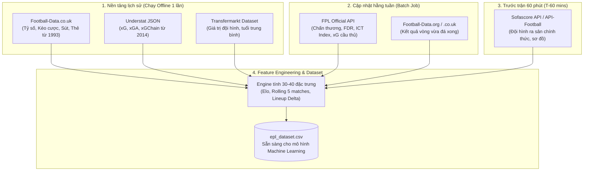

# Hướng Dẫn Toàn Diện Về Các API Bóng Đá (Public & Internal) & Khai Thác Đặc Trưng (Feature Extraction)

Tài liệu này cung cấp danh mục chi tiết các **API công khai (Public APIs)** và **API nội bộ / bán công khai (Internal / Reverse-Engineered Endpoints)** dùng để thu thập dữ liệu bóng đá (trọng tâm là Premier League - Ngoại Hạng Anh), phân tích giới hạn kỹ thuật (Rate limits, Anti-bot) và danh mục các đặc trưng (Features) có thể trích rút phục vụ mô hình học máy (Machine Learning / Deep Learning).

---

## 1. Bản Đồ Tổng Quan Hệ Sinh Thái Dữ Liệu Bóng Đá

```
                              ┌──────────────────────────────────────────────┐
                              │           HỆ SINH THÁI DỮ LIỆU BÓNG ĐÁ        │
                              └──────────────────────┬───────────────────────┘
                                                     │
         ┌───────────────────────────────────────────┼───────────────────────────────────────────┐
         ▼                                           ▼                                           ▼
┌──────────────────┐                       ┌──────────────────┐                        ┌──────────────────┐
│  1. PUBLIC APIS  │                       │ 2. INTERNAL APIS │                        │3. STATIC/SCRAPED │
│ (Chính thức/REST)│                       │(Bán công khai)   │                        │ (Dữ liệu mở)     │
├──────────────────┤                       ├──────────────────┤                        ├──────────────────┤
│• API-Football    │                       │• FPL Official    │                        │• Football-Data   │
│• Football-Data   │                       │• Sofascore v1    │                        │• Understat JSON  │
│• TheSportsDB     │                       │• FotMob API      │                        │• FBref (Opta)    │
│• StatsBomb Open  │                       │• PL PulseLive    │                        │• Transfermarkt   │
└──────────────────┘                       └──────────────────┘                        └──────────────────┘
```

---

## 2. Danh Mục Các API Công Khai (Official & Public APIs)

---

### 2.1. API-Football (API-Sports / RapidAPI)
Đây là API bóng đá thương mại phổ biến nhất thế giới, cung cấp độ phủ dữ liệu rộng và có gói Free cho lập trình viên.

* **Base URL:** `https://v3.football.api-sports.io` (hoặc qua RapidAPI gateway).
* **Xác thực:** Header `x-apisports-key: <YOUR_API_KEY>`.
* **Giới hạn & Báo giá (Rate Limits):**
  * **Gói Free:** **100 requests / ngày** (reset lúc 00:00 UTC).
  * **Tốc độ gọi:** Tối đa **10 requests / phút**.
  * **Theo dõi giới hạn:** Trả về trong header phản hồi:
    * `x-ratelimit-requests-limit`: Hạn mức ngày.
    * `x-ratelimit-requests-remaining`: Số request ngày còn lại.
    * `X-RateLimit-Remaining`: Số request phút còn lại.
  * **Chính sách:** Nghiêm cấm tạo nhiều tài khoản ảo để gian lận quota.
* **Các Endpoint Chính:**
  * `GET /fixtures?league=39&season=2024`: Lịch thi đấu và kết quả cả mùa.
  * `GET /fixtures/statistics?fixture={id}`: Thống kê chi tiết trận đấu.
  * `GET /fixtures/lineups?fixture={id}`: Đội hình ra sân, dự bị, sơ đồ chiến thuật (formation).
  * `GET /fixtures/events?fixture={id}`: Bàn thắng, thẻ phạt, thay người, VAR timeline.
  * `GET /injuries?fixture={id}`: Danh sách cầu thủ chấn thương/treo giò trước trận.
  * `GET /predictions?fixture={id}`: Tỷ lệ phân tích sức mạnh của API (H2H, so sánh công thủ).
  * `GET /odds?fixture={id}`: Tỷ lệ kèo nhà cái (1X2, Asian Handicap, Over/Under).
* **Các Feature Có Thể Trích Rút:**
  * **Feature Trận Đấu:** `shots_total`, `shots_on_goal`, `possession_pct`, `passes_total`, `passes_accuracy_pct`, `fouls`, `corners`, `offsides`.
  * **Feature Đội Hình (T-60 phút):** `formation` (ví dụ 4-3-3, 3-4-2-1), danh sách 11 cầu thủ đá chính, `player_rating` sau trận.
  * **Feature Tổn Thất:** `missing_players_count` (số lượng ca chấn thương), `is_key_player_missing`.
  * **Feature Thị Trường:** `odds_home_win`, `odds_draw`, `odds_away_win`, `handicap_line`.

---

### 2.2. Football-Data.org (REST API)
API chuẩn hóa hướng tới nhà phát triển cá nhân và các dự án học thuật nhỏ.

* **Base URL:** `https://api.football-data.org/v4/`
* **Xác thực:** Header `X-Auth-Token: <YOUR_API_KEY>`.
* **Giới hạn & Báo giá (Rate Limits):**
  * **Gói Free:** **10 requests / phút**.
  * **Phạm vi dữ liệu:** Chỉ cho phép truy cập **1 - 2 mùa giải gần nhất** ở gói miễn phí.
  * **Độ sâu:** Gói Free không trả về các chỉ số chi tiết như sút, góc, xG mà chỉ có tỷ số, lịch thi đấu và bảng xếp hạng.
* **Các Endpoint Chính:**
  * `GET /competitions/PL/matches?season=2024`: Danh sách toàn bộ 380 trận EPL.
  * `GET /competitions/PL/standings`: Bảng xếp hạng cập nhật.
  * `GET /teams/{id}`: Thông tin CLB (năm thành lập, SVĐ, ban huấn luyện).
* **Các Feature Có Thể Trích Rút:**
  * **Feature Lịch Thi Đấu & Điểm Số:** `matchday`, `points_home`, `points_away`, `goal_difference`.
  * **Định Danh Chuẩn (Entity Resolution):** Dùng `team.id` và `team.shortName` làm bộ từ điển chuẩn hóa ID cho toàn bộ hệ thống.

---

### 2.3. TheSportsDB
Cơ sở dữ liệu cộng đồng mã nguồn mở về thông tin thể thao, sân vận động, hình ảnh và metadata.

* **Base URL:** `https://www.thesportsdb.com/api/v1/json/3/` (Key '3' là key công khai cho mục đích giáo dục).
* **Xác thực:** Không bắt buộc đối với key dùng thử '3' (Gói Patreon cung cấp key riêng không giới hạn).
* **Giới hạn (Rate Limits):** Khoảng 1 - 2 request / giây; có thể bị throttle nếu gửi request liên tục.
* **Các Endpoint Chính:**
  * `GET /search_all_teams.php?l=English%20Premier%20League`: Danh sách 20 đội bóng.
  * `GET /eventsseason.php?id=4328&s=2024-2025`: Kết quả cả mùa.
  * `GET /lookuptable.php?l=4328&s=2024-2025`: Bảng xếp hạng.
* **Các Feature Có Thể Trích Rút:**
  * **Feature SVĐ & Địa Lý:** `stadium_name`, `stadium_capacity` (sức chứa sân), `stadium_location` (thành phố, tọa độ địa lý để tính khoảng cách di chuyển).
  * **Feature Hồ Sơ:** Năm thành lập, màu cờ sắc áo, HLV hiện tại.

---

### 2.4. StatsBomb Open Data (GitHub / `statsbombpy`)
Dữ liệu sự kiện cấp độ chuyên gia (Tracking & Event Data) do StatsBomb phát hành miễn phí cho cộng đồng nghiên cứu khoa học.

* **Cách Tiếp Cận:** Sử dụng thư viện Python `statsbombpy` (không cần API key):
  ```bash
  pip install statsbombpy
  ```
* **Giới hạn:** Không cung cấp real-time cho mùa giải đang diễn ra; chỉ cấp dữ liệu lịch sử các mùa giải đã đấu và một số giải đấu chọn lọc (các mùa giải bất bại của Arsenal 2003/04, World Cup, Euro, La Liga).
* **Các Hàm Chính Trong Python:**
  * `sb.competitions()`: Danh mục giải đấu có dữ liệu mở.
  * `sb.matches(competition_id=..., season_id=...)`: Danh sách trận đấu.
  * `sb.lineups(match_id=...)`: Đội hình ra sân chi tiết.
  * `sb.events(match_id=...)`: Toàn bộ các hành động trên sân theo mili-giây.
* **Các Feature Có Thể Trích Rút (Đẳng cấp nghiên cứu sâu):**
  * **Tọa Độ Sự Kiện Không Gian:** `location` $(x, y)$, `pass_end_location` $(x, y)$.
  * **Chỉ Số Chuyên Sâu:** `shot_statsbomb_xg`, `freeze_frame` (vị trí thủ môn và toàn bộ hậu vệ tại thời điểm vung chân sút), `under_pressure` (cầu thủ có đang bị đối phương áp sát lúc chuyền/sút không).

---

## 3. Danh Mục Các API Nội Bộ & Bán Công Khai (Internal & Reverse-Engineered Endpoints)

Đây là các endpoint RESTful do các trang web và ứng dụng di động lớn sử dụng ngầm. Các endpoint này trả về dữ liệu định dạng JSON cực kỳ phong phú và **hoàn toàn miễn phí**, nhưng cần chú ý cơ chế giả lập trình duyệt và giới hạn tần suất.

---

### 3.1. Fantasy Premier League (FPL) Official API
Đây là "kho vàng" dữ liệu miễn phí lớn nhất dành riêng cho Ngoại Hạng Anh, không yêu cầu API Key.

* **Base URL:** `https://fantasy.premierleague.com/api/`
* **Xác thực:** **Không cần (Public Unauthenticated)**.
* **Giới hạn (Rate Limits):** Rất thoáng. Khuyến nghị giãn cách $0.5 - 1.0$ giây giữa các request để tránh kích hoạt Cloudflare bảo vệ.
* **Các Endpoint Cốt Lõi:**

| Endpoint | Chức năng | Dữ liệu trả về |
|---|---|---|
| `GET /bootstrap-static/` | Trung tâm dữ liệu toàn mùa | 20 CLB, ~600 cầu thủ, 38 Gameweeks, luật chơi, trạng thái chấn thương. |
| `GET /fixtures/` | Lịch thi đấu 380 trận | Trận đã đá (bàn thắng, kiến tạo, bonus points); Trận sắp đá (độ khó FDR - Fixture Difficulty Rating). |
| `GET /fixtures/?event={gw}` | Lọc theo vòng đấu cụ thể | Danh sách 10 trận của vòng đấu Gameweek {gw}. |
| `GET /element-summary/{player_id}/` | Lịch sử chi tiết của 1 cầu thủ | Từng trận đã đấu mùa này: phút thi đấu, xG, xA, sút, đường chuyền quyết định, và các mùa giải trước. |

* **Các Feature Trích Rút Đắt Giá Cho Bài Toán ML:**
  * **Chỉ Số ICT Index (Độc quyền FPL):**
    * `influence`: Thước đo mức độ chi phối kết quả trận đấu.
    * `creativity`: Khả năng kiến tạo cơ hội ghi bàn cho đồng đội.
    * `threat`: Mức độ đe dọa khung thành đối phương (xác suất dứt điểm).
    * `ict_index`: Tổng hợp 3 chỉ số trên của từng cầu thủ.
  * **Feature Tình Trạng Sức Khỏe (Availability):**
    * `chance_of_playing_next_round`: Tỷ lệ % khả năng ra sân ($0\%, 25\%, 50\%, 75\%, 100\%$).
    * `news`: Thông tin chấn thương cập nhật từ HLV (ví dụ: *"Hamstring injury - Expected back Nov 2"*).
  * **Feature Độ Khó Trận Đấu (FDR):**
    * `team_h_difficulty`, `team_a_difficulty` (thang điểm 1 đến 5 do ban chuyên môn Premier League xếp hạng độ khó).

---

### 3.2. Sofascore Internal API
Sofascore sở hữu nguồn dữ liệu trực tiếp và dữ liệu không gian (tọa độ cú sút, bản đồ nhiệt) tốt nhất hiện nay.

* **Base URL:** `https://api.sofascore.com/api/v1/`
* **Xác thực:** Không có token cố định, nhưng bắt buộc giả lập trình duyệt:
  * Headers bắt buộc: `User-Agent: Mozilla/5.0...`, `Referer: https://www.sofascore.com/`, `Cache-Control: max-age=0`.
* **Giới hạn & Cơ Chế Chặn (Rate Limits & Anti-bot):**
  * Được bảo vệ bởi **Cloudflare WAF**.
  * Nếu gọi dồn dập (> 30-40 requests/phút từ 1 IP), server sẽ trả về mã `403 Forbidden` hoặc yêu cầu giải mã CAPTCHA.
  * Khuyến nghị: Giãn cách trễ ngẫu nhiên $2.5 - 4.5$ giây giữa các request, dùng thư viện `curl_cffi` (giả lập TLS impersonation Chrome) thay vì `requests`.
* **Các Endpoint Quan Trọng:**

```http
# 1. Đội hình chính thức và sơ đồ chiến thuật (có trước trận 60 phút)
GET https://api.sofascore.com/api/v1/event/{event_id}/lineups

# 2. Toàn bộ các cú sút trong trận (tọa độ, xG, hướng bóng)
GET https://api.sofascore.com/api/v1/event/{event_id}/shotmap

# 3. Thống kê chi tiết trận đấu
GET https://api.sofascore.com/api/v1/event/{event_id}/statistics

# 4. Diễn biến thời gian thực (Bàn thắng, thẻ phạt, thay người, VAR)
GET https://api.sofascore.com/api/v1/event/{event_id}/incidents

# 5. Vị trí trung bình của các cầu thủ trên sân (Average Positions)
GET https://api.sofascore.com/api/v1/event/{event_id}/average-positions
```

* **Các Feature Trích Rút Độc Quyền:**
  * **Shot Coordinates:** Tọa độ ra chân `playerCoordinates.x, playerCoordinates.y`, tọa độ bóng bay vào lưới `goalGridCoordinates.x, goalGridCoordinates.y`, `xg` từng cú sút, `bodyPart` (chân trái, chân phải, đánh đầu).
  * **Chỉ Số Đối Kháng Trận Đấu:** `groundDuelsWonPercentage`, `aerialDuelsWonPercentage`, `interceptions`, `tacklesWon`, `bigChancesCreated`, `bigChancesMissed`.
  * **Đánh Giá Hiệu Suất:** `rating` (điểm số thuật toán từ 1.0 đến 10.0 cho từng cầu thủ).

---

### 3.3. FotMob Internal API
Nguồn dữ liệu di động nhanh, trực quan, có biểu đồ sức ép trận đấu theo phút (Momentum).

* **Base URL:** `https://www.fotmob.com/api/`
* **Xác thực:** Không bắt buộc.
* **Giới hạn:** Cần User-Agent trình duyệt, không có rate limit cố định nhưng sẽ rate-limit tạm thời nếu quét nhanh.
* **Các Endpoint Chính:**
  * `GET /matchDetails?matchId={matchId}`: Trả về gói JSON đầy đủ gồm đội hình, timeline, thống kê và shotmap.
  * `GET /leagues?id=47`: Dữ liệu giải Premier League (ID = 47), lịch thi đấu, BXH, phong độ gần đây.
* **Các Feature Đắt Giá Có Thể Trích Rút:**
  * **Biểu Đồ Sức Ép (Match Momentum):** Mảng giá trị sức ép tấn công theo từng phút thi đấu từ phút 1 đến phút 90 (`momentum` array). Đây là feature lý tưởng cho bài toán **dự đoán in-play theo từng phút**.
  * **Shot Map & Expected Goals (xG, xGOT):** Điểm xG và xGOT (xG On Target - chất lượng cú sút trúng đích).

---

### 3.4. Understat (Internal JSON Scripts)
Chuyên sâu về thuật toán xG và chuỗi tấn công tại 6 giải VĐQG hàng đầu châu Âu từ năm 2014.

* **Base URL:** `https://understat.com/`
* **Cách Bóc Tách Kỹ Thuật:**
  Dữ liệu không nằm ở REST endpoint thuần túy mà được nhúng dưới dạng chuỗi JSON mã hóa bên trong thẻ `<script>` HTML:
  ```python
  import json, re, requests

  resp = requests.get(f"https://understat.com/match/{match_id}")
  # Tìm chuỗi JSON gán vào biến shotsData
  match = re.search(r"shotsData\s+=\s+JSON\.parse\('([^']+)'\)", resp.text)
  if match:
      raw = match.group(1).encode('utf-8').decode('unicode_escape')
      shots = json.loads(raw)
  ```
* **Giới hạn:** Rất ít khi chặn nếu giãn cách 1-2 giây/request; tuy nhiên dữ liệu chỉ lưu từ mùa 2014/15 và không có thống kê phòng ngự/thẻ phạt.
* **Các Feature Trích Rút:**
  * `xG`: Bàn thắng kỳ vọng của từng cú sút và tổng trận.
  * `xGChain`: Tổng xG của các chuỗi kiểm soát bóng mà cầu thủ tham gia (đo lường đóng góp vào lối chơi chung).
  * `xGBuildup`: Tổng xG của chuỗi chuyền bóng loại trừ người trực tiếp dứt điểm và người kiến tạo (đo lường vai trò của tiền vệ phòng ngự/trung vệ xây dựng bóng từ tuyến dưới).

---

### 3.5. Premier League PulseLive API (Official Backend)
Endpoint nội bộ vận hành website chính thức của Ban tổ chức Ngoại Hạng Anh (`premierleague.com`).

* **Base URL:** `https://footballapi.pulselive.com/football/`
* **Xác thực:** Không cần Token, nhưng **bắt buộc phải có Request Headers nguồn gốc**:
  ```http
  Origin: https://www.premierleague.com
  Referer: https://www.premierleague.com/
  User-Agent: Mozilla/5.0 (Windows NT 10.0; Win64; x64)...
  ```
* **Các Endpoint Chính:**
  * `GET /fixtures?comps=1&compSeasons=719&page=0&pageSize=40`: Lấy lịch đấu và kết quả chính thức.
  * `GET /stats/match/{matchID}`: Báo cáo kỹ thuật trận đấu từ ban tổ chức.
  * `GET /players?pageSize=30&compSeasons=719`: Danh sách đăng ký thi đấu của toàn bộ cầu thủ.
* **Các Feature Trích Rút:**
  * Báo cáo sự kiện có mốc thời gian chính thức đến từng giây.
  * Quyết định của tổ trọng tài và can thiệp của VAR (việt vị, phạt đền, hủy bàn thắng).

---

## 4. Ma Trận Đối Chiếu Thuộc Tính & Khả Năng Khai Thác

Bảng dưới đây tổng hợp tất cả các feature có thể trích rút cho mô hình học máy theo từng API:

| Nhóm Feature | Biến Cụ Thể | Nguồn Tốt Nhất | Hình Thức Thu Thập |
|---|---|---|---|
| **Sức mạnh & Điểm số** | Elo, Rank, Points, PPG | Tự tính từ Football-Data.co.uk / FPL | Offline / Local calculation |
| **Giá trị & Tài chính** | `market_value`, `wage_bill` | Transfermarkt (Open Dataset) | Định kỳ theo mùa/tháng |
| **Bàn thắng kỳ vọng** | `xG`, `npxG`, `xGA`, `PSxG` | Understat / FBref / Sofascore | Scraper / Internal JSON |
| **Chuỗi bóng & Pressing** | `xGChain`, `xGBuildup`, `PPDA` | Understat / FBref | Scraper |
| **Tọa độ sút không gian** | `shot_x`, `shot_y`, `goal_grid_x` | Sofascore (`/shotmap`) / Understat | Internal REST API |
| **Đội hình xuất phát (T-60)** | Starting XI, Sub, Formations | Sofascore (`/lineups`) / API-Football | Real-time REST API |
| **Tình trạng chấn thương** | `chance_of_playing`, `news` | FPL Official (`/bootstrap-static`) | Public API (Miễn phí 100%) |
| **Sức ép theo phút (In-play)**| `momentum_minute_1_to_90` | FotMob (`/matchDetails`) | Internal REST API |
| **Thị trường cá cược** | Odds 1X2, Asian Handicap, O/U | Football-Data.co.uk / API-Football | File CSV / REST API |

---

## 5. Chiến Lược Xây Dựng Pipeline Thu Thập Dữ Liệu Tối Ưu

Để tối đa hóa số lượng đặc trưng mà **không vượt quá rate-limit** và **không tốn chi phí mua API**, kiến trúc thu thập dữ liệu khuyến nghị cho nhóm như sau:



### Các Kỹ Thuật Chống Chặn (Anti-Ban & Rate-Limit Management):
1. **Quản lý phiên với `curl_cffi`:**
   Giả lập TLS Fingerprint của trình duyệt Chrome thật để vượt qua tường lửa cơ bản của Cloudflare:
   ```python
   from curl_cffi import requests
   # Giả lập hoàn hảo trình duyệt Chrome bản mới nhất
   response = requests.get(url, impersonate="chrome124", headers=headers)
   ```
2. **Cơ Chế Trễ Thích Ứng (Adaptive Jitter):**
   Không dùng `time.sleep(2)` cố định vì dễ bị nhận diện mẫu bot. Dùng hàm trễ ngẫu nhiên:
   ```python
   import time, random
   time.sleep(random.uniform(2.5, 4.8))
   ```
3. **Bộ Đệm Dữ Liệu Cục Bộ (Local Cache First):**
   Trước khi gửi bất kỳ request nào, kiểm tra xem `match_id` đã có trong database SQLite hoặc thư mục `data/` chưa. Trận đấu trong quá khứ chỉ cần tải đúng **1 lần duy nhất**.

