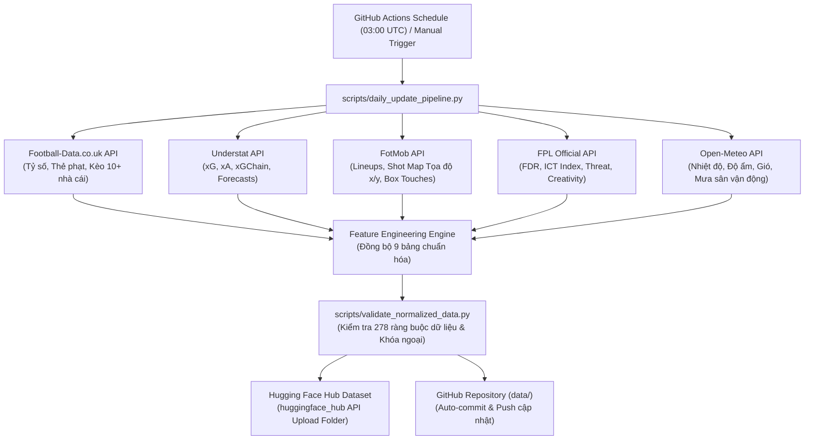

# Hướng dẫn Vận hành Tự động hóa Pipeline EPL & Đồng bộ Hugging Face Hub

Tài liệu này hướng dẫn chi tiết quy trình tự động hóa thu thập (crawl), trích xuất đặc trưng (feature engineering) và đồng bộ dữ liệu Premier League mùa giải **2026-2027** (và các mùa giải tiếp theo) lên **Hugging Face Datasets** bằng **GitHub Actions**.

---

## 1. Kiến trúc Tổng thể (Architecture Overview)



---

## 2. Danh mục 9 Bảng Chuẩn hóa Mùa giải 2026-2027

Hệ thống crawl tự động sinh ra đầy đủ 9 bảng dữ liệu với cấu trúc cột và kiểu dữ liệu **hoàn toàn đồng nhất 100%** với 5 mùa giải lịch sử (2021-2022 đến 2025-2026):

| STT | Bảng Dữ Liệu | Đường Dẫn Lưu Trữ | Số Cột | Đặc Trưng Nổi Bật Được Trích Xuất |
| :--- | :--- | :--- | :---: | :--- |
| **1** | **Match Context** | `data/2026_2027/matches/match_context.csv` | **44** | `match_id`, xG đội nhà/khách, xác suất mô phỏng Understat, độ khó lịch thi đấu FPL (`fdr_home`, `fdr_away`), thời tiết theo giờ sân đấu (nhiệt độ, gió, độ ẩm, lượng mưa). |
| **2** | **Betting Odds** | `data/2026_2027/matches/match_betting_odds.csv` | **119** | Tỷ lệ mở/đóng 10+ nhà cái hàng đầu thế giới (Bet365, Pinnacle, William Hill, Betfair...), Overround, Xác suất ngụ ý loại bỏ biên lợi nhuận, Kèo biến động (`odds_drift`). |
| **3** | **Match Lineups** | `data/2026_2027/matches/match_lineups.csv` | **8** | Đội hình ra sân chính thức (`starter`), danh sách dự bị (`bench`), số áo, vị trí thi đấu, đội trưởng (`is_captain`), liên kết ID Transfermarkt Master. |
| **4** | **Club Profile** | `data/2026_2027/clubs/club_season_profile.csv` | **9** | Chỉ số sức mạnh câu lạc bộ từ FPL: Tấn công sân nhà/khách (`strength_attack`), Phòng ngự (`strength_defence`), Tổng thể (`strength_overall`). |
| **5** | **Club Match Performance** | `data/2026_2027/clubs/club_match_performance.csv` | **54** | Thống kê nâng cao từng trận của 20 CLB: xG mở/cố định/không phạt đền, chạm bóng trong vòng cấm (`touches_in_opposition_box`), tranh chấp thành công (`duels_won`), rê bóng, đường chuyền chính xác, tắc bóng, giải vây. |
| **6** | **Player Valuations** | `data/2026_2027/players/player_valuations.csv` | **6** | Định giá thị trường (EUR) Transfermarkt, phân định giải đấu và định danh chuẩn cho toàn bộ cầu thủ thi đấu. |
| **7** | **Player Match Stats** | `data/2026_2027/players/player_match_stats.csv` | **32** | Chỉ số cá nhân chi tiết: Phút thi đấu, Bàn thắng, Kiến tạo, xG/xA/xGI FPL, Điểm thưởng (`fpl_bonus`, `fpl_bps`), Bộ ba chỉ số ICT Index (Influence, Creativity, Threat), Giá trị cầu thủ. |
| **8** | **Player Season Understat** | `data/2026_2027/players/player_season_understat.csv` | **19** | Thống kê nâng cao mùa giải từ Understat: xG, xA, Số cú sút, Key passes, Bàn thắng không phạt đền (`npg`, `npxg`), Chuỗi phát triển bóng xG (`xg_chain`, `xg_buildup`). |
| **9** | **Match Shots** | `data/2026_2027/events/match_shots.csv` | **29** | Tọa độ không gian mọi cú sút: Tọa độ sân `(x, y)`, Tọa độ hướng khung thành `(on_goal_shot_x, y)`, xG, xGOT, Loại cú sút (chân phải/trái/đầu), Tình huống (Open play/Set piece/Fast break). |

---

## 3. Cấu hình trên GitHub Repository (Thiết lập 1 lần)

Để quy trình tự động hóa có thể đẩy dữ liệu lên Hugging Face Hub và tự động commit lại vào Git repository, bạn cần thiết lập cấu hình trên GitHub:

### Bước 1: Tạo Access Token trên Hugging Face
1. Đăng nhập tài khoản tại [Hugging Face](https://huggingface.co/).
2. Vào **Settings** > **Access Tokens** (hoặc truy cập `https://huggingface.co/settings/tokens`).
3. Nhấp **Create new token**:
   - **Token type**: Chọn `Write` (để pipeline có quyền ghi/upload file).
   - **Token name**: Ví dụ: `github-actions-epl-crawler`.
4. Sao chép chuỗi mã Token vừa tạo.

### Bước 2: Thiết lập Secret trên GitHub Repo
1. Mở Repository của bạn trên GitHub.
2. Vào tab **Settings** > ở cột bên trái chọn **Secrets and variables** > **Actions**.
3. Tại mục **Repository secrets**, nhấp **New repository secret**:
   - **Name**: `HF_TOKEN`
   - **Secret**: Dán chuỗi mã token Hugging Face đã sao chép ở Bước 1.
   - Nhấp **Add secret**.

### Bước 3 (Tùy chọn): Thiết lập Tên Repo Hugging Face
Mặc định hệ thống sẽ dùng repo: `Toibinguz/epl-premier-league-dataset`. Nếu bạn muốn dùng tên repo khác:
1. Cũng tại trang **Secrets and variables** > **Actions**, chuyển sang tab **Variables**.
2. Nhấp **New repository variable**:
   - **Name**: `HF_REPO_ID`
   - **Value**: `username/ten-dataset-cua-ban` (Ví dụ: `nguyenvana/premier-league-2026-2027`)
   - Nhấp **Add variable**.

*(Lưu ý: Nếu repo trên Hugging Face chưa tồn tại, pipeline sẽ tự động khởi tạo repo Dataset ở chế độ Public cho bạn!)*

---

## 4. Cách Vận hành Pipeline

### Chế độ 1: Tự động hàng ngày (Schedule Cron)
Workflow `.github/workflows/daily_epl_crawl.yml` được cấu hình chạy tự động vào lúc **03:00 UTC** (10:00 sáng giờ Việt Nam) hàng ngày.
- Tự động kiểm tra các trận đấu vừa kết thúc trong ngày.
- Crawl bổ sung các trận đấu mới, cập nhật tỷ số, xG, kèo cá cược, tọa độ sút bóng và chỉ số cầu thủ.
- Tự động chạy bộ test `validate_normalized_data.py` (278 tiêu chí).
- Tự động đồng bộ lên Hugging Face Dataset và commit các file CSV cập nhật vào Git repository.

### Chế độ 2: Kích hoạt thủ công bằng nút bấm (Manual Trigger)
Bạn có thể chạy pipeline bất kỳ lúc nào ngay trên giao diện web của GitHub:
1. Mở GitHub Repository, chuyển vào tab **Actions**.
2. Ở danh sách bên trái, chọn **Daily Premier League Data Pipeline & Hugging Face Sync**.
3. Nhấp vào nút **Run workflow** ở góc phải:
   - **Season identifier**: Giữ mặc định `2026_2027` (hoặc nhập mùa giải muốn crawl).
   - **Upload & synchronize datasets to Hugging Face Hub**: Tích chọn `true`.
   - **Commit updated CSV datasets back to Git repo**: Tích chọn `true`.
4. Nhấp nút xanh **Run workflow**.

---

## 5. Hướng dẫn Chạy Thử nghiệm tại Local (Máy cá nhân)

Bạn có thể chạy thử pipeline trực tiếp trên máy của mình:

```bash
# Cài đặt thư viện phụ thuộc
pip install -r requirements.txt

# Chạy cập nhật dữ liệu mùa giải 2026-2027 và kiểm thử QA nội bộ
python scripts/daily_update_pipeline.py --season 2026_2027

# Chạy cập nhật và đồng bộ trực tiếp lên Hugging Face (cần truyền Token)
python scripts/daily_update_pipeline.py --season 2026_2027 --sync-hf --token "hf_YourHuggingFaceTokenHere" --repo-id "username/epl-premier-league-dataset"

# Chạy kiểm thử xác thực 278 chỉ tiêu toàn vẹn dữ liệu
python scripts/validate_normalized_data.py
```

---

## 6. Hướng dẫn Đẩy Dự án lên GitHub Lần đầu

Chạy các lệnh sau trong terminal tại thư mục gốc của dự án (`Z:\Desktop\Bet`):

```bash
# 1. Thêm tất cả mã nguồn và dữ liệu chuẩn hóa vào git (thư mục raw cache đã được bỏ qua tự động bởi .gitignore)
git add .

# 2. Tạo bản commit đầu tiên
git commit -m "feat: Add Premier League 2026-2027 daily automation pipeline and Hugging Face sync"

# 3. Đặt nhánh chính là main
git branch -M main

# 4. Thêm địa chỉ GitHub repo từ xa của bạn (đã được cấu hình tự động):
git remote add origin https://github.com/toibinguz/EPL_Data_Crawler.git

# 5. Đẩy toàn bộ lên GitHub
git push -u origin main
```
Sau khi push thành công, GitHub Actions sẽ sẵn sàng chạy tự động hàng ngày!
