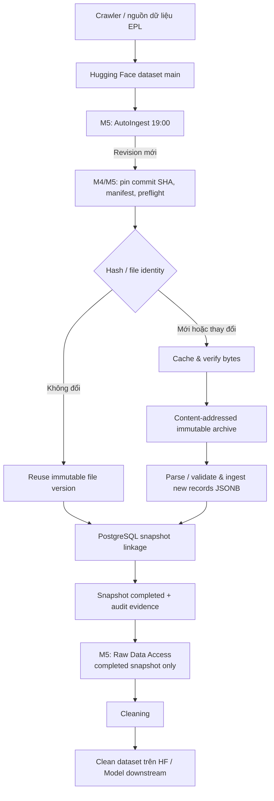
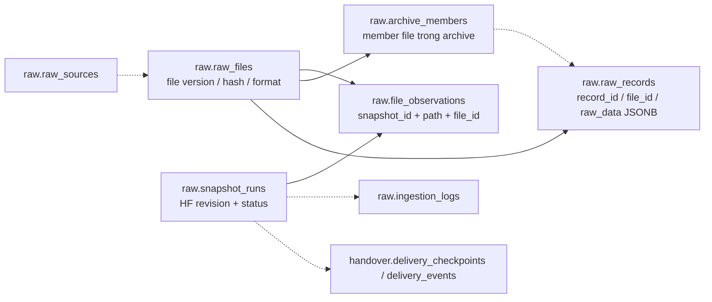
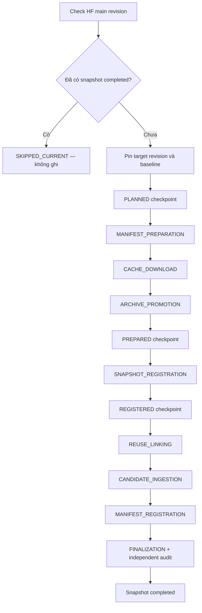

# EPL Raw Storage V2 — Snapshot-based Data Ingestion & Access

> **Phạm vi:** lớp lưu trữ dữ liệu thô của dự án môn Nhập môn Khoa học dữ liệu — dự đoán kết quả trận đấu tiếp theo tại giải Ngoại hạng Anh (EPL). Raw Storage bàn giao nền tảng tiếp nhận, bảo toàn, lập phiên bản và truy xuất dữ liệu, **không** phụ trách làm sạch hay huấn luyện mô hình.
>
> **Cập nhật** pipeline có hỗ tự động đã ingest thực tế revision được kiểm tra 19:00 hằng ngày
>
> **CSV/JSON và Controlled Auto-Recovery:** hỗ trợ cả hai định dạng candidate; retry lỗi tạm thời có giới hạn, tiếp tục từ checkpoint/evidence đã xác minh và ledger chống ghi trùng. Chạy `auto_ingest --status` để xem kết quả và lý do cần can thiệp. [Hướng dẫn recovery](docs/CONTROLLED_AUTO_RECOVERY.md).

## 1. Mục tiêu & phạm vi

Hệ thống giữ dữ liệu EPL gốc dưới dạng CSV, CSV.GZ, JSON và TAR.GZ từ dataset Hugging Face [`Toibinguz/epl-premier-league-dataset`](https://huggingface.co/datasets/Toibinguz/epl-premier-league-dataset), bảo lưu bằng chứng phiên bản file, lưu nội dung record nguyên bản dưới dạng **PostgreSQL JSONB**, và cung cấp quyền truy xuất **read-only** cho bước Cleaning. Các mùa lịch sử được giữ theo phạm vi Raw Storage; phạm vi mùa dùng cho huấn luyện mô hình do nhóm Model quyết định và không được áp đặt lên lớp Raw.

Nguyên tắc thiết kế: **immutable raw**, **snapshot theo HF revision**, **content-aware reuse/dedup**, **audit và checkpoint có bằng chứng**, **không thực thi Writer khi chưa được cấp phép** và **truy xuất phân trang** thay vì xuất cả corpus vào RAM.

### Trách nhiệm của từng phần

| Giai đoạn | Trách nhiệm | Tài liệu |
|---|---|---|
| **M1** | Khảo sát nguồn, xác định yêu cầu, định danh dataset và phạm vi raw | [M1](docs/M1/README.md) |
| **M2** | Thiết kế dữ liệu, metadata, raw JSONB và cấu trúc lưu trữ | [M2](docs/M2/README.md) |
| **M3** | File discovery, validation, parser, preflight và ingestion nền tảng | [M3](docs/M3/README.md) |
| **M4** | Snapshot, manifest, immutable archive, incremental reuse, PostgreSQL registration, recovery | [M4](docs/M4/README.md) |
| **M5** | Tự động ingest JSON/CSV, Controlled Auto-Recovery, scheduler, supervised tools và Raw Data Access | [M5](docs/M5/README.md) |


## 2. Kiến trúc tổng thể



`auto_ingest --run` tự thực hiện đầy đủ các stage cho candidate JSON/CSV, với khóa chống chạy chồng, checkpoint bất biến và kiểm chứng độc lập sau ghi. Writer có kết quả không rõ sẽ bị chặn bằng durable journal. `unified_incremental_runner --check` và Supervised Pipeline Runner vẫn dùng được cho kiểm tra/vận hành thủ công.

## 3. Cấu trúc lưu trữ PostgreSQL

Database đã nghiệm thu: `epl_raw_storage_v2`. Có schema `raw` phục vụ lưu trữ chính và schema `handover` chứa các bảng theo dõi bàn giao được mô tả trong SQL riêng.



> Sơ đồ thể hiện **quan hệ logic**; các cạnh nét đứt không khẳng định ràng buộc FOREIGN KEY vật lý. Muốn xem khóa/index/constraint thật, xem DDL [`sql/schema/raw_schema_v2.sql`](sql/schema/raw_schema_v2.sql) và [`sql/m4_4_handover_schema_v2.sql`](sql/m4_4_handover_schema_v2.sql).

| Bảng | Vai trò |
|---|---|
| `raw.raw_sources` | Metadata của các nguồn dữ liệu |
| `raw.snapshot_runs` | Mỗi phiên bản dataset/snapshot và trạng thái vòng đời |
| `raw.raw_files` | Bản ghi định danh/phiên bản file, định dạng, số record |
| `raw.file_observations` | File path nào thuộc snapshot nào, trỏ tới `file_id` (giúp **reuse**) |
| `raw.archive_members` | Danh mục thành phần trong TAR.GZ (khi áp dụng) |
| `raw.raw_records` | Dữ liệu gốc ở `raw_data JSONB` và metadata/lineage |
| `raw.ingestion_logs` | Bằng chứng ghi nhận hoạt động ingestion |
| `handover.delivery_checkpoints`, `handover.delivery_events` | Bảng hỗ trợ ghi nhận tiến trình bàn giao (không phải bản sao raw) |

### Grain và định danh

- **Snapshot:** định danh trạng thái nguồn tại một HF commit SHA đã pin; một snapshot mới có thể chỉ chứa **các tham chiếu reuse** thay vì ghi lại nội dung tất cả file.
- **File observation:** một `relative_path` và một phiên bản `file_id` tại một `snapshot_id`.
- **Raw record:** một record thuộc một `file_id`, có `record_id`, `record_locator`, `record_kind`, `raw_data JSONB`; có thể có `member_id`, `league_code`, `season`, `event_time`, `metadata_evidence`, `ingested_at`.
- `league_code` và `season` có thể **NULL** trong bản ghi thực tế. Cleaning phải kiểm tra nguồn/đường dẫn thay vì mặc định metadata đầy đủ.

## 4. Quy trình nhận cập nhật (Incremental)



- **NEW/CHANGED:** tải byte ứng viên, kiểm hash, đưa vào archive bất biến, ingest record mới.
- **UNCHANGED:** liên kết lại phiên bản file đã có, không nhân bản dữ liệu vật lý.
- **Bị chặn / lỗi:** không chuyển stage; đọc logs/checkpoints/journal và chạy audit. Không tự chạy lại thao tác ghi không rõ kết quả.
- Các checkpoint `PLANNED`, `PREPARED`, `REGISTERED` là bằng chứng riêng; không dựng lại checkpoint lịch sử đã hoàn thành chỉ vì các phiên bản workflow trước thiếu tài liệu checkpoint M5.

Chi tiết điều kiện chạy và recovery: [M4](docs/M4/README.md), [M5](docs/M5/README.md) và [Operations](docs/OPERATIONS.md).

## 5. Dữ liệu đã nghiệm thu

**Snapshot #368 `completed`** — revision `57d166f42099a561483f5d96aa0b4e93207fac6d`, nghiệm thu ngày 25/10/2026:

| Format | File | Logical record references |
|---|---:|---:|
| CSV | 86 | 993,784 |
| CSV.GZ | 9 | 7,497,120 |
| JSON | 201 | 959 |
| TAR.GZ | 2 | 10,753 |
| **Tổng** | **298** | **8,502,616** |

- Manifest đầy đủ: **316 file**; phạm vi raw: **298 file**. Lượt incremental dùng baseline #367, tái sử dụng 292 file và nạp 6 phiên bản file/385 record.
- **8,502,616 là số tham chiếu bản ghi logic**, không phải số record mới thêm. File version được reuse giữa snapshots; dữ liệu lịch sử còn được giữ.
- Revision đã completed sẽ được bỏ qua khi kiểm tra lại. Baseline #367 trước đó có 296 raw files/8.502.614 tham chiếu record; các ID là bằng chứng deployment, không phải hằng số cho máy mới.

### Module chính và CLI tương thích

`scripts/tools/` có **31 compatibility wrappers** (không phải 31 bản copy logic) và **21 standalone utilities**, gồm công cụ restore archive mới. Bản release giữ các wrapper có khả năng được gọi bởi code M4–M5 hoặc CLI cũ. Các module chính nằm trong [`scripts/incremental/`](scripts/incremental/) và wrapper trong [`scripts/tools/`](scripts/tools/). Một số source M4 được M5 kiểm SHA256 nội dung byte; xem `.gitattributes` và [Operations](docs/OPERATIONS.md) trước khi refactor hoặc đổi kiểu xuống dòng.

## 6. Cài đặt & chạy nhanh (Windows PowerShell)

1. Cài **Python 3.11**, PostgreSQL phù hợp và Git. Tạo môi trường `venv/` tại thư mục gốc repository rồi cài dependency từ `requirements.txt`.
2. Dựng database/schema theo DDL V2 (`sql/schema/raw_schema_v2.sql` và `sql/m4_4_handover_schema_v2.sql`) và theo [Operations Runbook](docs/OPERATIONS.md). Kiểm tra quyền DB, dependencies, archive và completed baseline trước khi chạy incremental. Các tên tài liệu V1 trong handover lịch sử không có trong release này và không dùng để dựng V2.
3. Sao chép `.env.example` thành `.env` (điền thông tin PostgreSQL cục bộ), và `.env.v2.example` thành `.env.v2` (giữ `DB_NAME=epl_raw_storage_v2` để kiểm tra an toàn). **Không commit** hai file thực tế, token hoặc mật khẩu.
4. Đứng tại thư mục gốc repository để chạy `python -m ...`. **Không đổi `.env.v2.example` thành `.env.example`** vì hai file mẫu khác nhiệm vụ, và các script hiện tại có thể bắt buộc dùng `.env.v2`.

```powershell
# Tạo venv trên Windows PowerShell (chỉ cần thực hiện lần đầu)
py -3.11 -m venv venv
& .\venv\Scripts\python.exe -m pip install -r requirements.txt
if (!(Test-Path .env)) { Copy-Item .env.example .env }
if (!(Test-Path .env.v2)) { Copy-Item .env.v2.example .env.v2 }
# Sau khi điền DB_USER/DB_PASSWORD vào .env:
& .\venv\Scripts\python.exe -B -m pip check

# Kiểm tra revision HF — chỉ đọc, không ingest
& .\venv\Scripts\python.exe -B -m scripts.orchestration.unified_incremental_runner --check --revision-ref main

# Xem kế hoạch ingest tự động, không ghi PostgreSQL
& .\venv\Scripts\python.exe -B -m scripts.orchestration.auto_ingest --check

# Xem trước lịch ingest 19:00 (không cài task)
powershell.exe -NoProfile -ExecutionPolicy Bypass -File .\scripts\scheduling\install_windows_task.ps1 -Mode AutoIngest -At "19:00"

# Chạy toàn bộ ingest/recovery hoặc chỉ xem kết quả gần nhất
& .\venv\Scripts\python.exe -B -m scripts.orchestration.auto_ingest --run
& .\venv\Scripts\python.exe -B -m scripts.orchestration.auto_ingest --status

# Liệt kê 5 file của completed snapshot 368 (read-only)
& .\venv\Scripts\python.exe -B -m scripts.access.raw_data_access --list-files --snapshot-id 368 --limit 5
```

> Các lệnh dùng snapshot ID 368 chỉ minh họa **snapshot đã nghiệm thu**; môi trường mới có thể chưa có snapshot này. Incremental ingest cần baseline completed và archive; clone GitHub **không mang theo PostgreSQL data, raw archives, cache hoặc secrets**.

## 7. Quy trình truy xuất Raw Storage → Cleaning

```mermaid
sequenceDiagram
    participant C as Cleaning consumer
    participant API as M5 Raw Data Access CLI/API
    participant DB as PostgreSQL raw schema
    C->>API: --list-files --snapshot-id <completed>
    API->>DB: Verify transaction_read_only=on + snapshot completed
    DB-->>API: file_observations + raw_files
    API-->>C: relative_path, file_id, format, record_count, cursor
    C->>API: --records --path <relative_path> --limit 20
    API->>DB: Resolve observed file_id; SELECT raw_records JSONB
    DB-->>API: bounded JSONB page + next_after_record_id
    API-->>C: raw_data + lineage/metadata
    C->>C: parse/normalize/feature engineering (Member 2)
```

CLI thực tế:

```powershell
# Bước 1: file thuộc snapshot completed
& .\venv\Scripts\python.exe -B -m scripts.access.raw_data_access --list-files --snapshot-id 368 --limit 5

# Bước 2: đọc một phần file đã liệt kê (không xuất tất cả dữ liệu)
& .\venv\Scripts\python.exe -B -m scripts.access.raw_data_access --records --snapshot-id 368 --path "2026_2027_new/football_data_raw_2627.csv" --limit 2
```

- Chỉ đọc từ **completed snapshot**; file phải là một observation của snapshot đó.
- Dùng `next_after_path` và `next_after_record_id` để phân trang; mỗi trang tối đa **50 records**, JSON output tối đa **8 MiB**.
- Nếu cần Cleaning lớn, kết nối PostgreSQL bằng **account SELECT-only** và xử lý từng trang; không cấp account ghi Raw Storage cho downstream.
- Thành viên 2 đã có dữ liệu clean trên thư mục HF `clean`; handover ở đây minh họa/cho phép kết nối từ Raw Storage, **không chạy Cleaning lại**.

Xem [Raw Data Handover](docs/raw_data_handover.md).

## 8. Lập lịch và chính sách an toàn

- Dữ liệu được crawl tự động vào khoảng **16:00–16:30**; Windows Task Scheduler kiểm tra revision **19:00 hằng ngày**, giờ hệ thống Windows.
- Task giữ tên **`EPL Raw Storage - Safe Revision Check`** để thay thế lịch cũ, nhưng action hiện gọi `run_windows_task.ps1 -Mode AutoIngest` → `auto_ingest --run --revision-ref main`.
- Đã đăng ký chế độ AutoIngest; lần chạy thực tế tạo snapshot #368, chạy lại và kích hoạt thử qua Task Scheduler đều trả `SKIPPED_CURRENT`, không ghi DB; `LastTaskResult=0`. Lần chạy tiếp theo: **25/10/2026 19:00 UTC+7**. **Chưa quan sát lượt chạy tự phát lúc 19:00 sau nâng cấp**.
- Máy tắt hẳn không thể chạy task; lịch chạy bù phụ thuộc cài đặt và phiên đăng nhập Windows.
- `auto_ingest` là entrypoint tự động riêng; A4 `supervised_pipeline_runner` tiếp tục nhận **một stage mỗi lệnh** và không dùng làm action lịch chạy. Cài đặt mới dùng `-Mode AutoIngest -Install`; thay task đã có thêm `-Replace`. Xem [Automation](docs/AUTOMATED_INGEST.md).
- Candidate mới/thay đổi hỗ trợ JSON và CSV; CSV.GZ/TAR.GZ hiện được reuse khi không đổi. Candidate nén thay đổi, path bị xóa hoặc vượt budget sẽ dừng để kiểm tra.

## 9. Cấu trúc repository (rút gọn)

```text
.
├── README.md                      # Bắt đầu tại đây
├── requirements.txt / requirements-dev.txt
├── .github/workflows/            # Hosted CI và dispatch tới storage host
├── .env.example / .env.v2.example  # Mẫu tạo .env / .env.v2
├── config/                       # discovery, source mapping, CSV format
├── sql/
│   ├── schema/raw_schema_v2.sql
│   └── m4_4_handover_schema_v2.sql
├── scripts/
│   ├── discovery/                # metadata/manifests HF
│   ├── incremental/              # M4 planner/audit/DB writers
│   ├── orchestration/            # M5 monitoring/guards/runners
│   ├── access/                   # Raw Data Access JSONB read-only
│   ├── scheduling/               # Windows Task Scheduler
│   └── tools/                    # wrappers, helpers, verifiers
├── tests/                        # Regression suites
└── docs/
    ├── M1/ ... M5/README.md      # Chi tiết theo giai đoạn
    ├── ARCHITECTURE.md           # Kiến trúc hệ thống 
    ├── OPERATIONS.md             # Vận hành và đồng bộ dữ liệu
    ├── AUTOMATED_INGEST.md       # Luồng ingest tự động
    ├── CONTROLLED_AUTO_RECOVERY.md # Retry/checkpoint/journal
    └── raw_data_handover.md      # Truy xuất và ban giao dữ liệu Raw cho cleaner
```


## 10. Kiểm thử, giới hạn và bàn giao

- **Đã có bằng chứng:** M4 completed snapshot #367; A2 live no-change; A3 Task Scheduler trigger test; A4 plan safety; A5.1 hợp đồng DB; A5.2 truy xuất file và JSONB record; R3.1 **168 test PASS, 1 SKIPPED**, 199 file Python parse OK, 213 release candidates, không phát hiện secret theo mẫu.
- **Bằng chứng tự động hóa 25/10:** 1.902 test chạy thành công (17 skipped); ingest revision mới qua `auto_ingest --run` thành snapshot #368, audit 298 archive / 8.502.616 tham chiếu record; chạy lại không ghi DB.
- **Sau bổ sung Controlled Auto-Recovery:** 1.968 test chạy thành công (17 skipped), gồm CSV+JSON hỗn hợp, retry có kiểm chứng, phục hồi checkpoint sau commit, budget xuyên lượt và báo cáo can thiệp. Nghiệm thu retry có fault injection trên kết nối nguồn/DB thật trả `RECOVERED`; Task Scheduler chạy bản mới exit `0`.
- **Chưa chứng minh:** clean install/fresh DB; scheduler tự kích hoạt đúng 19:00 sau nâng cấp. Luồng A4 giữ nguyên giới hạn nghiệm thu lịch sử; pipeline tự động dùng entrypoint mới.
- **Nguyên tắc release:** code + DDL + config mẫu + tests + tài liệu; **không** chứa dữ liệu nguồn lớn, PostgreSQL dumps, thư mục archive/cache, output báo cáo hay secret.

Đọc tiếp: [Kiến trúc sâu](docs/ARCHITECTURE.md) · [Vận hành](docs/OPERATIONS.md) · [Recovery](docs/CONTROLLED_AUTO_RECOVERY.md).


