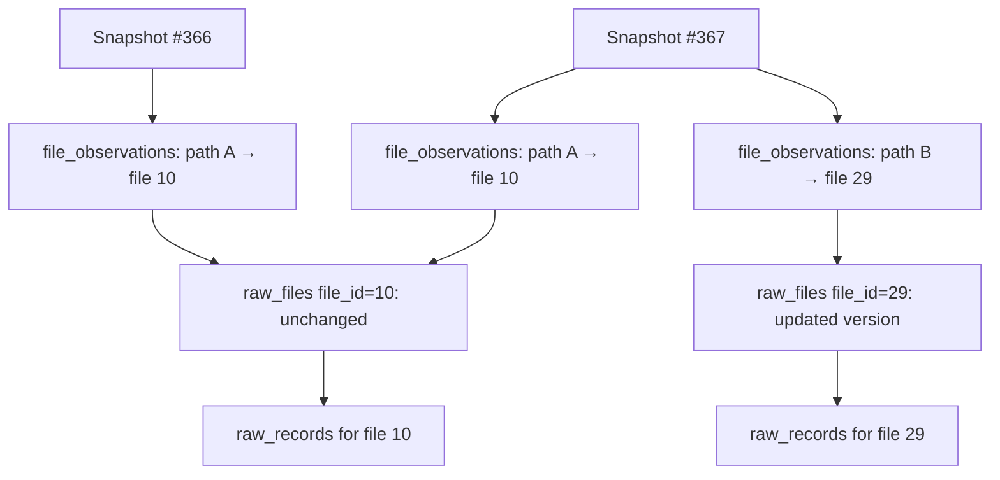
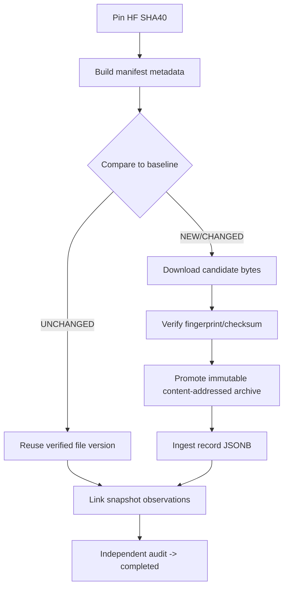

# Architecture & Data Lineage — EPL Raw Storage V2

## 1. Phân tách trách nhiệm

```mermaid
flowchart LR
  UP[Upstream: EPL crawler + HF main] --> DISC[Discovery / source mapping]
  DISC --> PRE[Validation / immutable manifest]
  PRE --> CACHE[Cache + archive bytes]
  CACHE --> PARSE[CSV / JSON / TAR reader]
  PARSE --> PG[(PostgreSQL raw schema)]
  PG --> ACC[Read-only Raw Data Access]
  ACC --> CLEAN[Downstream Cleaning]
  CLEAN --> MODEL[Feature / Model EPL]
  WATCH[M5 Windows Scheduler 19:00] --> AUTO[auto_ingest --run]
  AUTO --> UP
  AUTO --> PRE
```



Điểm quan trọng nhất là **hai dạng lưu trữ bổ sung nhau**: immutable archive giữ file bytes gốc, PostgreSQL JSONB giúp query và bàn giao record. Cần cả hai để vừa tái lập nguồn vừa hỗ trợ downstream.

## 2. Snapshot & file reuse



Đây là **một ví dụ minh họa** về mô hình quan hệ (ID ví dụ, không phải ID thực trong DB). File A không thay đổi nên cả hai snapshot cùng tham chiếu file 10. File B thay đổi nên được ánh xạ đến file version mới. Record vật lý không cần nhân đôi cho file A.

## 3. File và record grain

`raw.snapshot_runs(snapshot_id, hf_revision, status, ...)`

`raw.file_observations(snapshot_id, relative_path, file_id, ...)`

`raw.raw_files(file_id, file_format, record_count, ... )`

`raw.raw_records(record_id, file_id, member_id, record_locator, record_kind, raw_data JSONB, league_code, season, event_time, metadata_evidence, ingested_at)`

Cột/dấu `...` biểu thị metadata thực tế khác tùy bảng; không thay thế DDL. Luôn kiểm `sql/schema/raw_schema_v2.sql` khi cần constraint thực tế.

**Join truy xuất read-only (mô hình logic):**

```sql
SELECT r.record_id, r.record_kind, r.raw_data, r.season,
       r.league_code, r.metadata_evidence
FROM raw.file_observations AS obs
JOIN raw.raw_records AS r ON r.file_id = obs.file_id
WHERE obs.snapshot_id = :snapshot_id
  AND obs.relative_path = :relative_path
  AND r.record_id > :after_record_id
ORDER BY r.record_id
LIMIT :page_limit;
```

**SQL minh họa**, dùng named placeholders giả định để giải thích; không copy trực tiếp vào psql (psql không bind `:...` ở dạng trên). CLI production dùng `psycopg` với parameterized queries và xác minh snapshot `completed` trước khi query, tránh dùng SQL này thay thế.

## 4. Manifest, hash, archive và checkpoint



Các checkpoint `PLANNED`, `PREPARED`, `REGISTERED` và hash/fingerprint giúp phát hiện drift hoặc partial execution. Các bước `CACHE_DOWNLOAD`/`ARCHIVE_PROMOTION` ghi artifact local; các bước registration/reuse/ingestion/finalization ghi PostgreSQL. Không có quyền ghi trong `--plan` hoặc scheduled `--check`.

Từ 25/10/2026, `scripts/orchestration/auto_ingest.py` điều phối toàn bộ các stage qua backend M4 hiện có. OS lock và PostgreSQL session advisory lock chống chạy chồng; `reports/auto_ingest/active.json` giữ revision đang xử lý. Mỗi stage DB có claim bền vững trước khi gọi writer và phải qua kiểm chứng độc lập. Lỗi chuẩn bị artifact có thể chạy tiếp; kết quả DB không rõ cần đối soát trước khi tiếp tục. Chi tiết và bằng chứng: [AUTOMATED_INGEST.md](AUTOMATED_INGEST.md).

[Controlled Auto-Recovery](CONTROLLED_AUTO_RECOVERY.md) bổ sung policy retry và ledger create-only theo attempt, gắn với hash claim/context/argv gốc. Terminal success chỉ được xác minh/khôi phục checkpoint; writer lỗi tạm thời chỉ được retry sau independent audit hợp lệ. Budget ghi giữ xuyên lượt; thiếu terminal evidence tiếp tục bị chặn.

## 5. Raw Data Access là một boundary rõ ràng

- Consumer đọc **snapshot đã completed** (không đọc snapshot dở).
- Liệt kê file trước; sử dụng đường dẫn được trả về (tránh truy cập path ngoài snapshot).
- Đọc record theo `file_id` tương ứng, keyset `record_id`, `--limit <= 50`.
- Mỗi page có budget JSON <= 8 MiB; giảm limit cho document rất lớn.
- Không thay đổi nguồn raw và không cần xuất toàn bộ 8,5M tham chiếu bản ghi vào RAM.
- Mô-đun Cleaning phụ trách giải nghĩa kiểu payload nguồn; record CSV/JSON/TAR không đồng nhất schema.

## 6. Tài sản runtime vs source GitHub

| Loại | Git? | Lý do |
|---|---|---|
| Source code, SQL DDL, docs, tests | **Có** | Có thể tái dựng logic |
| Config mẫu `.env.example` | **Có** | Hướng dẫn triển khai không chứa secret |
| `.env`, HF token, DB password | **Không** | Bí mật và cấu hình máy |
| `raw-data/`, `raw-archive*/` | **Không** | Dữ liệu runtime lớn/phiên bản riêng |
| `reports/`, `exports/`, `test-artifacts/` | **Không** | Receipt/output local có thể nhạy cảm và thay đổi thường xuyên |
| PostgreSQL rows/database dumps | **Không** | Phải provision DB/bàn giao dữ liệu riêng |

## 7. Nguồn số liệu và giới hạn

Baseline #367 được nghiệm thu ngày 24/10/2026; snapshot #368 và recovery được nghiệm thu tiếp ngày 25/10 qua deployment Windows, independent audit và fixture tests. Tài liệu không chứng nhận integrity của mọi snapshot cũ hoặc khả năng khôi phục byte gốc chỉ từ JSONB. Dùng independent audit trên đúng target revision để xác minh thêm.

## 8. CI và host ingest

[GitHub Actions](../.github/workflows/ci.yml) kiểm source/docs/config/pins và offline tests trên hosted Windows/Linux. [Workflow dispatch](../.github/workflows/raw-ingest.yml) tùy chọn chạy trên self-hosted storage host, gọi deployment hiện có với runtime/journal. Nó không tự checkout đè persistent data và không tạo cron trùng lịch Windows 19:00.
