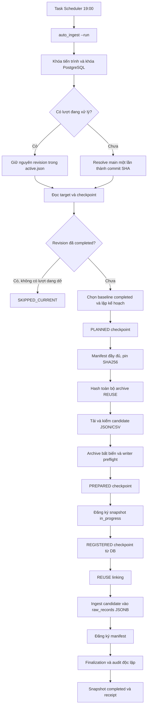

# Tự động ingest cập nhật Hugging Face vào PostgreSQL Raw Storage

Tài liệu này mô tả đường chạy tự động mới qua `scripts.orchestration.auto_ingest`. Scheduler vẫn chạy lúc **19:00 mỗi ngày**, nhưng chế độ `AutoIngest` thực hiện cả phát hiện revision, chuẩn bị dữ liệu, ghi PostgreSQL và xác minh snapshot hoàn chỉnh trong một lượt.

Dataset: `Toibinguz/epl-premier-league-dataset`. Database: `epl_raw_storage_v2`. Phạm vi Raw tiếp tục là `raw_data/` và `2026_2027_new/`; dữ liệu thuộc `clean/` không được ingest vào Raw.

> **Bổ sung Controlled Auto-Recovery ngày 25/10/2026:** JSON và CSV cùng được hỗ trợ; đã thêm retry lỗi tạm thời, đối soát terminal process trước khi retry writer và tiếp tục từ checkpoint đã xác minh. Chạy `auto_ingest --status` để xem `recovery_status`, `intervention_required`, `reason_code` và bằng chứng. [Chi tiết recovery và nghiệm thu CSV/JSON](CONTROLLED_AUTO_RECOVERY.md).

## 1. Luồng cũ và phần còn thiếu

Task cũ gọi `unified_incremental_runner --check --revision-ref main`. Nó pin HF commit SHA và lập kế hoạch chỉ đọc. Khi có revision mới, kết quả chỉ yêu cầu xem xét bước kế tiếp; task không tải candidate, đăng ký snapshot hoặc ghi record.

`supervised_pipeline_runner` cung cấp lệnh thực thi một stage, có kiểm tra context và intent SHA256. Tuy nhiên, ghép các lệnh đó thành một vòng lặp chưa đủ để tạo pipeline tự động:

| Điểm vướng | Ảnh hưởng | Cách xử lý trong luồng mới |
|---|---|---|
| Supervised request luôn truyền baseline rõ ràng, còn recovery router từ chối baseline override khi có checkpoint | Có thể dừng ngay sau PLANNED | Dùng trực tiếp context M4 đã xác minh; baseline nằm trong checkpoint, không ép lại lựa chọn của recovery router |
| Một số đường lập kế hoạch và kiểm cache mặc định chỉ nhận JSON | Candidate CSV không đi hết luồng | Bật đường JSON/CSV đã có trong M4 và kiểm lại bằng writer preflight |
| Copy mã nguồn sang thư mục mới không mang theo archive của baseline trong PostgreSQL | Finalization có thể thất bại sau khi đã tạo snapshot `in_progress` | Kiểm tra và hash toàn bộ archive REUSE trước khi tải candidate hoặc đăng ký snapshot |
| Audit completed trước đây còn điều kiện chỉ nhận candidate JSON | Snapshot chứa CSV không được audit hoàn chỉnh | Audit lấy định dạng từ đường dẫn candidate và xác minh JSON/CSV, record locator, số record và archive |
| Mỗi stage cần nhập lại nhiều tham số và digest | Vận hành thủ công dài, dễ nhầm context | Runner dựng tham số từ context bất biến, dành quyền thực thi một lần trong journal rồi gọi writer theo allowlist |

Các công cụ supervised và monitor cũ vẫn phục vụ kiểm tra, điều tra và thao tác theo stage. Đường chạy tự động dùng runner mới.

## 2. Luồng tự động mới



### Phát hiện và chọn phiên bản

Runner resolve `main` một lần thành commit SHA đầy đủ. Mọi metadata và byte tải tiếp theo đều gắn với SHA đó. Nếu revision đã có snapshot completed, lượt chạy bỏ qua việc ingest lại. Revision khác nhưng không thay đổi file thuộc Raw được ghi nhận là `SKIPPED_NO_RAW_CHANGES`.

Baseline mặc định là snapshot completed mới nhất. Nếu có snapshot `in_progress` của revision khác, runner dừng để đối soát trước khi lập kế hoạch mới. Một lượt còn dang dở có `reports/auto_ingest/active.json` tiếp tục dùng revision đã pin, kể cả khi `main` đã tiến tới commit khác.

### Chuẩn bị trước khi ghi database

Manifest mô tả đầy đủ file của revision, có byte JSON xác định và SHA256 ổn định. Bản report và bản archive được xuất bản theo cơ chế create-only; file có sẵn phải trùng byte.

Đối với REUSE, runner đọc observation của baseline trong transaction chỉ đọc, đối chiếu path, file version, trạng thái parse/archive, số record và identity của HF. Sau đó nó hash lại toàn bộ object được tái sử dụng. Một hàng `archive_state='verified'` trong DB không thay thế việc kiểm tra file thực tế trên máy.

Đối với NEW/CHANGED, runner chỉ tải candidate, kiểm kích thước, Git blob hoặc LFS SHA256, parse nội dung, rồi xuất bản archive có địa chỉ theo content hash. Writer preflight đọc lại archive bằng parser/writer thật trước khi cho phép tạo snapshot `in_progress`. PREPARED checkpoint liên kết manifest và receipt của từng candidate với PLANNED context.

### Ghi PostgreSQL và hoàn tất

Mỗi DB stage chạy CLI preflight `--plan` rồi đúng một writer đã được allowlist. Các tham số về revision, baseline, fingerprint, số file, số byte, số record và manifest được lấy từ context đã xác minh.

Trước khi gọi child, runner tạo durable claim cho `(repository, revision, stage)`. Chỉ khi kiểm chứng độc lập đạt yêu cầu mới ghi kết quả `VERIFIED_AFTER_WRITE`. ID snapshot được đọc lại từ PostgreSQL để tạo REGISTERED checkpoint, không được suy đoán từ stdout.

File không đổi liên kết lại `file_id` cũ qua `raw.file_observations`. Candidate có nội dung mới tạo file version và record JSONB mới; nội dung raw cũ vẫn được giữ. Candidate writer thực hiện từng file trong transaction riêng, có khóa và kiểm chứng trước/sau ghi. Finalization kiểm observation, manifest, record vật lý và byte archive trước khi chuyển snapshot thành completed. Sau đó audit completed độc lập kiểm lại toàn bộ snapshot.

## 3. Điều kiện môi trường

Cần có Python venv của dự án, dependency trong `requirements.txt`, PostgreSQL đang chạy và cấu hình hợp lệ trong `.env`/`.env.v2`. Database phải có schema V2, registry nguồn và ít nhất một snapshot completed làm baseline.

Cần giữ cùng nhau ba nhóm dữ liệu vận hành: PostgreSQL, `raw-archive-v2/` và `reports/` chứa checkpoint/journal. Chỉ clone hoặc copy mã nguồn không đủ để tiếp tục ingest trên database đã có lịch sử.

Nếu chuyển thư mục dự án nhưng database vẫn trỏ tới archive tương đối cũ, dùng tiện ích khôi phục một lần từ bản archive local đã có:

```powershell
# Xem object còn thiếu của baseline; chưa sao chép file.
& .\venv\Scripts\python.exe -B -m scripts.tools.restore_raw_archives `
    --source-root "C:\duong-dan\A5_STAGING" --snapshot-id 367

# Sao chép các object thiếu sau khi xác minh SHA256 và kích thước.
& .\venv\Scripts\python.exe -B -m scripts.tools.restore_raw_archives `
    --source-root "C:\duong-dan\A5_STAGING" --snapshot-id 367 --restore
```

Thay đường dẫn mẫu bằng thư mục dự án cũ có `raw-archive-v2/objects/`. `--source-root` nhận thư mục gốc dự án, không nhận riêng thư mục `objects`. Có thể bỏ `--snapshot-id` để chọn completed snapshot mới nhất. Công cụ chỉ nhận đường dẫn/hash được DB tham chiếu, không sửa PostgreSQL và không ghi đè object có sẵn. Chế độ `--restore` xác minh đầy đủ các byte nguồn trước khi xuất bản object đích.

## 4. Chạy bằng một lệnh

Đứng tại thư mục gốc dự án:

```powershell
# Xem revision, baseline và kế hoạch. Không ghi DB, tải body hay publish checkpoint.
& .\venv\Scripts\python.exe -B -m scripts.orchestration.auto_ingest --check

# Phát hiện cập nhật và tự chạy toàn bộ pipeline.
& .\venv\Scripts\python.exe -B -m scripts.orchestration.auto_ingest --run
```

`--revision-ref` mặc định là `main`. Khi điều tra một revision cụ thể có thể truyền SHA đầy đủ. Nếu có lượt active chưa hoàn tất, revision của lượt đó được ưu tiên để giữ nguyên context đang xử lý.

`--check` tạo receipt local để theo dõi kết quả; nó không thực hiện full body/archive preflight. `READY_TO_INGEST` biểu thị đã có kế hoạch, còn kiểm byte thực tế diễn ra trong `--run`. Không cần nhập lại từng `--expected-*` hoặc xác nhận từng stage trong lượt chạy thông thường.

Các trạng thái chính:

| Trạng thái | Ý nghĩa |
|---|---|
| `READY_TO_INGEST` | Chế độ check tìm thấy kế hoạch hoặc checkpoint đang chờ xử lý |
| `SKIPPED_CURRENT` | Revision đã có snapshot completed |
| `SKIPPED_NO_RAW_CHANGES` | Revision khác nhưng Raw không thay đổi |
| `COMPLETED` | Lượt ingest và audit độc lập đã thành công |
| `BLOCKED` | Có lỗi hoặc bằng chứng chưa đủ; đọc `failed_stage`, `detail`, journal và log |

Exit code `0` biểu thị kết quả thành công hoặc bỏ qua hợp lệ; `2` biểu thị bị chặn/lỗi. Receipt lưu trạng thái và ID snapshot thực tế.

## 5. Cài lịch 19:00 trên Windows

Máy đã được xác minh dùng **SE Asia Standard Time**, UTC+07:00 Bangkok/Hanoi/Jakarta. Installer lấy giờ local Windows; `19:00` ở đây tương ứng 19:00 Việt Nam và Thái Lan.

Xem trước cấu hình:

```powershell
powershell.exe -NoProfile -ExecutionPolicy Bypass -File .\scripts\scheduling\install_windows_task.ps1 `
    -Mode AutoIngest -At "19:00" -Replace
```

Đăng ký/thay task cùng tên để chuyển lịch check cũ sang ingest tự động:

```powershell
powershell.exe -NoProfile -ExecutionPolicy Bypass -File .\scripts\scheduling\install_windows_task.ps1 `
    -Mode AutoIngest -At "19:00" -Replace -Install
```

Task mặc định vẫn có tên `EPL Raw Storage - Safe Revision Check` để có thể thay cấu hình đã tồn tại. Hành vi thực tế do `-Mode AutoIngest` quyết định; tên task không biểu thị nó còn chỉ đọc. Nếu chưa có task cùng tên, `-Replace` vẫn dùng được. Installer từ chối thay task đang chạy.

`ExecutionPolicy Bypass` chỉ áp dụng cho tiến trình PowerShell này, không thay execution policy lâu dài của Windows. Cách gọi này xử lý trường hợp máy chặn chạy trực tiếp file `.ps1`.

Task gọi wrapper `run_windows_task.ps1`, wrapper chạy Python ở đúng working directory và truyền `auto_ingest --run --revision-ref main`. Các tiến trình được chạy ẩn, exit code của Python được giữ lại để Task Scheduler phản ánh đúng lỗi.

Thiết lập vận hành:

- `Interactive`: cần phiên người dùng Windows đã đăng nhập; không cài như một service chạy khi người dùng đã sign out.
- `StartWhenAvailable`: cho phép chạy bù lịch bỏ lỡ khi điều kiện chạy trở lại. Máy tắt hoàn toàn không thể thực thi task lúc 19:00.
- `MultipleInstances IgnoreNew`: bỏ qua lần kích hoạt chồng khi task trước còn chạy.
- Không cấu hình retry tự động ở Task Scheduler. Lượt hằng ngày tiếp theo vẫn kiểm tra journal và bằng chứng trước khi làm tiếp.
- Khóa tiến trình local và session advisory lock PostgreSQL giúp chặn worker tự động chồng nhau. Các M4 writer vẫn có khóa transaction riêng.
- Giới hạn task AutoIngest là 12 giờ; timeout mặc định cho mỗi child stage là 6 giờ. Child bị timeout được dừng cả cây tiến trình; journal giữ lại kết quả chưa xác minh.

Sau khi cài, có thể kích hoạt thử và đọc trạng thái:

```powershell
Start-ScheduledTask -TaskName "EPL Raw Storage - Safe Revision Check"
Get-ScheduledTaskInfo -TaskName "EPL Raw Storage - Safe Revision Check"
```

Kích hoạt thử thành công chứng minh action/wrapper chạy được; phải quan sát receipt của lần tự phát lúc 19:00 để xác nhận riêng lịch hằng ngày.

## 6. Checkpoint, journal và xử lý lỗi

Artifact chuẩn bị có thể được xác minh và tiếp tục: cache HF, manifest và object archive đều gắn với revision/identity đã pin; publication không ghi đè dữ liệu khác. Nếu dừng trong giai đoạn chuẩn bị, lần `--run` tiếp theo đọc `active.json` và checkpoint để làm tiếp revision đó.

DB write không được retry khi kết quả process chưa rõ. Controlled Auto-Recovery chỉ cho phép retry writer đã thoát với lỗi tạm thời được nhận diện, sau audit mới xác minh stage thiếu nhưng hợp lệ. Stage đã hoàn tất được bỏ qua; process thành công nhưng readback lỗi được xác minh lại. Registration đã commit có thể dựng lại REGISTERED khi có terminal success evidence và exact DB proof. Claim cũ không có bằng chứng terminal, crash/timeout writer, sai hash hoặc journal hỏng vẫn yêu cầu can thiệp. M5 claim gốc không đổi; recovery lưu các attempt mới trong ledger append-only. Xem [chính sách và budget](CONTROLLED_AUTO_RECOVERY.md).

Đối với stage đã ghi `VERIFIED_AFTER_WRITE`, runner vẫn yêu cầu evidence DB hiện tại khớp trước khi bỏ qua writer. Khi có bằng chứng stage hoàn tất từ luồng supervised hợp lệ, runner có thể bỏ qua thao tác ghi mà không tạo journal giả.

Nếu có lỗi, trước hết đọc receipt mới nhất và xác định `failed_stage`. Lỗi thiếu archive/cấu hình/network trong chuẩn bị được sửa tại nguyên nhân rồi chạy lại một lệnh. Với claim DB chưa xác minh, cần so sánh snapshot row, observation, record, checkpoint và log của đúng revision trước khi quyết định cách khôi phục.

## 7. Vị trí bằng chứng và log

| Đường dẫn | Nội dung |
|---|---|
| `reports/auto_ingest/active.json` | Revision đang xử lý và trạng thái kết thúc |
| `reports/auto_ingest/runs/<run_id>/receipt.json` | Kết quả từng lượt, số candidate, baseline, snapshot ID, bước đã xác minh và lỗi |
| `reports/auto_ingest/runs/<run_id>/<STAGE>.plan.log` | Output CLI preflight của DB stage |
| `reports/auto_ingest/runs/<run_id>/<STAGE>.write.log` | Output writer của DB stage |
| `reports/m4_6_runs/<revision>/planned.json` | Context kế hoạch bất biến |
| `reports/m4_6_runs/<revision>/prepared.json` | Manifest và receipt candidate đã chuẩn bị |
| `reports/m4_6_runs/<revision>/registered.json` | Context có ID target đọc lại từ PostgreSQL |
| `reports/m5_write_attempts/v1/<repo_hash>/<revision>/` | Durable claim/result theo DB stage |
| `reports/scheduled_tasks/*.stdout.log` | Receipt JSON của Python khi chạy qua scheduler |
| `reports/scheduled_tasks/*.stderr.log` | Tiến độ chuẩn bị/audit và lỗi khi chạy qua scheduler |
| `reports/scheduled_tasks/*.status.json` | Thời điểm chạy, mode và exit code của wrapper |

Timestamp trong receipt/log filename dùng UTC để đối chiếu; lịch kích hoạt dùng giờ Windows local UTC+07:00. Không đưa `.env`, token, mật khẩu hoặc database dump vào repository/báo cáo chia sẻ.

## 8. Phạm vi và giới hạn hiện tại

- Candidate mới/thay đổi: JSON và CSV không nén. JSON tối đa 16 MiB/file; CSV writer tối đa 64 MiB/file; mỗi candidate tối đa 250.000 record. Tổng byte candidate của một plan tối đa 64 MiB.
- Candidate phải có byte/record hợp lệ và không rỗng theo hợp đồng writer hiện hành. Payload parse lỗi hoặc không phù hợp JSONB dừng trước đăng ký snapshot.
- CSV.GZ/TAR.GZ thuộc baseline được REUSE nếu identity không đổi và archive còn đúng byte. Candidate mới/thay đổi ở các định dạng nén này chưa được đường tự động hỗ trợ và sẽ bị chặn.
- Đường dẫn Raw bị xóa hoặc metadata không đủ xác định identity sẽ bị chặn để xử lý riêng. Lượt ingest không xóa dữ liệu raw cũ.
- Raw Storage lưu phiên bản file, record nguyên bản và lineage. Pipeline này không chạy Cleaning, không chuẩn hóa dữ liệu và không huấn luyện Model.

## 9. Nghiệm thu trực tiếp ngày 25/10/2026

Lượt chạy thực tế đã hoàn thành lúc **05:54:25 ngày 25/10/2026, UTC+07:00**. Snapshot mới **#368 completed**, từ baseline **#367**, gắn với revision đầy đủ **`57d166f42099a561483f5d96aa0b4e93207fac6d`**.

| Bằng chứng | Kết quả |
|---|---:|
| Candidate mới/thay đổi | 6 file |
| Byte candidate | 3.898.797 |
| File REUSE | 292 |
| Tổng observation/file của snapshot mới | 298 |
| Candidate record được ingest | 385 |
| Tham chiếu record logic trong snapshot mới | 8.502.616 |
| Object archive được audit | 298 |
| Tổng byte archive được audit | 837.371.615 |

Trước lượt ingest, **296 object baseline**, tổng **836.992.064 byte**, đã được khôi phục vào thư mục dự án mới từ bản archive local có sẵn và kiểm SHA256. Thao tác khôi phục không sửa PostgreSQL. Lượt chạy sau đó thực hiện đầy đủ đăng ký snapshot, REUSE linking, candidate ingestion, manifest registration, finalization và audit completed độc lập.

Receipt nghiệm thu local: `reports/auto_ingest/runs/20261024T225301529082Z_02f988b03993/receipt.json`. Thư mục `reports/` là artifact local, không được mang theo khi chỉ clone GitHub.

Kiểm thử tại thời điểm nghiệm thu pipeline ban đầu: **1.902 test, 17 skip, không lỗi**. Sau bổ sung Controlled Auto-Recovery: **1.968 test, 17 skip, không lỗi**; xem [bằng chứng recovery](CONTROLLED_AUTO_RECOVERY.md). Test backend bao gồm parse và archive JSON/CSV thật trên fixture local, archive REUSE thiếu/hỏng, chặn revision khác đang `in_progress`, chặn retry write chưa xác minh và dừng child timeout.

Chạy lại trực tiếp lúc **05:54:41** trả `SKIPPED_CURRENT`, `snapshot_id=368`, `write_executed=false`, exit `0`. Receipt local: `reports/auto_ingest/runs/20261024T225441681584Z_554a49a4563c/receipt.json`.

Đã thay task cũ bằng action `run_windows_task.ps1 -Mode AutoIngest`, working directory trỏ đúng thư mục dự án hiện tại. Kích hoạt thử Task Scheduler lúc **05:55:20** thành công: `LastTaskResult=0`, receipt `SKIPPED_CURRENT`, `snapshot_id=368`, `write_executed=false`; stderr rỗng. Bằng chứng local: `reports/scheduled_tasks/20261024T225521279Z-AutoIngest-7112.status.json` và file `.stdout.log` cùng run ID.

Cấu hình đọc lại tại nghiệm thu ban đầu: task `Ready`, trigger `2026-10-25T19:00:00+07:00`, `NextRunTime=2026-10-25T19:00:00+07:00`, `Interactive`, `StartWhenAvailable=true`, `MultipleInstances=IgnoreNew`, giới hạn `PT12H`. Người dùng không cần chạy chuỗi lệnh ingest hằng ngày; máy và phiên đăng nhập phải đáp ứng điều kiện trên.

### 9.1. Khôi phục sau đổi tên thư mục

Ngày **25/10/2026**, thư mục triển khai được đổi từ `EPL_Raw_Storage (1)` thành `EPL_Raw_Storage`. Task vẫn giữ đường dẫn cũ trong action và working directory; lượt tự động lúc **19:02:07 UTC+7** thất bại với `0x8007010B` (directory name invalid), trước khi wrapper chạy. Đã cập nhật cả hai đường dẫn, giữ lịch hằng ngày **19:00** và sửa các activation script/launcher Python còn giữ đường dẫn cũ. Hướng dẫn cho lần di chuyển tiếp theo nằm trong [Operations](OPERATIONS.md#sau-khi-đổi-tên-hoặc-di-chuyển-thư-mục).

Sau sửa, task được **kích hoạt thủ công để chạy bù** lúc **19:37:24**. Ingest và audit hoàn tất lúc **19:38:41 UTC+7**, tạo snapshot **#369 completed** từ baseline **#368**, revision **`430d18414996a15df6e4fb03a78ecce6364f54ae`**.

| Bằng chứng | Kết quả |
|---|---:|
| Candidate mới/thay đổi | 12 file JSON |
| Byte candidate | 5.092.207 |
| File REUSE | 294 |
| Observation/object archive được audit | 306 |
| Tham chiếu record logic | 8.502.624 |
| Audit độc lập | `verified=true` |
| Wrapper exit / LastTaskResult | `0` / `0` |

Receipt local: `reports/auto_ingest/runs/20261025T123725178753Z_c82a3055ad10/receipt.json`. Wrapper kết thúc lúc **19:38:42**; status local: `reports/scheduled_tasks/20261025T123724869Z-AutoIngest-25728.status.json`. Bản sao cấu hình task và các file venv trước sửa nằm trong `reports/path_repair/`; các artifact này được giữ local.

Đọc lại sau chạy bù: task `Ready`, đường dẫn mới, lần chạy tiếp theo **26/10/2026 19:00 UTC+7**. Lượt chạy bù chứng minh task/wrapper và ingest hoạt động sau sửa; lần tự kích hoạt theo lịch 19:00 sau sửa vẫn cần quan sát riêng.

## 10. CI và điều khiển qua GitHub

[GitHub Actions](../.github/workflows/ci.yml) chạy source/docs/workflow checks và CLI imports trên hosted runners; bước regression chỉ chạy khi checkout có `tests/`. Thư mục test hiện được giữ local và bỏ qua bởi Git. [Workflow ingest thủ công](../.github/workflows/raw-ingest.yml) chỉ gọi deployment đã có dữ liệu qua self-hosted runner khi được bật; không tạo cron thứ hai hay checkout đè thư mục archive/journal. Source-only CI không cần DB production và không chứng nhận lại một snapshot live.
