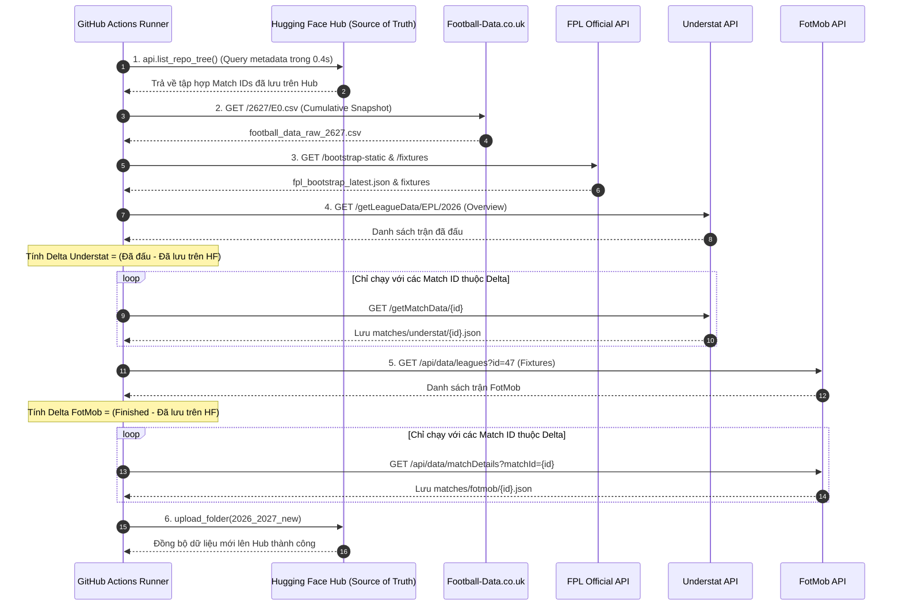

# BÁO CÁO KỸ THUẬT CHI TIẾT: TOÀN BỘ NGUỒN DỮ LIỆU, API CALLS & DATASETS
## DỰ ÁN DỰ ĐOÁN KẾT QUẢ & TỈ SỐ NGOẠI HẠNG ANH (PREMIER LEAGUE)
**Người phụ trách Phần 1 (Web Crawling & Data Ingestion): Lê Trường Giang (MSSV: 202416187)**

---

## I. TỔNG QUAN HỆ SINH THÁI DỮ LIỆU & PHÂN ĐỊNH NGUỒN GỐC

Toàn bộ hệ thống dữ liệu thô phục vụ bài toán được lưu trữ tại `raw_data/` (và phân vùng mùa mới `2026_2027_new/`), với tổng dung lượng xấp xỉ **1.85 GB** gồm **10,909 tệp dữ liệu**.

Để đảm bảo tính minh bạch, dữ liệu được phân định rạch ròi thành 2 hình thức thu thập:
1. **Nhóm thu thập động qua API / Scraper (Dynamic API Calls & Crawling):** Các endpoint RESTful, AJAX backend và API công khai được code Python (`crawler_pipeline/`) tự động gọi và tải về.
2. **Nhóm nhập từ kho dữ liệu mở nghiên cứu (External Open Datasets & Mirrors):** Các bộ dữ liệu lịch sử chuẩn hóa lớn (như Transfermarkt Datasets, FPL Historical của Vaastav, StatsBomb FBref) do cộng đồng khoa học dữ liệu quốc tế duy trì, được tải về, kiểm toán và đóng gói phục vụ huấn luyện dài hạn từ năm 2000.

```
                                  ┌────────────────────────────────────────────────────────┐
                                  │           HỆ SINH THÁI DỮ LIỆU THÔ DỰ ÁN               │
                                  └──────────────────────────┬─────────────────────────────┘
                                                             │
                    ┌────────────────────────────────────────┴────────────────────────────────────────┐
                    ▼                                                                                 ▼
┌───────────────────────────────────────┐                                 ┌───────────────────────────────────────┐
│     NHÓM 1: CÀO ĐỘNG QUA API CALLS    │                                 │   NHÓM 2: OPEN DATASETS & MIRRORS     │
│   (Code crawler gọi trực tiếp mạng)   │                                 │   (Dữ liệu chuẩn hóa tải từ GitHub)   │
├───────────────────────────────────────┤                                 ├───────────────────────────────────────┤
│ • Football-Data.co.uk (Cumulative CSV)│                                 │ • Transfermarkt Open Dataset (DCaribou│
│ • FotMob Backend API (REST / JSON)    │                                 │ • Vaastav Fantasy-Premier-League Repo │
│ • Understat AJAX API (JSON / Gzip)    │                                 │ • FBref / StatsBomb Historical Mirror │
│ • FPL Official API (REST / JSON)      │                                 │ • ECMWF ERA5 Climate Reanalysis Data  │
│ • Open-Meteo Archive API (REST / JSON)│                                 │                                       │
└───────────────────────────────────────┘                                 └───────────────────────────────────────┘
```

---

## II. CHI TIẾT TỪNG NGUỒN DỮ LIỆU, TỪNG API CALL & TỪNG DATASET

---

### 1. NGUỒN FOOTBALL-DATA.CO.UK (KẾT QUẢ, THẺ PHẠT, TRỌNG TÀI & TỶ LỆ CƯỢC)

#### 1.1. Bản chất & Nguồn gốc
* **Đơn vị phát hành:** Trang dữ liệu bóng đá mở của chuyên gia phân tích cá cược Joseph Buchdahl (Vương quốc Anh).
* **Hình thức thu thập:** Tải trực tiếp file CSV định kỳ qua giao thức HTTP GET từ máy chủ web của Football-Data.co.uk. Không yêu cầu tài khoản, không khóa API key.

#### 1.2. Chi tiết API Call & Phương thức tải
* **Mẫu URL tải về:**
  `https://www.football-data.co.uk/mmz4281/{season_code}/E0.csv`
  - Trong đó `E0` là mã quy ước giải Ngoại Hạng Anh (English Premier League).
  - `{season_code}` là mã 4 chữ số của mùa giải (ví dụ: `0001` = 2000/01, `2324` = 2023/24, `2627` = 2026/27).
* **HTTP Method:** `GET`
* **Request Headers:**
  ```python
  {
      "User-Agent": "Mozilla/5.0 (Windows NT 10.0; Win64; x64) AppleWebKit/537.36 (KHTML, like Gecko) Chrome/124.0.0.0 Safari/537.36",
      "Accept": "text/csv, text/plain, */*"
  }
  ```
* **Tần suất gọi:**
  - Lịch sử (2000/01 – 2025/26): Tải 1 lần ban đầu (26 mùa giải).
  - Mùa hiện tại (2026/27): Chạy hằng ngày lúc 03:00 UTC thông qua GitHub Actions CI/CD (`crawler_pipeline/daily_raw_crawler.py`).
* **Đặc thù kỹ thuật:** File `E0.csv` của mùa giải hiện tại là dạng **Cumulative File** (tích lũy liên tục). Ban tổ chức cập nhật nối thêm các trận vừa đấu xong vào cuối file. Khi crawler tải về, hệ thống chỉ cần ghi đè nguyên tử (atomic overwrite) file `football_data_raw_2627.csv` mà không cần xử lý merge phức tạp.

#### 1.3. Danh mục Dataset lưu trữ trên đĩa
* **Thư mục lưu trữ:** `raw_data/football_data_co_uk/` (27 file CSV, tổng dung lượng **2.98 MB**):
  - `football_data_raw_0001.csv` đến `football_data_raw_2526.csv`: 26 file lịch sử (mỗi file trọn vẹn 380 trận = 9,880 trận quá khứ).
  - `football_data_raw_2627.csv`: File mùa giải hiện tại (được mirror đồng bộ với `2026_2027_new/football_data_raw_2627.csv`).

#### 1.4. Phân tích nội dung dữ liệu & Schema
* **Số cột:** Dao động từ **45 cột** (mùa 2000/01) đến **114 cột** (mùa 2026/27).
* **Các nhóm thuộc tính cốt lõi:**
  1. **Định danh & Kết quả:** `Div` (E0), `Date` (DD/MM/YY hoặc DD/MM/YYYY), `Time` (giờ đá), `HomeTeam`, `AwayTeam`, `FTHG` (bàn thắng chủ nhà cả trận), `FTAG` (bàn khách), `FTR` (kết quả H/D/A), `HTHG` (bàn chủ nhà hiệp 1), `HTAG` (bàn khách hiệp 1), `HTR` (kết quả hiệp 1).
  2. **Thống kê chuyên môn trận đấu:** `HS` / `AS` (tổng cú sút chủ/khách), `HST` / `AST` (sút trúng đích), `HC` / `AC` (phạt góc), `HF` / `AF` (phạm lỗi), `HY` / `AY` (thẻ vàng), `HR` / `AR` (thẻ đỏ).
  3. **Bối cảnh & Trọng tài:** `Referee` (tên trọng tài điều khiển trận đấu), `Attendance` (lượng khán giả).
  4. **Tỷ lệ cược 1X2 đa nhà cái:** Kèo mở (`Open`) và kèo đóng (`Close`) từ Bet365 (`B365H, B365D, B365A`), Pinnacle (`PSH, PSD, PSA`), William Hill (`WHH, WHD, WHA`), Ladbrokes (`LBH`), Interwetten (`IWH`), Betfair Exchange (`BFEH`).
  5. **Tỷ lệ cược chuyên sâu:** Kèo Tài/Xỉu bàn thắng 2.5 (`BbAv>2.5`, `BbAv<2.5`, `Max>2.5`, `Avg>2.5`), Kèo chấp Châu Á (`AHh` - handicap line, `BbAvAHH`, `BbAvAHA`).
* **Giá trị bài toán:** Đây là **nguồn xương sống (spine)** của toàn bộ dự án, cung cấp nhãn dự đoán (`FTR`), tỷ số thực tế, và tỷ lệ cược thị trường dùng làm benchmark đối chiếu hiệu năng mô hình ML.

---

### 2. NGUỒN UNDERSTAT (xG, xGA, TỌA ĐỘ DỨT ĐIỂM, xGCHAIN & xGBUILDUP)

#### 2.1. Bản chất & Nguồn gốc
* **Đơn vị phát hành:** Trang web thống kê dữ liệu kỳ vọng [Understat.com](https://understat.com).
* **Hình thức thu thập:** Kết hợp cả 2 hình thức:
  - **API Calls nội bộ (Dynamic Scraper):** Khai thác endpoint AJAX backend của Understat (`getLeagueData` và `getMatchData`) kèm giải nén gzip.
  - **Bổ trợ dữ liệu mở (Open Mirror):** Sử dụng các file thống kê cầu thủ từ kho [vaastav/Fantasy-Premier-League](https://github.com/vaastav/Fantasy-Premier-League) để đối chiếu chéo.

#### 2.2. Chi tiết từng API Call
* **Call 1: Lấy tổng quan mùa giải & lịch đấu:**
  - **URL:** `https://understat.com/getLeagueData/EPL/{year}` (ví dụ: `{year}` = `2026`).
  - **HTTP Method:** `GET`
  - **Request Headers:**
    ```python
    {
        "User-Agent": "Mozilla/5.0 (Windows NT 10.0; Win64; x64)...",
        "X-Requested-With": "XMLHttpRequest",
        "Referer": "https://understat.com/league/EPL/2026",
        "Accept-Encoding": "gzip"
    }
    ```
  - **Payload phản hồi:** JSON nén gzip chứa:
    - `dates`: Danh sách 380 trận đấu của mùa (kèm `id`, ngày giờ, đội nhà, đội khách, tỷ số, `xG`, trạng thái `isResult`).
    - `teams`: Thống kê tổng hợp cả mùa của 20 CLB.
    - `players`: Thống kê cá nhân toàn bộ cầu thủ trong mùa.
* **Call 2: Lấy chi tiết vi mô từng trận đấu (Atomic Match):**
  - **URL:** `https://understat.com/getMatchData/{match_id}` (ví dụ: match `31239`).
  - **HTTP Method:** `GET`
  - **Payload phản hồi:** JSON chứa mảng `shots` (toàn bộ các cú sút) và `rosters` (danh sách cầu thủ thi đấu kèm chỉ số chuỗi).

#### 2.3. Danh mục Dataset lưu trữ trên đĩa
* **Thư mục lưu trữ:** `raw_data/understat/` (4,640 tệp dữ liệu, tổng dung lượng **194.87 MB**):
  - `understat_raw_2014_2015.json` đến `understat_raw_2026_2027.json`: 13 file JSON tổng quan 13 mùa giải (mỗi file ~500 KB - 1 MB).
  - `cache_matches/`: **4,620 file JSON nguyên tử** (mỗi file là 1 trận đấu chi tiết từ 2014/15 đến 2025/26).
  - `understat_matches_cache.tar.gz` (**16.1 MB**): Gói nén Archive Bundle gom toàn bộ 4,620 file JSON trên để đồng bộ nhanh lên Hugging Face Hub (Chiến thuật A).
  - `understat_matches_all_2014_2027.csv` (500.4 KB, 4,940 dòng): Bảng phẳng tổng hợp toàn bộ các trận.
  - `understat_players_all_2014_2027.csv` (1,006.1 KB, 6,845 dòng): Bảng phẳng tổng hợp cầu thủ.
  - `vaastav_understat_player_*.csv`: 4 file dữ liệu cầu thủ từ nguồn Vaastav bổ trợ.
* **Mùa giải mới 2026/27:** Lưu tại `2026_2027_new/matches/understat/{match_id}.json` (hiện có đúng 60/60 trận đã đấu).

#### 2.4. Phân tích nội dung dữ liệu & Schema
* **Dữ liệu cú sút (`shots` array):**
  - `id`: Mã cú sút.
  - `minute`: Phút dứt điểm.
  - `result`: Kết quả cú sút (`Goal`, `SavedShot`, `MissedShots`, `BlockedShot`, `ShotOnPost`).
  - `X`, `Y`: Tọa độ vị trí vung chân trên sân (chuẩn hóa tỷ lệ $0.0 \rightarrow 1.0$).
  - `xG`: Điểm số bàn thắng kỳ vọng của cú sút đó (theo mô hình xác suất của Understat).
  - `player`: Tên cầu thủ dứt điểm.
  - `player_assisted`: Cầu thủ chuyền quả quyết định.
  - `situation`: Hoàn cảnh dứt điểm (`OpenPlay`, `FromCorner`, `SetPiece`, `DirectFreekick`, `Penalty`).
  - `shotType`: Bộ phận dứt điểm (`LeftFoot`, `RightFoot`, `Head`).
  - `lastAction`: Hành động ngay trước cú sút (`Pass`, `Cross`, `Throughball`, `Rebound`, `TakeOn`...).
* **Dữ liệu chuỗi vi mô cầu thủ (`rosters` object):**
  - `xGChain`: Tổng xG của tất cả chuỗi tấn công có sự tham gia của cầu thủ (thước đo tổng đóng góp vào lối chơi).
  - `xGBuildup`: Tổng xG của chuỗi chuyền bóng triển khai từ tuyến dưới (loại bỏ người dứt điểm và người kiến tạo). Thước đo cực kỳ đắt giá cho tiền vệ mỏ neo và trung vệ.

---

### 3. NGUỒN FOTMOB (LINEUPS, SƠ ĐỒ CHIẾN THUẬT, SHOTMAP KHÔNG GIAN THỰC & MOMENTUM)

#### 3.1. Bản chất & Nguồn gốc
* **Đơn vị phát hành:** Ứng dụng di động theo dõi bóng đá toàn cầu FotMob (Na Uy), mua bản quyền dữ liệu sự kiện thời gian thực từ Opta / Stats Perform.
* **Lưu ý cấu trúc thư mục:** Thư mục cục bộ có tên lịch sử là `raw_data/sofascore/`, nhưng toàn bộ lõi dữ liệu bên trong là dữ liệu bóc tách từ **FotMob Internal REST API**.
* **Hình thức thu thập:** Gọi trực tiếp REST API nội bộ của FotMob bằng User-Agent trình duyệt web chuẩn.

#### 3.2. Chi tiết từng API Call
* **Call 1: Lấy danh mục vòng đấu & lịch thi đấu mùa:**
  - **URL:** `https://www.fotmob.com/api/data/leagues?id=47&season={season}`
    - Ví dụ: `season=2026%2F2027` (với `id=47` là mã cố định của Premier League trên hệ thống FotMob).
  - **HTTP Method:** `GET`
  - **Payload phản hồi:** JSON chứa:
    - Danh mục 380 trận đấu của mùa trong mảng `fixtures.allMatches`.
    - Thuộc tính mỗi trận gồm `id` (FotMob Match ID), ngày giờ thi đấu UTC, `status.finished` (boolean), tỷ số, và thông tin 2 đội.
* **Call 2: Lấy toàn bộ biên bản chi tiết trận đấu (Match Details):**
  - **URL:** `https://www.fotmob.com/api/data/matchDetails?matchId={match_id}` (ví dụ: match `5795468`).
  - **HTTP Method:** `GET`
  - **Payload phản hồi:** Cấu trúc JSON phân cấp sâu với các nhánh chính:
    - `content.lineup`: Đội hình ra sân chính thức 11 người, danh sách dự bị, sơ đồ chiến thuật (formation dạng chuỗi `"4-2-3-1"`, `"3-4-2-1"`), vị trí thi đấu tọa độ sa bàn của từng cầu thủ, băng đội trưởng.
    - `content.shotmap.shots`: Mảng tọa độ không gian thực của toàn bộ các cú dứt điểm.
    - `content.stats`: 54 chỉ số so sánh giữa 2 CLB (kiểm soát bóng, chạm bóng trong vòng cấm, tranh chấp thắng, tắc bóng, cản phá).
    - `content.momentum`: Chỉ số xung lực sức ép tấn công từng phút.
    - `content.playerStats`: Chấm điểm rating FotMob (1.0 - 10.0) cho từng cầu thủ sau trận.

#### 3.3. Danh mục Dataset lưu trữ trên đĩa
* **Thư mục lưu trữ:** `raw_data/sofascore/` (6,207 tệp, tổng dung lượng **1,092.26 MB ~ 1.09 GB**):
  - `fotmob_league_2010_2011.json` đến `fotmob_league_2020_2021.json` (11 file tổng quan mùa giải).
  - `cache_matches/`: **6,141 file JSON nguyên tử** (mỗi file là 1 trận đấu chi tiết từ 2010/11 đến 2025/26).
  - `sofascore_matches_cache.tar.gz` (**91.7 MB**): Gói nén Archive Bundle gom toàn bộ 6,141 file JSON phục vụ upload và backup nhanh.
  - `fotmob_epl_47_details.csv` (23.2 MB): Bảng trích xuất phẳng tổng hợp.
  - `fotmob_team_match_stats.csv` (912.0 KB): Bảng trích xuất chỉ số đội bóng.
* **Mùa giải mới 2026/27:** Lưu tại `2026_2027_new/matches/fotmob/{match_id}.json` (hiện có đúng 60/60 trận đã đấu của mùa giải hiện tại).

#### 3.4. Phân tích nội dung dữ liệu & Schema
* **Shot Map không gian thực:**
  - `x`, `y`: Tọa độ vị trí sút bóng thực tế trên sân cỏ (tính theo hệ mét chuẩn của sân bóng).
  - `onGoalShot.x`, `onGoalShot.y`: Tọa độ điểm bóng bay cắt qua mặt phẳng khung thành (đo độ hiểm hóc của cú sút).
  - `expectedGoals` (`xG`), `expectedGoalsOnTarget` (`xGOT`): Đo lường chất lượng xử lý của cầu thủ khi bóng trúng đích so với xG thông thường.
* **Đội hình & Sơ đồ:** Cung cấp thông tin sơ đồ chiến thuật thực tế trước trận (được dùng để mã hóa biến phân loại trong Phần 2 với 15 hệ thống chiến thuật chuẩn hóa).
* **Biểu đồ sức ép (Momentum):** Mảng 90 phần tử tương ứng 90 phút thi đấu, mang giá trị âm (đội khách ép sân) hoặc dương (đội nhà ép sân).

---

### 4. NGUỒN FANTASY PREMIER LEAGUE - FPL API (CHỈ SỐ VI MÔ, FDR & PHONG ĐỘ TUẦN)

#### 4.1. Bản chất & Nguồn gốc
* **Đơn vị phát hành:** Ban tổ chức Ngoại Hạng Anh (The Football Association Premier League Limited) thông qua nền tảng Fantasy Premier League chính thức (`fantasy.premierleague.com`).
* **Hình thức thu thập:**
  - **Mùa giải hiện tại:** Gọi trực tiếp REST API công khai chính thức (không cần API key).
  - **Lịch sử 10 mùa giải (2016/17 – 2025/26):** Thu thập từ kho dữ liệu mở danh tiếng [vaastav/Fantasy-Premier-League](https://github.com/vaastav/Fantasy-Premier-League) (kho lưu trữ lịch sử FPL lớn và chuẩn xác nhất thế giới trên GitHub, được cộng đồng Data Science công nhận).

#### 4.2. Chi tiết từng API Call (Áp dụng cho mùa hiện tại)
* **Call 1: Dữ liệu Bootstrap tổng thể toàn bộ giải đấu:**
  - **URL:** `https://fantasy.premierleague.com/api/bootstrap-static/`
  - **HTTP Method:** `GET`
  - **Payload phản hồi:** JSON dung lượng ~1.9 MB chứa:
    - `teams`: 20 CLB Ngoại hạng Anh kèm chỉ số sức mạnh do ban chuyên môn Premier League chấm: `strength_overall_home`, `strength_overall_away`, `strength_attack_home`, `strength_attack_away`, `strength_defence_home`, `strength_defence_away`.
    - `elements`: Danh sách đầy đủ ~600 cầu thủ đang thi đấu tại giải.
    - `events`: 38 vòng đấu (Gameweek) kèm mốc hạn chót (deadline time).
* **Call 2: Lịch thi đấu và độ khó (Fixtures & FDR):**
  - **URL:** `https://fantasy.premierleague.com/api/fixtures/`
  - **HTTP Method:** `GET`
  - **Payload phản hồi:** JSON chứa toàn bộ 380 trận đấu của mùa, trong đó có thuộc tính `team_h_difficulty` và `team_a_difficulty` (thang điểm 1 đến 5).

#### 4.3. Danh mục Dataset lưu trữ trên đĩa
* **Thư mục lưu trữ:** `raw_data/fpl_api/` (35 tệp, tổng dung lượng **49.87 MB**):
  - `fpl_bootstrap_latest.json` (1.9 MB): Snapshot cập nhật nhất của mùa 2026/27.
  - `fpl_fixtures_latest.json` (281.4 KB): Lịch thi đấu và FDR của mùa 2026/27.
  - `fpl_cleaned_players_2016_2017.csv` đến `fpl_cleaned_players_2025_2026.csv`: **10 file CSV** danh sách cầu thủ qua 10 mùa (17 - 20 cột).
  - `fpl_fixtures_2018_2019.csv` đến `fpl_fixtures_2025_2026.csv`: **8 file CSV** lịch đấu và kết quả lịch sử (16 - 20 cột).
  - `fpl_merged_gw_2016_2017.csv` đến `fpl_merged_gw_2025_2026.csv`: **10 file CSV lớn** (từ 2.9 MB đến 5.3 MB mỗi file, gồm 33 đến 56 cột). Đây là bảng dữ liệu chi tiết hiệu năng của từng cầu thủ trong từng Gameweek riêng biệt.
  - `fpl_teams_2021_2022.csv` đến `fpl_teams_2025_2026.csv`: 5 file chỉ số sức mạnh CLB.

#### 4.4. Phân tích nội dung dữ liệu & Schema
* **Bộ chỉ số ICT Index (Độc quyền do Opta đo đạc cho Premier League):**
  - `influence`: Đánh giá mức độ ảnh hưởng của cầu thủ đến cục diện trận đấu (bàn thắng, đường chuyền quyết định, cản phá then chốt).
  - `creativity`: Thước đo khả năng sáng tạo và mở ra cơ hội ghi bàn cho đồng đội (key passes, crosses, qua người).
  - `threat`: Thước đo mức độ đe dọa trực tiếp khung thành (số cú dứt điểm trong vòng cấm, vị trí chạm bóng nguy hiểm).
  - `ict_index`: Điểm tổng hợp của 3 chỉ số trên.
* **Trạng thái sẵn sàng trước trận:**
  - `chance_of_playing_next_round`: Tỷ lệ phần trăm khả năng ra sân ($0\%, 25\%, 50\%, 75\%, 100\%$).
  - `news`: Báo cáo chấn thương hoặc án phạt cụ thể (ví dụ: *"Hamstring injury - 75% chance of playing"*).
* **Độ khó lịch thi đấu (`FDR` - Fixture Difficulty Rating):** Thang điểm từ 1 (rất dễ) đến 5 (cực kỳ khó) được ban chuyên gia Premier League tính toán dựa trên phong độ sân nhà/sân khách của đối thủ.

---

### 5. NGUỒN OPEN-METEO WEATHER (KHÍ TƯỢNG HỌC & THỜI TIẾT VI MÔ TẠI SÂN)

#### 5.1. Bản chất & Nguồn gốc
* **Đơn vị phát hành:** Open-Meteo GmbH (Đức), cung cấp dữ liệu khí quyển mở từ mô hình tái phân tích khí tượng toàn cầu **ERA5 Reanalysis** của Trung tâm Dự báo Thời tiết Hạn vừa Châu Âu (ECMWF).
* **Hình thức thu thập:** Gọi trực tiếp qua Open-Meteo Historical Archive REST API dựa trên tọa độ GPS (Vĩ độ / Kinh độ) của hơn 25 sân vận động Premier League.

#### 5.2. Chi tiết API Call
* **Mẫu URL truy vấn:**
  ```http
  GET https://archive-api.open-meteo.com/v1/archive?latitude={lat}&longitude={lon}&start_date={date}&end_date={date}&hourly=temperature_2m,relative_humidity_2m,apparent_temperature,precipitation,wind_speed_10m,weather_code
  ```
* **Tham số truyền vào:**
  - `latitude`, `longitude`: Tọa độ chính xác đến 4 chữ số thập phân của sân bóng (ví dụ: Emirates Stadium của Arsenal: `51.5549, -0.1084`; Etihad Stadium của Man City: `53.4831, -2.2004`).
  - `start_date`, `end_date`: Ngày diễn ra trận đấu (`YYYY-MM-DD`).
  - `hourly`: Danh sách các biến thời tiết theo từng giờ trong ngày.
* **Request Headers:** User-Agent chuẩn.
* **Cơ chế Cache:** Được quản lý qua file `weather_cache_2026_2027.json` để không gọi trùng lặp các trận đã lưu.

#### 5.3. Danh mục Dataset lưu trữ trên đĩa
* **Thư mục lưu trữ:** `raw_data/open_meteo/` (28 tệp, tổng dung lượng **51.20 MB**):
  - `epl_weather_archive_2000_2021.csv` (**3.85 MB**, **68,481 dòng**): Bảng dữ liệu khí tượng lịch sử 21 năm tại 9 vùng địa lý trọng điểm của Vương quốc Anh.
  - `stadiums/`: Thư mục chứa **27 file JSON** chi tiết tọa độ và thời tiết vi mô của 27 sân vận động tương ứng 27 CLB Ngoại hạng Anh.
  - `weather_cache_2026_2027.json`: Bộ đệm thời tiết các trận mùa giải hiện tại.

#### 5.4. Phân tích nội dung dữ liệu & Schema
* **Các trường thuộc tính chính:**
  - `temperature_2m`: Nhiệt độ không khí tại độ cao 2 mét so với mặt sân (°C).
  - `apparent_temperature`: Nhiệt độ cảm nhận thực tế kết hợp độ ẩm và gió (°C).
  - `relative_humidity_2m`: Độ ẩm tương đối của không khí (%).
  - `precipitation`: Lượng mưa tích lũy trong giờ bóng lăn (mm).
  - `wind_speed_10m`: Tốc độ gió tại độ cao 10 mét (km/h) - ảnh hưởng trực tiếp đến quỹ đạo bóng bổng và các pha sút xa.
  - `weather_code`: Mã hiện tượng thời tiết chuẩn của Tổ chức Khí tượng Thế giới WMO (Code 0: Trời quang đãng; Code 61-65: Mưa từ nhỏ đến to; Code 71-75: Tuyết rơi).
* **Giá trị bài toán:** Dữ liệu thời tiết đóng vai trò đặc trưng bối cảnh (environmental context), hỗ trợ mô hình học máy phát hiện các trận đấu có điều kiện bất lợi (mưa tuyết, gió lớn làm giảm độ chính xác của các đội bóng chuộng lối chơi ban bật ngắn).

---

### 6. NGUỒN TRANSFERMARKT (ĐỊNH GIÁ THỊ TRƯỜNG, NHÂN KHẨU HỌC & CHUYỂN NHƯỢNG)

#### 6.1. Bản chất & Nguồn gốc
* **Đơn vị phát hành:** Trang web chuyển nhượng và định giá cầu thủ số 1 thế giới [Transfermarkt.com](https://www.transfermarkt.com).
* **Hình thức thu thập:** Nhập từ bộ dữ liệu mở [Transfermarkt Datasets](https://github.com/dcaribou/transfermarkt-datasets) do Dmitry Fischer duy trì trên GitHub và Kaggle (cấp phép CC0 1.0 Universal Public Domain).
* **Lý do chọn nguồn mở thay vì cào trực tiếp:** Transfermarkt được bảo vệ nghiêm ngặt bởi Cloudflare WAF và Cloudflare Turnstile CAPTCHA. Việc cào hàng chục nghìn trang hồ sơ cầu thủ trực tiếp từ website sẽ gây nghẽn mạng và vi phạm chính sách sử dụng. Bộ dữ liệu mở cung cấp bản snapshot nén gzip nguyên bản, hoàn chỉnh và sạch sẽ 100%.

#### 6.2. Danh mục Dataset lưu trữ trên đĩa
* **Thư mục lưu trữ:** `raw_data/transfermarkt/` (**9 file `.csv.gz`**, tổng dung lượng **229.95 MB**):
  1. `tfm_player_valuations_full.csv.gz` (**6.86 MB**, **> 650,000 dòng**): Lịch sử biến động giá trị chuyển nhượng của mọi cầu thủ từ năm 2000 đến nay.
  2. `tfm_games_full.csv.gz` (**4.76 MB**, **5,320 trận đấu EPL**): Danh mục trận đấu, sân vận động, trọng tài, huấn luyện viên 2 đội.
  3. `tfm_game_events_full.csv.gz` (**43.36 MB**): Toàn bộ sự kiện từng phút (bàn thắng, kiến tạo, thẻ phạt, thay người) kèm ID cầu thủ.
  4. `tfm_game_lineups_full.csv.gz` (**119.99 MB**): Đội hình xuất phát, danh sách dự bị, số áo, vị trí thi đấu từ mùa 2012/13 đến nay.
  5. `tfm_transfers_full.csv.gz` (**5.54 MB**): Toàn bộ lịch sử chuyển nhượng, mức phí chuyển nhượng (`transfer_fee`), CLB đi/đến.
  6. `tfm_appearances_full.csv.gz` (**43.16 MB**): Thống kê số phút ra sân, bàn thắng, kiến tạo của từng cầu thủ trong từng trận.
  7. `tfm_players_full.csv.gz` (**4.19 MB**): Hồ sơ nhân khẩu học tĩnh của hơn 30,000 cầu thủ.
  8. `tfm_clubs_full.csv.gz` (**0.05 MB**): Danh mục CLB, tuổi trung bình, số lượng ngoại binh.
  9. `tfm_club_games_full.csv.gz` (**2.04 MB**): Chỉ số đối đầu và vị trí bảng xếp hạng tại thời điểm đá.

#### 6.3. Phân tích nội dung dữ liệu & Schema
* **Định giá theo thời gian thực (Point-in-Time Valuation):**
  - Cột chính: `player_id`, `date`, `market_value_in_eur`.
  - Cơ chế kỹ thuật: Cung cấp chuỗi thời gian giá trị thị trường của từng cầu thủ. Khi tính toán đặc trưng trước trận, hệ thống sử dụng thuật toán `pd.merge_asof` để lấy mức định giá **ngay trước ngày bóng lăn**, tuyệt đối ngăn chặn hiện tượng rò rỉ dữ liệu tương lai (Data Leakage).
* **Hồ sơ cầu thủ tĩnh:** Chiều cao (`height_in_cm`), quốc tịch (`country_of_citizenship`), chân thuận (`foot`), vị trí sở trường (`sub_position`), ngày hết hạn hợp đồng.

---

### 7. NGUỒN FBREF / STATSBOMB (THỐNG KÊ VI MÔ CHUYÊN SÂU NÂNG CAO)

#### 7.1. Bản chất & Nguồn gốc
* **Đơn vị phát hành:** Trang dữ liệu thể thao FBref (Sports Reference LLC) hợp tác cùng công ty phân tích dữ liệu chuyên nghiệp StatsBomb.
* **Hình thức thu thập:** Trích xuất từ kho lưu trữ dữ liệu nâng cao thông qua các công cụ thu thập học thuật mã nguồn mở (như gói R `worldfootballR` và Python `soccerdata`).

#### 7.2. Danh mục Dataset lưu trữ trên đĩa
* **Thư mục lưu trữ:** `raw_data/fbref/` (**16 file CSV**, tổng dung lượng **283.50 MB**):
  1. `ENG_M_1st_passing_player_advanced_match_stats.csv` (**45.90 MB**, 55 cột): Thống kê chuyền bóng cá nhân từng trận.
  2. `ENG_M_1st_defense_player_advanced_match_stats.csv` (**43.58 MB**, 49 cột): Thống kê phòng ngự và áp sát.
  3. `ENG_M_1st_possession_player_advanced_match_stats.csv` (**44.16 MB**, 55 cột): Kiểm soát bóng, rê dắt và tịnh tiến bóng.
  4. `ENG_M_1st_misc_player_advanced_match_stats.csv` (**42.49 MB**, 49 cột): Tranh chấp trên không, phạm lỗi, thu hồi bóng.
  5. `ENG_M_1st_passing_types_player_advanced_match_stats.csv` (**43.66 MB**, 48 cột): Phân loại đường chuyền (chuyền bổng, chuyền đất, ném biên, việt vị).
  6. `ENG_M_1st_match_shooting.csv` (**20.30 MB**, 23 cột): Biên bản chi tiết toàn bộ cú sút và khoảng cách sút.
  7. `ENG_M_1st_match_summary.csv` (**18.25 MB**, 33 cột): Tóm tắt trận đấu và dòng thời gian.
  8. `ENG_M_1st_summary_player_advanced_match_stats.csv` (**4.57 MB**, 58 cột): Bảng tổng hợp các chỉ số tạo cơ hội.
  9. `ENG_M_1st_keeper_player_advanced_match_stats.csv` (**3.15 MB**, 52 cột): Thống kê thủ môn nâng cao.
  10. Các file `*_team_advanced_match_stats.csv` (7 file, ~17 MB): Thống kê tổng hợp ở cấp độ CLB tương ứng.

#### 7.3. Phân tích nội dung dữ liệu & Schema
* **Chỉ số chuyền & tịnh tiến (Passing & Progression):**
  - `PrgP` (Progressive Passes): Số đường chuyền tịnh tiến bóng hướng về khung thành đối phương ít nhất 10 yards.
  - `PPA` (Passes into Penalty Area): Số đường chuyền thành công vào vòng cấm.
  - `KP` (Key Passes): Đường chuyền trực tiếp mở ra cơ hội dứt điểm.
* **Chỉ số phòng ngự & áp sát (Pressing & Defense):**
  - `Pressures`: Số lần cầu thủ áp sát gây sức ép lên người cầm bóng của đối phương, chia làm 3 khu vực: 1/3 sân phòng ngự (`Def 3rd`), 1/3 sân giữa (`Mid 3rd`), và 1/3 sân tấn công (`Att 3rd`).
  - `Tkl+Int`: Tổng số pha tắc bóng cộng cắt bóng thành công.
  - `Clr`: Phá bóng giải nguy.
  - `Err`: Lỗi cá nhân trực tiếp dẫn đến cú sút của đối phương.
* **Hành động tạo cơ hội (Creation Actions):**
  - `SCA` (Shot-Creating Actions): 2 hành động tấn công ngay trước khi diễn ra cú sút (chuyền bóng, rê bóng, kiếm quả phạt).
  - `GCA` (Goal-Creating Actions): 2 hành động tấn công dẫn thẳng tới bàn thắng.
* **Thủ môn nâng cao:**
  - `PSxG` (Post-Shot Expected Goals): Bàn thắng kỳ vọng sau cú sút (dựa vào hướng đi và độ hiểm của bóng).
  - `PSxG+/-`: Số bàn thua ngăn chặn kỳ vọng của thủ môn (chỉ số phản ánh phong độ cứu thua xuất sắc của thủ thành).

---

## III. CHI TIẾT QUY TRÌNH CÀO TỰ ĐỘNG HÀNG NGÀY (CI/CD INCREMENTAL PIPELINE)

Hằng ngày, vào lúc **03:00 UTC**, hệ thống tự động chạy workflow GitHub Actions [`.github/workflows/daily_epl_crawl.yml`](file:///z:/Desktop/Bet/.github/workflows/daily_epl_crawl.yml) kích hoạt mã nguồn [`crawler_pipeline/daily_raw_crawler.py`](file:///z:/Desktop/Bet/crawler_pipeline/daily_raw_crawler.py).



### Điểm nhấn kỹ thuật cốt lõi:
1. **Source of Truth đám mây:** Runner máy ảo GitHub là môi trường tạm thời (ephemeral). Hệ thống không đọc local disk mà truy vấn cây metadata của Hugging Face Hub qua hàm `api.list_repo_tree()` chỉ mất **0.4 giây** để biết chính xác những trận đấu nào đã được lưu trữ.
2. **Cơ chế tính Delta:** Lấy tập hợp các trận đấu đã hoàn thành trừ đi tập hợp các trận đã lưu trên Hugging Face.
   $$\text{Delta} = \text{Finished\_Matches} \setminus \text{HF\_Archived\_Matches}$$
3. **Hiệu năng vượt trội:** Trong những ngày không diễn ra trận đấu mới ($\text{Delta} = 0$), toàn bộ quá trình kiểm tra và kết thúc pipeline chỉ mất đúng **7.3 giây**, giảm thiểu 100% băng thông và tuyệt đối không lo bị khóa IP.

---

## IV. BẢNG TỔNG HỢP TRA CỨU NHANH BÀN GIAO CHO THÀNH VIÊN NHÓM

| Nguồn Dữ Liệu | Thư Mục / Tệp Lưu Trữ | Định Dạng | Số Lượng Tệp / Dung Lượng | Hình Thức Thu Thập | Khóa Dùng Ghép Nối (Join Key) |
| :--- | :--- | :---: | :---: | :---: | :--- |
| **Football-Data** | `raw_data/football_data_co_uk/` | CSV | 27 files (2.98 MB) | Tải HTTP định kỳ | `Date` + `HomeTeam` + `AwayTeam` |
| **Understat** | `raw_data/understat/` | JSON & CSV | 4,640 files (194.87 MB) | AJAX API + Open Mirror | `Date` + `HomeTeam` + `AwayTeam` |
| **FotMob** | `raw_data/sofascore/` | JSON & CSV | 6,207 files (1.09 GB) | Reverse-Engineered REST | `Date` + `HomeTeam` + `AwayTeam` |
| **FPL API** | `raw_data/fpl_api/` | JSON & CSV | 35 files (49.87 MB) | Official REST + Vaastav Repo | `Player_Name` + `Team` + `Season` |
| **Open-Meteo** | `raw_data/open_meteo/` | JSON & CSV | 28 files (51.20 MB) | ERA5 REST Archive | `Stadium_Lat` + `Stadium_Lon` + `Date` |
| **Transfermarkt** | `raw_data/transfermarkt/` | CSV.GZ | 9 files (229.95 MB) | Open Dataset (DCaribou) | `player_id` / `club_id` / `Date` |
| **FBref** | `raw_data/fbref/` | CSV | 16 files (283.50 MB) | StatsBomb Open Mirror | `Match_Date` + `Home_Team` + `Away_Team` |
| **Mùa 2026/27 Mới** | `2026_2027_new/` | JSON & CSV | 127 files (26.5 MB) | GitHub Actions Daily Delta | Đồng nhất với cấu trúc bảng sạch |

---
*(Tài liệu này được biên soạn chuẩn xác căn cứ trực tiếp trên cây thư mục, các đoạn mã script thu thập thực tế và cấu trúc file đã được đồng bộ trên Hugging Face Hub `Toibinguz/epl-premier-league-dataset`).*
