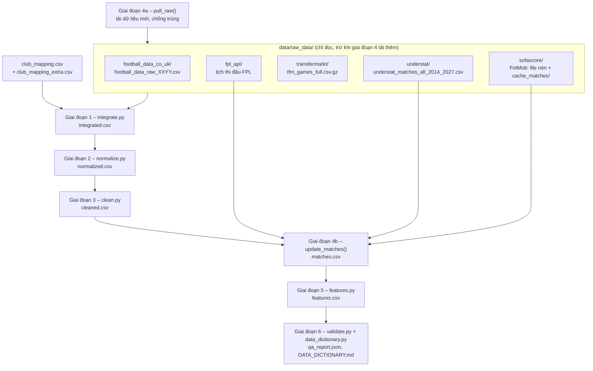

# Data Integration & Preprocessing – Cơ chế hoạt động chi tiết

Tài liệu này giải thích **toàn bộ** thư mục [`Data integration and preprocessing/`](../Data%20integration%20and%20preprocessing/):
mục đích của từng file, từng hàm, dữ liệu đi qua các giai đoạn ra sao, và vì sao lại làm như vậy.
Đọc xong, bạn có thể tự chạy, kiểm tra, sửa lỗi hoặc mở rộng pipeline mà không cần đọc code trước.

> Tài liệu liên quan:
> - [`DATA_DICTIONARY.md`](../Data%20integration%20and%20preprocessing/DATA_DICTIONARY.md): ý nghĩa từng **cột** dữ liệu. File này được sinh tự động.
> - [`README.md`](../Data%20integration%20and%20preprocessing/README.md): tóm tắt ngắn cách chạy.

---

## Mục lục

1. [Bài toán và sản phẩm đầu ra](#1-bài-toán-và-sản-phẩm-đầu-ra)
2. [Luồng hoạt động tổng thể](#2-luồng-hoạt-động-tổng-thể)
3. [Dữ liệu đầu vào (raw_data)](#3-dữ-liệu-đầu-vào-raw_data)
4. [Các khái niệm dùng xuyên suốt](#4-các-khái-niệm-dùng-xuyên-suốt)
5. [Giai đoạn 1 – `integrate.py`](#5-giai-đoạn-1--integratepy-tích-hợp-nguồn)
6. [Giai đoạn 2 – `normalize.py`](#6-giai-đoạn-2--normalizepy-chuẩn-hóa)
7. [Giai đoạn 3 – `clean.py`](#7-giai-đoạn-3--cleanpy-làm-sạch)
8. [Giai đoạn 4 – `update_current_season.py`](#8-giai-đoạn-4--update_current_seasonpy-cập-nhật-mùa-đang-diễn-ra)
9. [Giai đoạn 5 – `features.py`](#9-giai-đoạn-5--featurespy-tạo-đặc-trưng)
10. [Giai đoạn 6 – `validate.py`, `data_dictionary.py`, `run_prepare.py`](#10-giai-đoạn-6--kiểm-tra-tài-liệu-và-chạy-một-lệnh)
11. [Theo dấu một trận đấu qua toàn bộ pipeline](#11-theo-dấu-một-trận-đấu-qua-toàn-bộ-pipeline)
12. [Vận hành: chạy, cập nhật hằng tuần, mở rộng](#12-vận-hành-chạy-cập-nhật-hằng-tuần-mở-rộng)
13. [Câu hỏi thường gặp](#13-câu-hỏi-thường-gặp)

---

## 1. Bài toán và sản phẩm đầu ra

**Mục tiêu.** Dự đoán kết quả trận Premier League: tỉ số, và xác suất Thắng / Hòa / Thua của đội nhà.
Để huấn luyện mô hình, ta cần một bảng trong đó **mỗi dòng là một trận** với:
- thông tin trận (ngày, đội, trọng tài, kèo…);
- **đặc trưng trước trận**: những gì đã biết *trước khi* trận bắt đầu, như Elo, phong độ 5 trận gần nhất, vị trí trên bảng xếp hạng;
- **nhãn**: tỉ số và kết quả, chỉ có với trận đã đá.

Dữ liệu gốc nằm rải rác ở 5 nguồn khác nhau. Mỗi nguồn có cách viết tên đội, định dạng ngày, múi giờ, mùa giải và lỗi riêng.
Pipeline này **gộp, chuẩn hóa, làm sạch** chúng thành một bộ dữ liệu duy nhất, rồi **tạo đặc trưng** không bị rò rỉ thông tin tương lai.

**Phạm vi.** Mùa 2000/01 → mùa đang diễn ra (2026/27). Chỉ đọc từ `data/raw_data/`.

**Sản phẩm chính** (trong `data/clean/`):

| File | Nội dung | Kích thước hiện tại |
|---|---|---|
| `matches.csv` | Bộ dữ liệu sạch, mỗi dòng một trận: đã đá (`played`) và sắp đá (`upcoming`) | 9.850 dòng × 106 cột |
| `features.csv` | Bảng đặc trưng trước trận + nhãn, dùng để huấn luyện và dự đoán | 9.850 dòng × 102 cột (87 đặc trưng) |
| `DATA_DICTIONARY.md` (trong thư mục code) | Mô tả từng cột | – |
| `qa_report.json` | Kết quả kiểm tra chất lượng tự động | 108 kiểm tra |

**File trung gian và nhật ký** (cũng trong `data/clean/`, giúp truy vết):

| File | Sinh bởi | Công dụng |
|---|---|---|
| `integrated.csv`, `report.json`, `mismatches.csv` | Giai đoạn 1 | Dữ liệu đã ghép; báo cáo độ phủ; các trận mà nguồn lệch nhau |
| `fotmob_extracted.csv` | Giai đoạn 1 | Bộ nhớ đệm của file nén FotMob đã đọc (tăng tốc) |
| `normalized.csv`, `normalize_report.json`, `referee_mapping.csv` | Giai đoạn 2 | Dữ liệu đã chuẩn hóa; bảng đổi tên trọng tài |
| `cleaned.csv`, `clean_report.json`, `cleaning_log.csv` | Giai đoạn 3 | Dữ liệu đã sạch; **mọi ô đã bị sửa** kèm lý do |
| `update_log.csv` | Giai đoạn 4 | Một dòng cho mỗi lần cập nhật mùa hiện tại |
| `features_report.json` | Giai đoạn 5 | Kết quả tự kiểm tra rò rỉ, tỉ lệ thiếu |

---

## 2. Luồng hoạt động tổng thể



Viết bằng lời. Lệnh `python run_prepare.py` chạy lần lượt:

1. **Tải dữ liệu mới** cho mùa hiện tại: football-data, Understat, FPL, FotMob. Ghi vào `raw_data` theo cách không làm mất dữ liệu cũ và không tạo bản trùng.
2. **Giai đoạn 1 – Tích hợp:** đọc 4 nguồn trận đấu, đổi tên đội về mã chung, ghép theo khóa `(mùa, đội nhà, đội khách)`, đối chiếu tỉ số và ngày.
3. **Giai đoạn 2 – Chuẩn hóa:** tạo `match_id`, chuẩn hóa ngày giờ, tên đội, tỉ số, tên trọng tài, sơ đồ chiến thuật, kiểu dữ liệu.
4. **Giai đoạn 3 – Làm sạch:** bỏ trùng; xóa giá trị sai định dạng hoặc ngoài miền hợp lệ; sửa mâu thuẫn; điền khán giả = 0 cho các trận đá kín thời COVID. Mọi ô bị sửa đều được ghi log.
5. **Giai đoạn 4 – Dựng `matches.csv`:**
   - giữ các trận đã chốt;
   - thêm kết quả mới;
   - thêm **kết quả tạm thời** cho trận đã đá nhưng football-data chưa cập nhật;
   - xóa danh sách "trận sắp đá" cũ, thay bằng danh sách mới (trận vòng hiện tại chưa đá, trận hoãn, và vòng sau nếu chỉ còn ≤ 1 ngày là bắt đầu).
6. **Giai đoạn 5 – Đặc trưng:** duyệt các trận theo thời gian, tính Elo, phong độ, bảng xếp hạng… chỉ từ các trận **trước đó**, rồi tự kiểm tra rò rỉ.
7. **Giai đoạn 6:** chạy 108 kiểm tra chất lượng và sinh Data Dictionary.

Các file Python import lẫn nhau như sau. `integrate.py` là nơi khai báo đường dẫn và hằng số chung.

```
integrate.py  ◄── normalize.py ◄── update_current_season.py ◄── run_prepare.py
     ▲              ▲                    ▲                          │
     ├── clean.py ──┴────────────────────┘                          │
     ├── features.py ◄──────────────────────────────────────────────┤
     ├── validate.py (dùng clean.RANGES) ◄──────────────────────────┤
     └── data_dictionary.py ◄───────────────────────────────────────┘
```

Mỗi file đều có `main()` và chạy độc lập được (`python integrate.py`, `python features.py`…). Điều này tiện khi chỉ muốn chạy lại một giai đoạn.

---

## 3. Dữ liệu đầu vào (raw_data)

| Nguồn | File | Có gì | Phạm vi | Vai trò |
|---|---|---|---|---|
| **football-data.co.uk** | `football_data_co_uk/football_data_raw_0001.csv` … `_2627.csv` (mỗi mùa một file) | Tỉ số cả trận và hiệp 1, cú sút, phạt góc, lỗi, thẻ, trọng tài, kèo nhiều nhà cái | 2000/01 → nay | **Xương sống.** Một trận chỉ có trong bộ dữ liệu khi có trong football-data (trừ trận tạm thời và trận sắp đá) |
| **Understat** | `understat/understat_matches_all_2014_2027.csv` | xG, tỉ số, giờ đá theo **UTC** | 2014/15 → nay | xG; kết quả tạm thời khi football-data chậm |
| **Transfermarkt** | `transfermarkt/tfm_games_full.csv.gz` | Khán giả, sân, trọng tài, HLV, sơ đồ | 2012/13 → 2025/26 | Thông tin bối cảnh |
| **FotMob** (thư mục tên `sofascore` nhưng chứa dữ liệu FotMob) | `sofascore/sofascore_matches_cache.tar.gz` (6.137 file JSON) + `sofascore/cache_matches/*.json` (tải thêm) | Kiểm soát bóng, tình huống ngon ăn, sút và chạm bóng trong vòng cấm, chuyền bóng, tắc bóng, cứu thua, xG/xGOT của FotMob | 2010/11 → nay | Thống kê lối chơi, dùng để đo phong độ |
| **FPL API** | `fpl_api/fpl_fixtures_2026_2027.csv`, `fpl_teams_2026_2027.csv` | Lịch mùa hiện tại: vòng đấu (gameweek), giờ đá | 2026/27 | Danh sách trận sắp đá |

**Bảng ánh xạ CLB** (mỗi nguồn viết tên đội một kiểu, ví dụ "Man United", "Manchester United", "Manchester United FC"):
- `data/00_master_entities/club_mapping.csv`: 29 CLB, có cột tên theo từng nguồn (`name_football_data`, `name_understat`, `name_transfermarkt`, `name_fpl`, `name_fotmob`) và mã số (`tm_club_id`, `fotmob_team_id`).
- `data/clean/club_mapping_extra.csv`: 17 CLB cũ không có trong file master (Blackburn, Bolton, Wigan…), cũng có `tm_club_id` và `fotmob_team_id`.

**Các file FotMob không được dùng, và lý do:**
- `fotmob_team_match_stats.csv`: chỉ là tập con 2021–2026 của file nén, lại có định dạng ngày lẫn lộn.
- `fotmob_epl_47_details.csv`: dữ liệu từng cú sút, và cột mùa bị gán sai.
- `fotmob_league_YYYY_YYYY.json`: kết quả đã có ở nguồn khác; ngoài ra chứa **bảng xếp hạng cuối mùa**, nếu dùng làm đặc trưng sẽ là rò rỉ tương lai.
- `fotmob_fixtures_2026_2027.json`: chỉ dùng trong giai đoạn 4 để biết trận nào đã kết thúc và cần tải chi tiết.

---

## 4. Các khái niệm dùng xuyên suốt

### 4.1 Mã CLB (`club_id`)
Mỗi đội có một mã 3 chữ cái cố định: `ARS`, `MCI`, `WIG`… Ngay khi đọc nguồn nào, tên hoặc mã đội của nguồn đó lập tức được đổi sang `club_id`.
Sau bước này, mọi phép ghép đều dùng `club_id`, không bao giờ dùng tên. Nếu một nguồn có tên đội chưa được ánh xạ, chương trình **dừng và báo lỗi** chứ không âm thầm bỏ trận đó.

### 4.2 Mùa giải (`season`)
Luôn có dạng `"2000/01"`, sinh bởi `season_label(2000)`. Mỗi nguồn ghi mùa theo cách khác nhau:
- football-data: suy từ tên file (`_0001` → 2000/01).
- Understat: cột `season` dạng `"2014_2015"` → lấy 4 ký tự đầu.
- Transfermarkt: cột `season` là năm bắt đầu.
- FotMob: **không có cột mùa đáng tin**, nên suy từ ngày đá: trước tháng 8 thì thuộc mùa trước.
  Mốc tháng 8 (không phải tháng 7) để các trận đá bù sau COVID (tháng 6–7/2020) vẫn thuộc mùa 2019/20.

### 4.3 Khóa ghép `KEY = (season, home_club_id, away_club_id)`
Trong một mùa Premier League, mỗi cặp (đội nhà, đội khách) chỉ gặp nhau **đúng một lần**. Vì vậy bộ ba này xác định duy nhất một trận.

Lý do không ghép theo ngày: các nguồn có thể ghi lệch ngày, do múi giờ UTC so với giờ Anh, hoặc trận bị dời lịch.
Ngày chỉ được dùng để **đối chiếu**: lệch quá 1 ngày thì ghi vào `mismatches.csv`.

### 4.4 Mã trận (`match_id`)
`EPL_<năm bắt đầu>_<năm kết thúc>_<NHÀ>_<KHÁCH>`, ví dụ `EPL_2026_2027_ARS_LEE`.
Mã này sinh ra từ khóa ghép, nên **ổn định**: chạy lại pipeline bao nhiêu lần, cùng một trận vẫn cùng một mã. Nhờ vậy có thể chống trùng giữa các lần cập nhật.

### 4.5 Giờ và múi giờ
Mọi ngày giờ trong sản phẩm đều theo **giờ Anh (Europe/London)**, giống football-data.
Understat, FotMob và FPL trả giờ UTC, nên được đổi sang giờ Anh. Ví dụ: trận lúc 23:30 UTC ngày 1 có thể là 00:30 ngày 2 giờ Anh vào mùa hè.

### 4.6 Thời điểm biết giá trị và rò rỉ dữ liệu
Một cột như `home_shots` (số cú sút) chỉ có **sau** trận đấu. Nếu đưa nó vào mô hình để đoán chính trận đó thì mô hình "nhìn trước đáp án": đó là **rò rỉ dữ liệu**.
Vì vậy:
- `matches.csv` chứa thống kê của chính trận (để lưu trữ và phân tích).
- `features.csv` chỉ chứa những gì tính từ **các trận trước**, ví dụ "trung bình cú sút 5 trận gần nhất".

Data Dictionary gắn cho mỗi cột một nhãn thời điểm: Định danh / Trước trận / Sát giờ / Sau trận / Mục tiêu / Kỹ thuật.

### 4.7 Nguyên tắc "không mất dữ liệu, không trùng dữ liệu"
- File raw mới chỉ ghi đè file cũ khi **không ít trận hơn** (một bản tải lỗi không thể xóa kết quả cũ).
- Dữ liệu mới được **upsert** (cập nhật nếu đã có, thêm nếu chưa có) theo mã định danh của nguồn: `understat_id`, mã trận FotMob.
- `matches.csv` chống trùng theo `match_id`.

---

## 5. Giai đoạn 1 – `integrate.py` (tích hợp nguồn)

**Đầu vào:** raw football-data, Understat, Transfermarkt, FotMob, và hai bảng ánh xạ CLB.
**Đầu ra:** `integrated.csv` (9.850 × 91), `mismatches.csv`, `report.json`, `fotmob_extracted.csv`.

### 5.1 Hằng số

| Hằng số | Giá trị / ý nghĩa |
|---|---|
| `HERE`, `ROOT` | Thư mục code và thư mục gốc project. Mọi đường dẫn tính từ đây, nên chạy từ đâu cũng được |
| `RAW_DIR`, `MASTER_DIR`, `OUT_DIR` | `data/raw_data`, `data/00_master_entities`, `data/clean` |
| `EXTRA_MAPPING` | `data/clean/club_mapping_extra.csv` |
| `FIRST_SEASON, LAST_SEASON` | `2000, 2026`: năm bắt đầu của mùa đầu và mùa cuối |
| `CURRENT_SEASON` | `"2026/27"`, sinh từ `LAST_SEASON`. **Sang mùa mới chỉ cần đổi `LAST_SEASON`** |
| `KEY` | Khóa ghép `["season", "home_club_id", "away_club_id"]` |
| `MAX_DATE_GAP_DAYS` | `1`: lệch ngày giữa các nguồn tối đa cho phép |
| `FD_COLUMNS` | Bảng đổi tên cột football-data, ví dụ `FTHG` → `home_goals`, `B365H` → `b365_home_odds` |
| `FD_FALLBACK` | File cũ ghi kèo trung bình là `BbAvH/D/A`, file mới là `AvgH/D/A`; cột mới thiếu thì lấy cột cũ |
| `INT_COLUMNS` | Các cột đếm (bàn, sút, thẻ…), ép về số nguyên |
| `FOTMOB_DIR`, `FOTMOB_ARCHIVE`, `FOTMOB_NEW_DIR`, `FOTMOB_EXTRACT` | Thư mục FotMob, file nén lịch sử, thư mục trận tải thêm, file bộ nhớ đệm |
| `FM_STATS` | Bảng đổi khóa chỉ số FotMob sang tên cột, ví dụ `BallPossesion` → `possession`, `expected_goals_on_target` → `fm_xgot`. Tiền tố `fm_` dùng khi nguồn khác có khái niệm trùng (xG của Understat là `home_xg`, của FotMob là `home_fm_xg`), để không trộn hai cách đo |
| `FM_FLOAT` | Chỉ số FotMob dạng số thực (các loại xG, `pass_accuracy`); còn lại là số nguyên |
| `FM_COLUMNS` | Danh sách đầy đủ 38 cột FotMob: `home_possession`, `away_possession`, … |

### 5.2 Các hàm

#### `season_label(start_year)`
`2000 → "2000/01"`, `2026 → "2026/27"`. Mọi nguồn dùng chung hàm này để mùa luôn cùng một định dạng.

#### `load_club_mapping()`
- Đọc 7 cột từ `club_mapping.csv` và `club_mapping_extra.csv`, nối hai bảng.
- **Kiểm tra trùng:** nếu một `club_id` xuất hiện hai lần thì báo lỗi ngay, tránh trường hợp một đội có hai cách ánh xạ.
- Trả về một dict gồm 4 bảng tra, mỗi bảng đi từ tên hoặc mã của nguồn sang `club_id`:
  - `"football_data"`: `{"Man United": "MUN", …}`
  - `"understat"`: `{"Manchester United": "MUN", …}`
  - `"transfermarkt"`: `{985: "MUN", …}`, tra theo **mã số** CLB của Transfermarkt.
  - `"fotmob"`: `{10260: "MUN", …}`, tra theo **mã số** FotMob, vì FotMob đổi tên đội theo thời gian ("Blackburn" ↔ "Blackburn Rovers") còn mã thì không đổi.
- Hàm con `lookup(col)` bỏ các dòng trống ở cột tên rồi tạo dict tên → `club_id`.

#### `map_teams(df, cols, mapping, source)`
- Với mỗi cột tên đội (đội nhà, đội khách), tìm các giá trị **không có trong bảng tra**.
- Nếu có, dừng chương trình và in danh sách tên lạ kèm tên nguồn, ví dụ `[football-data] team names without club_id … ['Luton']`. Người dùng chỉ cần thêm dòng vào file ánh xạ.
- Nếu đủ, trả về các cột đã đổi sang `club_id`.

Lý do **dừng hẳn** thay vì bỏ qua: bỏ qua sẽ làm mất trận một cách âm thầm, mùa sẽ thiếu trận mà không ai biết.

#### `parse_fd_date(s)`
football-data dùng hai định dạng ngày: file cũ `dd/mm/yy` (`19/08/00`), file mới `dd/mm/yyyy`.
Hàm thử định dạng 4 chữ số năm trước, chỗ nào thất bại thì thử 2 chữ số, rồi gộp lại.
Thứ tự này quan trọng: nếu thử `%y` trước, chuỗi `19/08/2000` có thể bị hiểu sai.

#### `load_football_data(club_map)`
Lặp qua từng mùa 2000 → 2026:
1. Tạo mã file (`2000 → "0001"`) và đọc với `encoding="latin-1"`, vì file có ký tự đặc biệt không phải UTF-8. Dòng hỏng bị bỏ qua (`on_bad_lines="skip"`).
2. Xóa ký tự BOM (``) bị dính vào tên cột đầu tiên.
3. Bỏ các dòng trống ở cuối file: dòng không có đội hoặc tỉ số.
4. Tạo cột `season`, `date` (qua `parse_fd_date`), đổi tên đội sang `club_id`.
5. Đổi tên cột theo `FD_COLUMNS`. Cột không tồn tại trong mùa đó (ví dụ kèo Pinnacle trước 2012) để trống.
6. Lấy kèo trung bình từ cột cũ `BbAv*` khi cột mới `Avg*` trống.

Sau vòng lặp: nối 27 mùa, ép cột đếm sang số nguyên (`Int64` cho phép ô trống), ép kèo sang số thực. **Có ngày nào không đọc được thì báo lỗi.**

#### `load_understat(club_map)`
- Chỉ giữ trận đã có kết quả (`is_result == True`) và nằm trong phạm vi mùa.
- Đổi `"2014_2015"` → `"2014/15"`, đổi tên đội.
- Trả về các cột có tiền tố `us_`: `us_date`, `us_home_goals`, `us_away_goals`, dùng để đối chiếu; và `home_xg`, `away_xg` là giá trị chính thức của xG.

#### `load_transfermarkt(club_map)`
- Lọc giải `GB1` (Premier League) trong phạm vi mùa. Đội được tra theo **mã số** Transfermarkt.
- Trả về `tm_date`, `tm_home_goals`, `tm_away_goals` (để đối chiếu), `tm_attendance`, `stadium`, `tm_referee`, `home/away_manager`, `home/away_formation`.

#### `fm_number(v)`
FotMob trả giá trị theo nhiều dạng: số `64`, chuỗi `"1.88"`, hoặc `"583 (89%)"` (số đường chuyền chính xác kèm tỉ lệ).
Hàm lấy **số đầu tiên** trong chuỗi bằng biểu thức chính quy: `"583 (89%)" → 583.0`. Giá trị `None` thành `NaN`.

#### `parse_fotmob_match(d)`
Đọc một file JSON "matchDetails" của FotMob và trả về **một dòng phẳng**, hoặc `None` nếu file không dùng được:
- Không có khóa `general` (file rỗng hoặc lỗi; có 111 file như vậy) → `None`.
- Không thuộc Premier League (mã giải 47), chưa kết thúc, bị hủy, hoặc **bị bỏ dở** (`reason.short == "Ab"`, ví dụ Bournemouth–Luton 16/12/2023 dừng giữa chừng rồi đá lại tháng 3/2024) → `None`.

Dòng trả về gồm:
- `fm_match_id`, `fm_kickoff_utc`, mã FotMob của hai đội, tỉ số.
- Các chỉ số trong `content.stats.Periods.All.stats`. Cấu trúc này có nhiều nhóm (Top stats, Shots, Passes…), mỗi nhóm có danh sách chỉ số dạng `{"key": ..., "stats": [nhà, khách]}`.

Một chỉ số có thể xuất hiện ở hai nhóm (ví dụ `accurate_passes` ở cả Top stats và Passes), nên hàm chỉ lấy **lần đầu**.
Các dòng tiêu đề nhóm có giá trị `[None, None]` nên tự động bị bỏ.

#### `read_fotmob_details()`
Đọc toàn bộ chi tiết trận FotMob. Đọc 6.137 file JSON trong file nén mất khoảng **44 giây**, nên hàm dùng bộ nhớ đệm:

1. Nếu `fotmob_extracted.csv` tồn tại, **mới hơn** file nén, và có đủ các cột chỉ số → đọc thẳng file CSV (dưới 1 giây).
2. Nếu không (lần chạy đầu, file nén vừa thay, hoặc `FM_STATS` vừa thêm chỉ số) → mở file nén, gọi `parse_fotmob_match` cho từng file, rồi ghi lại CSV đệm.
3. Đọc thêm các file trong `sofascore/cache_matches/` (do giai đoạn 4 tải về). Nếu trùng `fm_match_id` với file nén thì **bản mới thắng**.

Muốn buộc đọc lại từ đầu, chỉ cần xóa `data/clean/fotmob_extracted.csv`.

#### `load_fotmob(club_map)`
1. Gọi `read_fotmob_details()`.
2. Đổi giờ UTC → giờ Anh; suy **mùa từ ngày đá** với mốc tháng 8 (xem mục 4.2).
3. Lọc phạm vi mùa, đổi mã đội FotMob → `club_id`.
4. Tính `pass_accuracy = accurate_passes / passes × 100`. Chính xác hơn phần trăm làm tròn trong chuỗi `"(89%)"`.
5. Trả về các cột đối chiếu `fm_date`, `fm_kickoff_time`, `fm_home_goals`, `fm_away_goals`, mã trận `fm_match_id`, và 38 cột chỉ số.

#### `check_unique_key(df, source)`
Kiểm tra mỗi nguồn không có hai dòng cùng khóa `(mùa, nhà, khách)`. Nếu có thì in cảnh báo, giữ dòng đầu, và trả về số dòng trùng để ghi báo cáo.
Hiện tại không nguồn nào bị trùng.

#### `cross_check(df)`
Sau khi ghép, với mỗi nguồn phụ (Understat `us_`, Transfermarkt `tm_`, FotMob `fm_`), trận nào thỏa một trong hai điều kiện sẽ được ghi một dòng vào `mismatches.csv`:
- **tỉ số khác** football-data, hoặc
- **ngày lệch** quá 1 ngày.

Dòng ghi lại cả hai phiên bản để người dùng kiểm tra tay. Hiện tại file này **rỗng**, nghĩa là các nguồn khớp nhau hoàn toàn.

#### `main()`
1. Tải bảng ánh xạ; đọc 4 nguồn, mỗi nguồn qua `check_unique_key`.
2. **Ghép trái** (left join) Understat, Transfermarkt, FotMob vào football-data theo `KEY`.
   football-data là xương sống: trận không có trong football-data sẽ không vào `integrated.csv`. Trận đã đá nhưng football-data chưa cập nhật được giai đoạn 4 xử lý riêng.
3. Gọi `cross_check`.
4. **Một giá trị cho mỗi khái niệm:**
   - `attendance`: ưu tiên Transfermarkt, thiếu thì lấy football-data.
   - `referee`: ưu tiên football-data, thiếu thì lấy Transfermarkt.
5. `source_flags`: chuỗi ghi nguồn đã ghép được cho trận, ví dụ `FD+US+TM+FM`.
6. Chọn cột, sắp xếp theo mùa/ngày, ghi `integrated.csv`, `mismatches.csv`.
7. Ghi `report.json`:
   - số trận mỗi mùa, mùa không đủ 380 trận;
   - số khóa trùng trong từng nguồn;
   - độ phủ khi ghép, ví dụ "FotMob: 6.029 / 6.140 trận của các mùa nó có";
   - số trận FotMob không có thống kê;
   - `not_in_football_data`: các trận nguồn phụ có mà football-data chưa có, thường là vòng vừa đá.

---

## 6. Giai đoạn 2 – `normalize.py` (chuẩn hóa)

**Đầu vào:** `integrated.csv`. **Đầu ra:** `normalized.csv` (9.850 × 100), `referee_mapping.csv`, `normalize_report.json`.

Giai đoạn này **không xóa hay sửa giá trị sai**; đó là việc của giai đoạn 3. Nó chỉ đưa mọi thứ về **cùng một định dạng** và thêm cột định danh.

### 6.1 Hằng số
- `LEAGUE = "Premier League"`.
- `COUNT_COLUMNS`: các cột đếm, ép sang số nguyên.
- `TEXT_COLUMNS`: các cột chữ cần làm sạch khoảng trắng (trọng tài, sân, HLV, sơ đồ).
- `REFEREE_FIXES`: sửa 3 tên trọng tài bị gõ sai hoặc cắt cụt trong file gốc: `D Ellaray` → `D Elleray`, `D Gallagh` / `D Gallaghe` → `D Gallagher`.

### 6.2 Các hàm

#### `team_names()`
Trả về dict `club_id → name_standard` (ví dụ `MUN → "Manchester United"`) từ hai file ánh xạ. Giai đoạn 4 cũng dùng hàm này.

#### `clean_text(s)`
Bỏ khoảng trắng đầu và cuối, gộp nhiều khoảng trắng thành một, chuỗi rỗng thành ô trống.

#### `normalize_referee(name)`
Trọng tài được ghi theo nhiều kiểu: `"Mike Dean"`, `"M Dean"`, `"Dean, M. L"`, `"M. L. Dean"`. Hàm đưa tất cả về **`<chữ cái đầu của tên> <Họ>`**:
1. Có dấu phẩy (`"Họ, Tên"`) thì đảo lại thành `"Tên Họ"`.
2. Bỏ dấu chấm, tách từ.
3. Lấy chữ cái đầu của từ đầu tiên và giữ nguyên từ cuối cùng (họ), viết hoa chữ đầu.

Kết quả: 165 cách viết → 88 trọng tài. Bảng đổi tên được ghi ra `referee_mapping.csv`.

#### `formation_shape(s)`
Transfermarkt ghi sơ đồ kèm mô tả: `"4-3-3 Attacking"`, `"4-2-3-1 Defensive"`. Hàm chỉ giữ phần số (`"4-3-3"`), tạo cột `*_formation_shape`.
26 nhãn gốc rút lại còn 17 sơ đồ.

#### `check_formats(df)`
Đếm số giá trị **sai định dạng mong đợi** để ghi báo cáo, không sửa gì: ngày không phải `YYYY-MM-DD`, giờ không phải `HH:MM`, kết quả không thuộc H/D/A, thiếu tỉ số, thiếu tên đội, `match_id` trùng.

#### `main()`
1. Thêm `league`, `season_start_year`, `match_id` (mục 4.4).
2. Ngày → `YYYY-MM-DD`; giờ → `HH:MM`.
3. `home_team`, `away_team` = tên chuẩn từ `club_id`.
4. Cột đếm → số nguyên; `result`, `ht_result` → chữ in hoa; tạo `score = "2-1"`, `ht_score = "1-0"`.
5. Làm sạch chữ; chuẩn hóa trọng tài, áp `REFEREE_FIXES`, xuất `referee_mapping.csv`; tạo `*_formation_shape`.
6. Kèo, xG → số thực. Cột FotMob: chỉ số trong `FM_FLOAT` là số thực, còn lại là số nguyên. `fm_match_id` → số nguyên.
7. Sắp xếp cột theo thứ tự cố định: định danh → tỉ số → thống kê → bối cảnh → FotMob → kèo → nguồn.
8. Ghi file và báo cáo. Báo cáo có danh sách trọng tài chỉ xuất hiện đúng 1 trận, vì đó có thể là lỗi chính tả; giai đoạn 3 sẽ xem xét.

---

## 7. Giai đoạn 3 – `clean.py` (làm sạch)

**Đầu vào:** `normalized.csv`. **Đầu ra:** `cleaned.csv` (9.850 × 103), `cleaning_log.csv`, `clean_report.json`.

Nguyên tắc: **không đoán bừa giá trị.** Giá trị chắc chắn sai thì xóa (để trống); chỉ sửa khi có căn cứ chắc chắn, ví dụ tính lại kết quả từ tỉ số. **Mọi ô bị thay đổi đều được ghi log.**

### 7.1 Hằng số
| Hằng số | Ý nghĩa |
|---|---|
| `CLOSED_DOORS` | 17/06/2020 → 23/05/2021: giai đoạn Premier League đá **không khán giả** vì COVID |
| `SEASON_MATCHES = 380` | Số trận một mùa đầy đủ (20 đội × 19 đối thủ × 2 lượt) |
| `REFEREE_MIN_MATCHES = 5` | Ngưỡng để coi một trọng tài là "có thật" khi sửa tên |
| `POSSESSION_TOLERANCE = 2` | Kiểm soát bóng hai đội cộng lại phải bằng 100 ± 2 (sai số làm tròn) |
| `RANGES` | Miền hợp lệ của từng cột số, ví dụ bàn thắng 0–20, sút 0–60, xG 0–10, khán giả 0–100.000, kiểm soát bóng 0–100, chuyền 0–1.500… |
| `FLOAT_COLUMNS` | Các cột số thực (xG, xGOT, `pass_accuracy`). Các cột còn lại trong `RANGES` được ép về số nguyên ở cuối |
| `log` | Danh sách toàn cục, mỗi phần tử là một ô bị sửa |

### 7.2 Các hàm

#### `record(df, mask, column, new_value, rule, reason)`
Hàm **trung tâm** của giai đoạn này. Mọi thay đổi đều đi qua nó:
1. Với mỗi dòng mà `mask` đúng, ghi vào `log`: `match_id`, cột, giá trị cũ, giá trị mới, mã quy tắc, lý do.
2. Sau đó mới gán giá trị mới vào bảng.

`new_value` có thể là một hằng số (ví dụ `NaN`, `0`) hoặc một cột (ví dụ kết quả tính lại cho từng dòng).
Nhờ hàm này, `cleaning_log.csv` trả lời được câu hỏi "ô này vì sao khác file gốc?".

#### Các quy tắc làm sạch

| Mã | Hàm | Phát hiện | Xử lý | Số ô đã sửa |
|---|---|---|---|---|
| **R1** | `drop_duplicates` | Hai dòng trùng `match_id` hoặc trùng khóa | Giữ dòng **có nhiều ô có dữ liệu nhất**, bỏ dòng còn lại | 0 |
| **R2** | `fix_formats_and_ranges` | Ngày không đọc được; giá trị không phải số trong cột số | Xóa ô | 0 |
| **R3** | `fix_formats_and_ranges` | Số nằm ngoài `RANGES`; kèo ≤ 1 | Xóa ô | 0 |
| **R4** | `fix_consistency` | `result` (hoặc `ht_result`) không khớp với tỉ số | **Tính lại** từ tỉ số | 0 |
| **R5** | `fix_consistency` | Bàn hiệp 1 > bàn cả trận | Xóa 4 ô hiệp 1 (vì không biết số nào sai) | 0 |
| **R6** | `fix_consistency` | Sút trúng đích > tổng cú sút | Xóa cả hai ô sút của đội đó | 10 |
| **R7** | `fix_referees` | Tên trọng tài chỉ xuất hiện 1 trận, trong khi cùng mùa có đúng một trọng tài **cùng họ** bắt ≥ 5 trận | Đổi sang tên trọng tài đó | 6 |
| **R8** | `check_season_window` | Ngày nằm ngoài khoảng 1/7 năm bắt đầu → 31/7 năm sau | **Chỉ báo cáo** | 0 |
| **R9** | `fill_closed_doors` | Khán giả trống trong giai đoạn COVID | Điền `0`, đánh dấu `attendance_imputed = True` | 441 |
| **R10** | `fix_consistency` | Kiểm soát bóng hai đội cộng lại ≠ 100 ± 2 | Xóa cả hai ô | 0 |
| **R11** | `fix_consistency` | Chuyền chính xác > tổng chuyền; cơ hội lớn bỏ lỡ > cơ hội lớn | Xóa các ô liên quan | 2 |

Giải thích thêm một số hàm:
- **`outcome(home, away)`**: trả về `H`/`D`/`A` cho từng dòng từ hai cột bàn thắng; R4 dùng hàm này.
- **`fix_referees`**:
  - Ví dụ: `"O Oliver"` chỉ xuất hiện một lần (trận BOU–FUL 2024/25), trong khi `"M Oliver"` bắt 25 trận mùa đó, nên được đổi.
    Các trường hợp khác: `A Moss → J Moss` (2020/21), `K Kavanagh → C Kavanagh` (2024/25)…
  - Điều kiện "cùng họ, cùng mùa, ≥ 5 trận, **duy nhất** một ứng viên" giúp tránh đổi nhầm hai trọng tài khác nhau có cùng họ.
- **`check_season_window`**: không sửa, vì trận nằm ngoài khung mùa thường do nguồn ghi sai mùa. Cần người kiểm tra tay.
- **R9 và lý do điền 0**: ô trống ở đây không phải "không biết" mà là "không có khán giả". Đó là thông tin thật và quan trọng: lợi thế sân nhà giảm rõ khi sân không có khán giả. Cờ `attendance_imputed` cho biết giá trị được suy ra chứ không đọc từ nguồn.

#### `missing_report(df)`
Với mỗi cột có ô trống, báo cáo:
- tỉ lệ thiếu chung;
- các mùa **hoàn toàn không có** cột đó (do nguồn chưa có, ví dụ xG trước 2014). Đây là thiếu **có cấu trúc**, không phải lỗi;
- các mùa **thiếu một phần**.

Thông tin này giúp chọn cách xử lý thiếu khi huấn luyện.

#### `main()`
Chạy lần lượt `drop_duplicates` (R1) → `fix_formats_and_ranges` (R2, R3) → `fix_consistency` (R4, R5, R6, R10, R11)
→ `fix_referees` (R7) → `fill_closed_doors` (R9) → `check_season_window` (R8). Sau đó ép cột đếm về số nguyên và thêm:
- `season_complete`: mùa có đủ 380 trận. Hiện 2003/04 và 2004/05 chỉ có 335 trận vì file gốc thiếu; mùa hiện tại chưa đá xong.
- `status = "played"`.

Ghi `cleaned.csv`, `cleaning_log.csv`, `clean_report.json`. Báo cáo có thêm mục `not_errors`: các trường hợp trông như lỗi nhưng không phải.
Ví dụ: số bàn thắng > số sút trúng đích là chuyện bình thường, vì bàn phản lưới nhà không phải cú sút của đội ghi bàn.

---

## 8. Giai đoạn 4 – `update_current_season.py` (cập nhật mùa đang diễn ra)

**Đầu vào:** Internet (football-data, Understat, FPL, FotMob), `cleaned.csv`, `matches.csv` cũ.
**Đầu ra:** file raw được cập nhật, `matches.csv`, `update_log.csv`.

Đây là file chạy **sau mỗi vòng đấu**. Nó có hai phần:
- **(a)** kéo dữ liệu mới vào `raw_data` rồi chạy lại giai đoạn 1–3;
- **(b)** dựng `matches.csv` với ba loại dòng: trận đã chốt, trận có kết quả tạm thời, và trận sắp đá.

### 8.1 Hằng số
| Hằng số | Ý nghĩa |
|---|---|
| `SEASON_CODE = "2627"`, `SEASON_DIR_LABEL = "2026_2027"` | Dùng trong URL và tên file |
| `FD_FILE`, `US_FILE`, `FPL_FIXTURES_FILE`, `FPL_TEAMS_FILE`, `FM_FIXTURES_FILE` | File raw tương ứng |
| `MATCHES_FILE`, `UPDATE_LOG` | `matches.csv`, `update_log.csv` |
| `NEXT_ROUND_WINDOW = 1 ngày` | Vòng tiếp theo chỉ được thêm khi còn ≤ 1 ngày là bắt đầu |
| `FM_API` | `https://www.fotmob.com/api/data` |

### 8.2 Phần (a): kéo dữ liệu mới

#### `pull_football_data()`
Tải `E0.csv` của mùa hiện tại. **Chỉ ghi đè** file local khi bản mới có **số trận ≥ bản cũ**, để một lần tải lỗi hoặc thiếu không xóa được kết quả đã có.
Trả về số trận mới.

#### `pull_understat()`
Gọi API nội bộ `getLeagueData/EPL/2026`. API này cần header `X-Requested-With` và `Referer`, nếu thiếu sẽ bị từ chối.
- Chuyển mỗi trận (cả trận chưa đá) thành một dòng, gồm xG và dự báo của Understat.
- **Upsert theo `understat_id`:** xóa các dòng cũ có cùng id, thêm dòng mới. Trận cũ không bị nhân đôi, trận vừa có kết quả được cập nhật.
- Ghi lại toàn bộ file đã sắp xếp.

#### `pull_fpl()`
Tải danh sách 380 trận (`fixtures`) và 20 đội (`bootstrap-static`) của FPL, ghi đè hai file CSV.
FPL là nguồn **lịch thi đấu**: vòng mấy, giờ đá nào, trận nào bị hoãn.

#### `pull_fotmob()`
1. Tải lịch mùa của FotMob. Ghi đè `fotmob_fixtures_2026_2027.json` chỉ khi số trận đã kết thúc **không giảm**.
2. Lấy các trận đã kết thúc và không bị hủy.
3. Gọi `integrate.read_fotmob_details()` để biết những trận nào **đã có chi tiết kèm thống kê** (trong file nén hoặc `cache_matches/`).
4. Với mỗi trận còn thiếu: tải `matchDetails?matchId=…`, kiểm tra bằng `parse_fotmob_match` rằng đây là trận hợp lệ, rồi lưu `cache_matches/<mã>.json`. Mỗi lần tải nghỉ 0,5 giây để không gửi yêu cầu dồn dập.

**Chống trùng theo mã trận FotMob:** trận đã có thì không tải lại. Trận đã tải nhưng FotMob chưa kịp có thống kê sẽ được tải lại ở lần chạy sau.

#### `pull_raw()`
Gọi 4 hàm trên. Nếu một nguồn lỗi (mất mạng, API đổi), chỉ in cảnh báo và **chạy tiếp** với file raw đã có. Pipeline không bao giờ dừng chỉ vì một nguồn tạm thời không truy cập được.

### 8.3 Phần (b): dựng `matches.csv`

#### `fpl_fixtures()`
Đọc lịch FPL và đổi mã đội FPL → tên FPL → `club_id`, qua cột `name_fpl` trong `club_mapping.csv`. Tên lạ thì báo lỗi, yêu cầu sửa `name_fpl`.
Đổi giờ đá UTC → giờ Anh. Trả về `gameweek` (trống nếu trận bị hoãn chưa xếp lại), đội, `kickoff_utc`, `date`, `kickoff_time`.

#### `base_row(home, away)`
Tạo phần chung của một dòng mùa hiện tại: `match_id`, giải, mùa, mã và tên hai đội, `season_complete = False`, `attendance_imputed = False`.

#### `result_fields(hg, ag)`
Từ hai số bàn tạo `home_goals`, `away_goals`, `score`, `result`, `status = "played"`, `provisional = True`.

#### `provisional_results(played_ids)`: kết quả tạm thời
football-data thường cập nhật chậm 1–3 ngày sau vòng đấu. Để đặc trưng của vòng sau dùng được kết quả mới nhất, hàm tạo **dòng tạm** cho các trận đã đá nhưng chưa có trong football-data (không thuộc `played_ids`):
1. **Từ Understat:** tỉ số, xG, giờ đá (đổi UTC → giờ Anh). `source_flags = "US"`.
2. **Từ FotMob:**
   - trận Understat cũng có: gắn thêm 38 cột thống kê FotMob, cờ thành `US+FM`;
   - trận Understat chưa có: lấy luôn tỉ số và ngày giờ từ FotMob, cờ `FM`.

Các dòng này có `provisional = True`. Khi football-data cập nhật, lần chạy sau sẽ **thay** chúng bằng dòng chính thức.

#### `upcoming_matches(fixtures, played_ids, now)`: chọn trận sắp đá
Đây là nơi thực hiện quy tắc: *"chỉ lưu các trận chưa diễn ra hoặc bị hoãn; khi còn 1 ngày trước vòng mới thì mới lưu cả vòng mới"*.

1. **Giờ bắt đầu của mỗi vòng** = giờ đá sớm nhất trong vòng đó.
2. **Vòng hiện tại** (`current_gw`) = vòng lớn nhất **đã bắt đầu** (giờ bắt đầu ≤ `now`).
3. **Vòng tiếp theo** (`next_gw`) = vòng nhỏ nhất chưa bắt đầu. Vòng này được thêm (`include_next`) khi `now ≥ giờ bắt đầu − 1 ngày`.
4. Chỉ xét các trận **chưa có kết quả** (`unplayed`). Một trận bị coi là **hoãn** khi:
   - không có vòng hoặc giờ đá (FPL bỏ trống khi hoãn mà chưa xếp lịch mới), hoặc
   - thuộc vòng trước vòng hiện tại, hoặc
   - giờ đá đã qua hơn 1 ngày mà vẫn chưa có kết quả.
5. **Giữ lại:** trận hoãn + trận chưa đá của vòng hiện tại + (cả vòng tiếp theo nếu `include_next`).

Mỗi trận giữ lại thành một dòng `status = "upcoming"`, `postponed` đúng hoặc sai, `source_flags = "FPL"`.

Ví dụ (giờ Anh), vòng 7 bắt đầu thứ Bảy 17/10 lúc 12:30:

| Thời điểm chạy | Vòng hiện tại | Dòng "upcoming" |
|---|---|---|
| Thứ Ba 13/10 | 6 (đã đá xong) | không có, hoặc chỉ các trận hoãn |
| Thứ Sáu 16/10 lúc 13:00 | 6 | **cả 10 trận vòng 7**: còn < 1 ngày |
| Chủ Nhật 18/10, sau 6 trận | 7 | 4 trận vòng 7 chưa đá |
| Thứ Hai 19/10, sau trận cuối | 7 | không có, hoặc chỉ các trận hoãn |

#### `update_matches(now, rebuild=False)`
Ráp `matches.csv` mới từ 4 phần:

1. Đọc `cleaned.csv` (dữ liệu chính thức vừa làm sạch) và `matches.csv` cũ (bỏ qua nếu `--rebuild`).
2. **Xóa các trận sắp đá cũ.** Chúng luôn được tính lại từ đầu ở bước 6.
3. **Giữ các trận đã chốt cũ** (`played`, không tạm thời). Chúng không bao giờ bị xóa, nhưng được **làm mới** từ `cleaned.csv` bằng `combine_first`:
   - giá trị mới từ raw được ưu tiên, giá trị cũ chỉ lấp chỗ trống;
   - nhờ vậy khi thêm nguồn mới (như FotMob), các dòng cũ cũng nhận cột mới mà không cần `--rebuild`.
4. **Thêm trận chính thức mới**: trận trong `cleaned.csv` chưa có trong `matches.csv` (**chống trùng theo `match_id`**). Dòng tạm thời cũ của các trận này bị thay thế.
5. **Thêm kết quả tạm thời** (`provisional_results`) cho trận đã đá còn thiếu.
6. **Thêm trận sắp đá** (`upcoming_matches`).
7. Gắn `gameweek` cho các trận mùa hiện tại theo lịch FPL; ép kiểu số nguyên; sắp xếp theo mùa → ngày → giờ.
8. Ghi `matches.csv`, trả về bảng tóm tắt:
   - thời điểm chạy;
   - số trận sắp đá đã xóa;
   - số trận chính thức đã thêm;
   - số trận tạm thời đã được thay;
   - vòng hiện tại và vòng tiếp theo, vòng sau đã được thêm chưa;
   - số trận sắp đá và số trận hoãn;
   - tổng số dòng.

#### `main()`
Đọc các cờ dòng lệnh:
- `--offline`: không tải gì, chỉ dùng file đã có.
- `--rebuild`: dựng lại `matches.csv` từ đầu.
- `--now "2026-10-16 13:00"`: giả lập thời điểm chạy (UTC), dùng để kiểm thử quy tắc chọn vòng.

Sau đó chạy: tải dữ liệu → giai đoạn 1–3 → `update_matches` → ghi thêm một dòng vào `update_log.csv` → in tóm tắt: trận vừa thêm, trận tạm thời, vòng hiện tại và vòng sau, danh sách sắp đá.

---

## 9. Giai đoạn 5 – `features.py` (tạo đặc trưng)

**Đầu vào:** `matches.csv`. **Đầu ra:** `features.csv` (87 đặc trưng), `features_report.json`.

### 9.1 Ý tưởng cốt lõi: duyệt theo thời gian, "đọc trước – cập nhật sau"
Pipeline duyệt **từng trận theo thứ tự thời gian** và giữ một "trạng thái" cho mỗi đội: 5 trận gần nhất, điểm từ đầu mùa, Elo…
Với mỗi trận:
1. **Đọc** trạng thái hiện tại của hai đội để tạo đặc trưng. Lúc này trạng thái chỉ chứa các trận **trước** trận này.
2. **Sau đó mới cập nhật** trạng thái bằng kết quả của trận này.

Nhờ thứ tự đó, đặc trưng của một trận **không thể** chứa thông tin của chính nó hay của trận sau. Đây là cách chống rò rỉ dữ liệu.
Các trận sắp đá được duyệt **sau cùng**: chúng chỉ được đọc, không cập nhật gì, nên nhìn thấy mọi kết quả đã biết.

### 9.2 Hằng số
| Hằng số | Ý nghĩa |
|---|---|
| `WINDOW = 5` | Số trận gần nhất để tính phong độ |
| `ELO_START, ELO_NEW_TEAM, ELO_K, ELO_HOME_ADV, ELO_CARRY` | `1500, 1450, 20, 65, 0.8` (xem 9.4) |
| `ID_COLS`, `TARGETS` | Cột định danh và nhãn (`home_goals`, `away_goals`, `result`) được giữ trong `features.csv` |
| `FM_FORM` | Đặc trưng phong độ FotMob → (cột trong `matches.csv`, `"for"` = của đội mình / `"against"` = của đối thủ). Ví dụ `big_chances_against5 = ("big_chances", "against")`: số tình huống ngon ăn **đối thủ** tạo ra trước đội này |
| `FORM_KEYS` | Danh sách đặc trưng cho mỗi đội (có tiền tố `home_` / `away_`) |
| `DIFF_KEYS` | Đặc trưng được lấy hiệu `home − away` (`diff_*`) |

### 9.3 Các hàm phụ
- **`points(gf, ga)`**: 3 / 1 / 0 điểm.
- **`mean(values)`**: trung bình **bỏ qua ô trống**. Nếu 5 trận gần nhất chỉ 3 trận có xG thì lấy trung bình 3 trận đó; không trận nào có thì trả `NaN`.
- **`elo_multiplier(goal_diff)`**: hệ số theo cách biệt: ≤ 1 bàn → 1; 2 bàn → 1,5; ≥ 3 bàn → (11 + cách biệt) / 8. Thắng đậm thì Elo thay đổi nhiều hơn.

#### `class TeamState`
Trạng thái của một đội:
- `last`: hàng đợi tối đa 5 phần tử, chứa 5 trận gần nhất (mọi sân). Mỗi phần tử là một dict gồm: kết quả, điểm, bàn thắng/thua, sút trúng đích, xG/xGA, Elo đối thủ, mức vượt Elo, các chỉ số FotMob.
- `venue["home"]`, `venue["away"]`: 5 trận gần nhất **trên sân nhà** và **trên sân khách**.
- `season, played, pts, gf, ga`: số trận, điểm, bàn thắng, bàn thua **từ đầu mùa**.
- `last_date`: ngày đá trận gần nhất, để tính số ngày nghỉ.
- `new_season(season)`: sang mùa mới thì đặt lại các tổng của mùa về 0, nhưng **giữ** `last` và `venue`.
  Phong độ 5 trận vì vậy nối tiếp qua mùa: trận đầu mùa vẫn có phong độ của 5 trận cuối mùa trước.

#### `team_features(st, venue, date, postponed)`
Đọc `TeamState` và trả về đặc trưng của một đội:

| Nhóm | Đặc trưng |
|---|---|
| Phong độ kết quả | `form` (chuỗi như `WWDLW`), `wins5`, `draws5`, `losses5`, `points5`, `goals_for5`, `goals_against5` |
| Phong độ cơ hội | `shots_on_target5`, `xg5`, `xga5` (Understat) |
| Phong độ có tính sức mạnh đối thủ | `opp_elo5`: Elo trung bình của 5 đối thủ gần nhất (lịch đấu khó hay dễ); `perf_vs_elo5`: trung bình (kết quả − điểm kỳ vọng Elo), > 0 nghĩa là đá tốt hơn Elo dự đoán |
| Phong độ lối chơi (FotMob) | `possession5`, `pass_accuracy5`, `big_chances5` / `_against5`, `box_shots5` / `_against5`, `box_touches5` / `_against5`, `xgot5` / `_against5` |
| Phong độ sân nhà / sân khách | `home_points5`, `home_goals_for5`, `home_goals_against5` (với đội nhà); tương tự `away_*` với đội khách |
| Từ đầu mùa | `played`, `ppg` (điểm/trận), `goals_for_pg`, `goals_against_pg` |
| Thể lực | `rest_days`: số ngày từ trận trước. Để trống với trận bị hoãn vì chưa biết ngày đá |

#### `table_positions(teams_in_season, state, season)`
Dựng **bảng xếp hạng tại thời điểm trước trận** cho các đội của mùa, theo đúng luật Premier League: điểm → hiệu số → bàn thắng → (mã đội, chỉ để thứ tự ổn định).
Đội chưa đá trận nào trong mùa được tính 0 điểm. Vị trí để trống nếu đội chưa đá trận nào trong mùa.

#### `implied_probs(df)`
Đổi kèo nhà cái sang xác suất. Dùng kèo trung bình thị trường, thiếu thì dùng Bet365. Các bước:
1. Lấy nghịch đảo của từng kèo: 1/kèo.
2. Tổng ba giá trị này luôn > 1, phần dư là **biên lợi nhuận của nhà cái**.
3. Chia mỗi giá trị cho tổng, để ba xác suất cộng lại đúng 1.

Kết quả là `odds_home_prob`, `odds_draw_prob`, `odds_away_prob`.

### 9.4 `build_features(matches)`: vòng lặp chính
1. **Sắp xếp:** trận đã đá theo ngày và giờ trước, trận sắp đá sau cùng.
2. Khởi tạo: `state` (một `TeamState` cho mỗi đội), `elo` (dict đội → điểm), `h2h` (5 lần đối đầu gần nhất của mỗi cặp đội).
3. Với mỗi trận:
   - **Sang mùa mới** (chỉ xét trận đã đá): kéo mọi Elo về gần 1500: `Elo = 0,8 × Elo + 0,2 × 1500`. Lực lượng mỗi đội thay đổi qua hè, nên Elo cũ không còn chắc chắn hoàn toàn.
   - **Đọc:**
     - Elo hai đội: đội chưa từng xuất hiện nhận 1500 ở mùa đầu tiên, 1450 nếu là đội mới lên hạng, vì đội lên hạng thường yếu hơn trung bình.
     - `elo_diff`.
     - `elo_home_win_prob = 1 / (1 + 10^((Elo_khách − Elo_nhà − 65) / 400))`: điểm kỳ vọng của đội nhà; 65 là lợi thế sân nhà.
     - Vị trí trên bảng xếp hạng.
     - Đặc trưng của hai đội qua `team_features`.
     - Đối đầu: `h2h_matches`, `h2h_home_points`, `h2h_home_goal_diff`, tính từ góc nhìn của đội nhà hiện tại.
   - **Cập nhật** (chỉ trận đã đá và có tỉ số):
     - `surprise = kết quả thực (1 / 0,5 / 0) − điểm kỳ vọng Elo`;
     - `Δ = 20 × elo_multiplier(cách biệt) × surprise`; đội nhà được cộng Δ, đội khách bị trừ Δ;
     - thêm trận vào `last`, `venue`, các tổng của mùa, `last_date` của hai đội. Đội khách lưu `perf_vs_elo = −surprise` và `opp_elo` = Elo đội nhà;
     - thêm vào lịch sử đối đầu.
4. Ghép đặc trưng vào bảng trận; thêm xác suất từ kèo, `position_diff`, các `diff_*`.

**Ví dụ Elo:** đội nhà 1600 tiếp đội khách 1500.
E = 1 / (1 + 10^((1500 − 1600 − 65)/400)) = 1 / (1 + 10^(−0,4125)) ≈ **0,721**.
Nếu đội nhà thắng 3-0: hệ số = (11 + 3)/8 = 1,75, nên Δ = 20 × 1,75 × (1 − 0,721) ≈ **+9,8**. Đội nhà lên 1609,8, đội khách xuống 1490,2.
Nếu đội nhà thua 0-1: Δ = 20 × 1 × (0 − 0,721) ≈ **−14,4**. Thua đội yếu hơn thì bị trừ nhiều.

### 9.5 `feature_columns(out)`
Chọn đúng các cột đặc trưng: tiền tố `elo_`, `odds_`, `diff_`, vị trí, `h2h_*`, `FORM_KEYS` của hai đội, phong độ sân nhà của đội nhà và phong độ sân khách của đội khách.
Thống kê **của chính trận** (sút, kiểm soát bóng, xG trận đó…) không bao giờ được chọn.

### 9.6 `leakage_check(matches, full, cols, n_dates=5, seed=0)`: tự kiểm tra rò rỉ
Chọn ngẫu nhiên 5 ngày. Với mỗi ngày D:
1. **Cắt bỏ** mọi trận sau ngày D rồi tính lại đặc trưng.
2. So đặc trưng của các trận **đúng ngày D** với kết quả tính trên toàn bộ dữ liệu.

Nếu giống hệt nhau, đặc trưng của trận ngày D không phụ thuộc vào bất kỳ trận nào sau nó, tức **không rò rỉ**.
Kết quả được ghi vào `features_report.json` (`leakage_check_passed`) và được `validate.py` kiểm tra.

### 9.7 `main()`
Tính đặc trưng, chọn cột (định danh + đặc trưng + nhãn), ép các cột đếm về số nguyên, sắp xếp (trận đã đá trước, sắp đá sau), ghi `features.csv`.
Chạy kiểm tra rò rỉ, ghi báo cáo tỉ lệ thiếu của từng đặc trưng (riêng trận đã đá và trận sắp đá), in bảng các trận sắp đá kèm Elo, vị trí, phong độ.

### 9.8 Đặc trưng nào đo phong độ tốt nhất?
Tương quan Spearman giữa hiệu đặc trưng (nhà − khách) và hiệu số bàn thắng, trên 3.480 trận từ 2017/18:

| Đặc trưng | Tương quan |
|---|---|
| `odds_home_prob` | 0,47 |
| `elo_diff` | 0,44 |
| `diff_ppg` | 0,38 |
| `diff_xg5` | 0,34 |
| `diff_possession5` (FotMob) | 0,33 |
| `diff_box_touches5` (FotMob) | 0,33 |
| `diff_points5` | 0,30 |
| `diff_goals_for5` | 0,29 |
| `diff_perf_vs_elo5` | 0,07 |

Nhận xét:
- Chỉ số lối chơi (kiểm soát bóng, chạm bóng trong vòng cấm, xG) đo phong độ **tốt hơn** điểm hay bàn thắng 5 trận gần nhất.
- `perf_vs_elo5` yếu vì Elo đã hấp thụ kết quả các trận.

---

## 10. Giai đoạn 6 – kiểm tra, tài liệu và chạy một lệnh

### 10.1 `validate.py`
`run_checks(m, f, feat_report)` chạy **108 kiểm tra** trên `matches.csv` và `features.csv`. Hàm con `check(name, ok, detail)` ghi lại kết quả từng kiểm tra.

| Nhóm | Ví dụ kiểm tra |
|---|---|
| Khóa | `match_id` duy nhất; khóa `(mùa, nhà, khách)` duy nhất; đội nhà ≠ đội khách; mọi `club_id` có trong bảng ánh xạ; tên đội đủ; giải = Premier League |
| Định dạng | Ngày `YYYY-MM-DD`; giờ `HH:MM`; `status` ∈ {played, upcoming} |
| Tỉ số | Trận đã đá có tỉ số; `result` khớp tỉ số; `score` khớp số bàn; bàn hiệp 1 ≤ cả trận; trận sắp đá không có tỉ số |
| Miền giá trị | Mọi cột trong `clean.RANGES` nằm trong miền; kèo > 1; kiểm soát bóng hai đội = 100 ± 2 |
| Nguồn | FotMob ghép được với mọi trận từ 2011/12; `mismatches.csv` rỗng |
| Cấu trúc mùa | Mỗi mùa đã xong có 20 đội, 380 trận, 38 trận mỗi đội; mùa hiện tại không có cặp nào gặp 2 lần cùng sân; trận tạm thời và trận sắp đá chỉ thuộc mùa hiện tại |
| Đặc trưng | `features.csv` có đúng các trận như `matches.csv`; kiểm tra rò rỉ đạt; trận sắp đá không có nhãn nhưng có Elo; xác suất Elo trong [0, 1]; xác suất kèo cộng lại = 1; vị trí trong [1, 20] |

Một số trường hợp đã biết được ghi là **cảnh báo**, không phải lỗi:
- `KNOWN_INCOMPLETE`: 2003/04 và 2004/05 chỉ có 335 trận.
- Không có trận sắp đá nào: bình thường khi đang giữa hai vòng.

`main()` ghi `qa_report.json` và trả về `False` nếu có kiểm tra thất bại. Khi đó `run_prepare.py` thoát với mã 1, nên công cụ tự động (ví dụ GitHub Actions) sẽ báo lỗi.

### 10.2 `data_dictionary.py`
Sinh `DATA_DICTIONARY.md` tự động, nên tài liệu luôn khớp với dữ liệu:
- `MATCH_COLUMNS`, `FEATURE_COLUMNS`: mô tả viết tay cho từng cột (mô tả, đơn vị, nguồn, thời điểm biết giá trị).
  Mẫu `{side}` được mở thành hai cột `home_` / `away_`; mẫu `{o}` thành ba kết quả home / draw / away.
- `expand(spec)`: mở các mẫu trên.
- `type_name(s)`: đoán kiểu cột (bool / int / float / text) từ dữ liệu thật.
- `measure(df, col)`: đo trên dữ liệu thật gồm kiểu, **% thiếu** (trên trận đã đá), **mùa đầu tiên có dữ liệu**, và một giá trị ví dụ.
- `table(df, spec, with_source)`: dựng bảng Markdown.
  **Nếu một cột chưa có mô tả, chương trình báo lỗi**, buộc người thêm cột mới phải viết mô tả cho nó.
- `main()`: ghép phần giới thiệu, hai bảng, công thức Elo và lưu ý sử dụng.

### 10.3 `run_prepare.py`
Chạy toàn bộ bằng một lệnh: `update_current_season.main()` (giai đoạn 1–4) → `features.main()` → `validate.main()` → `data_dictionary.main()`.
Các cờ `--offline`, `--rebuild`, `--now` được chuyển thẳng xuống giai đoạn 4. Mã thoát là 0 nếu mọi kiểm tra đạt, 1 nếu có lỗi.
Thời gian chạy khoảng 1 phút; lần đầu chạy lâu hơn khoảng 45 giây vì phải đọc file nén FotMob.

---

## 11. Theo dấu một trận đấu qua toàn bộ pipeline

Trận **Arsenal 2-1 Leeds, 10/10/2026, 12:30**.

| Bước | Trận này trông như thế nào |
|---|---|
| Raw football-data | Một dòng trong `football_data_raw_2627.csv`: `HomeTeam = Arsenal`, `AwayTeam = Leeds`, `Date = 10/10/2026`, `Time = 12:30`, `FTHG = 2`, `FTAG = 1`, `FTR = H`, `B365H = 1.40`, … |
| Raw Understat | `"Arsenal" – "Leeds"`, `datetime = 2026-10-10 11:30:00` (UTC), xG 2.32 – 1.20 |
| Raw FotMob | File `cache_matches/5795465.json`: `homeTeam.id = 9825` (Arsenal), `BallPossesion [58, 42]`, `accurate_passes ["437 (…%)", …]` |
| Giai đoạn 1 | Ba nguồn đều được đổi sang `ARS`, `LEE`, mùa `2026/27`. Ghép theo khóa thành **một dòng**, `source_flags = FD+US+FM`. Ngày (sau khi đổi UTC → giờ Anh) và tỉ số khớp nhau, nên không có dòng nào trong `mismatches.csv` |
| Giai đoạn 2 | `match_id = EPL_2026_2027_ARS_LEE`, `home_team = Arsenal`, `score = "2-1"`, `home_accurate_passes = 437`, `fm_match_id = 5795465` |
| Giai đoạn 3 | Mọi giá trị trong miền hợp lệ, không ô nào bị sửa. `status = played` |
| Giai đoạn 4 | Trước khi football-data cập nhật: dòng **tạm thời** tạo từ Understat + FotMob (`provisional = True`). Lần chạy sau khi football-data có trận này: dòng tạm bị thay bằng dòng chính thức, có `gameweek = 6` |
| Giai đoạn 5 | Đặc trưng **của trận này** được tính từ các trận trước 10/10 (Elo, phong độ…). Sau đó kết quả 2-1 cập nhật Elo và phong độ của ARS và LEE, ảnh hưởng tới **các trận sau** |

---

## 12. Vận hành: chạy, cập nhật hằng tuần, mở rộng

### 12.1 Lệnh chạy
```bash
pip install pandas numpy requests
python "Data integration and preprocessing/run_prepare.py"             # tải dữ liệu mới + chạy toàn bộ
python "Data integration and preprocessing/run_prepare.py" --offline   # chỉ dùng file đã có
python "Data integration and preprocessing/run_prepare.py" --rebuild   # dựng lại matches.csv từ đầu
python "Data integration and preprocessing/update_current_season.py" --offline --now "2026-10-16 13:00"
                                                                       # giả lập thời điểm chạy (UTC)
```

### 12.2 Quy trình mỗi vòng đấu
- **Sau khi vòng đấu kết thúc:** chạy `run_prepare.py` để thêm kết quả, tạm thời nếu football-data chưa có.
- **Trước vòng mới khoảng 1 ngày:** chạy lại để có cả vòng mới trong `features.csv` với `status = upcoming`, rồi đưa các dòng này vào mô hình để dự đoán.
- Xem nhanh `update_log.csv` để biết mỗi lần chạy đã thêm hoặc xóa gì.

### 12.3 Khi có lỗi
| Thông báo | Nguyên nhân | Cách sửa |
|---|---|---|
| `team names without club_id … ['X']` | Đội mới lên hạng hoặc nguồn đổi tên | Thêm hoặc sửa dòng trong `club_mapping.csv` hoặc `club_mapping_extra.csv`, đúng cột của nguồn đó (với FotMob là `fotmob_team_id`) |
| `FPL team names without club_id` | Tên FPL khác `name_fpl` | Sửa `name_fpl` trong `club_mapping.csv` |
| `download failed (...)` | Mất mạng hoặc API đổi | Pipeline vẫn chạy với file cũ; thử lại sau |
| `QA: … FAILED : …` | Dữ liệu vi phạm một kiểm tra | Xem `qa_report.json` → `details`, rồi `cleaning_log.csv`, `mismatches.csv` |

### 12.4 Sang mùa mới (ví dụ 2027/28)
1. Đổi `LAST_SEASON = 2027` trong `integrate.py`. Mùa hiện tại, mã file, URL đều tự đổi theo.
2. Thêm 3 đội mới lên hạng vào bảng ánh xạ, gồm tên mỗi nguồn, `name_fpl`, `fotmob_team_id`.
3. Kiểm tra tên file Understat (`US_FILE` đang là `understat_matches_all_2014_2027.csv`). Nếu đổi tên file thì sửa hằng số.
4. Chạy `run_prepare.py`.

### 12.5 Thêm một chỉ số FotMob mới
1. Thêm `"<khóa FotMob>": "<tên cột>"` vào `FM_STATS`. Nếu là số thực thì thêm vào `FM_FLOAT`.
2. Thêm miền giá trị vào `clean.RANGES` và mô tả vào `data_dictionary.MATCH_COLUMNS`.
3. Nếu muốn dùng làm phong độ: thêm vào `features.FM_FORM` và mô tả vào `FEATURE_COLUMNS`.
4. Chạy lại. Bộ nhớ đệm tự được làm mới vì thiếu cột mới.

---

## 13. Câu hỏi thường gặp

**Vì sao football-data là xương sống mà không phải FotMob?**
football-data có từ 2000/01, đủ 380 trận mỗi mùa (trừ hai mùa thiếu trong file gốc), và có kèo nhà cái. FotMob chỉ có từ 2010/11.

**Vì sao không điền giá trị thiếu ngay trong giai đoạn 3?**
Phần lớn ô trống là thiếu **có cấu trúc**, tức nguồn chưa đo chỉ số đó vào thời điểm ấy (ví dụ xG trước 2014). Điền trung bình sẽ tạo dữ liệu giả.
Cách xử lý thiếu tốt nhất phụ thuộc vào mô hình: một số mô hình tự xử lý được ô trống, hoặc có thể chỉ huấn luyện trên các mùa có dữ liệu. Vì vậy việc này để lại cho bước mô hình hóa. Ngoại lệ duy nhất là khán giả mùa COVID, vì 0 là giá trị thật.

**Vì sao vẫn giữ thống kê của chính trận trong `matches.csv` nếu không được dùng làm đặc trưng?**
Vì `matches.csv` là bộ dữ liệu sạch dùng cho phân tích, và là nguyên liệu để `features.py` tính trung bình các trận **trước**.

**Chạy pipeline nhiều lần có làm trùng dữ liệu không?**
Không:
- file raw: upsert theo id của nguồn, và không ghi đè nếu bản mới ít trận hơn;
- `matches.csv`: chống trùng theo `match_id`;
- trận sắp đá: luôn xóa và tính lại;
- trận tạm thời: được thay khi có bản chính thức.

**Làm sao biết một giá trị trong `matches.csv` có bị sửa so với file gốc không?**
Tìm `match_id` của trận đó trong `data/clean/cleaning_log.csv`.

**Vì sao `perf_vs_elo5` gần như không có tác dụng mà vẫn giữ?**
Nó cho biết đội đang đá vượt hay dưới kỳ vọng. Thông tin này có ích khi phân tích, nhưng trùng nhiều với Elo. Có thể bỏ khi huấn luyện nếu dùng phương pháp chọn đặc trưng.
