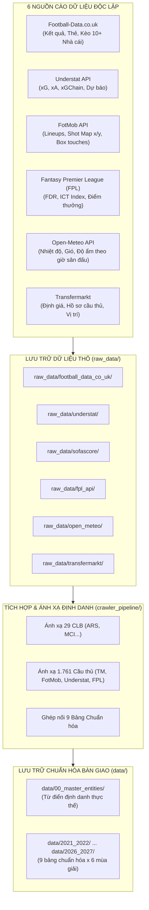

# 🗺️ Bản Đồ Lưu Trữ & Danh Mục Dữ Liệu Thu Thập (Data Inventory & Storage Map)

Tài liệu này ghi lại toàn bộ hệ sinh thái dữ liệu của dự án Premier League (2021/22 – 2026/27):
1. **Dữ liệu thô cào về được lưu ở đâu trong `raw_data/`**
2. **Dữ liệu sau khi tích hợp & chuẩn hóa được lưu ở đâu trong `data/`**
3. **Chi tiết các đặc trưng (features) và ý nghĩa trong từng bảng**

---

## 1. Kiến Trúc Luồng Dữ Liệu (Data Flow Architecture)



---

## 2. Chi Tiết Lưu Trữ Dữ Liệu Thô (`raw_data/`)

Thư mục `raw_data/` đóng vai trò là **Kho lưu trữ nguyên bản (Data Lake Staging)**, lưu trữ chính xác định dạng gốc (JSON/CSV) được tải về từ các API/Web scraper để có thể tái tạo hoặc kiểm toán (audit) bất kỳ lúc nào:

| Thư mục con trong `raw_data/` | Tệp dữ liệu đại diện | Nguồn gốc | Định dạng | Nội dung dữ liệu lưu trữ |
| :--- | :--- | :--- | :---: | :--- |
| `raw_data/football_data_co_uk/` | `football_data_raw_2627.csv`<br>`2021_2022.csv` ... `2025_2026.csv` | Football-Data.co.uk | CSV | Tỷ số FT/HT, trọng tài, số cú sút, phạt góc, thẻ phạt, và toàn bộ tỷ lệ cược mở/đóng của hơn 10 nhà cái lớn (Bet365, Pinnacle, William Hill, Betfair, Interwetten...). |
| `raw_data/understat/` | `understat_raw_2026_2027.json`<br>`understat_raw_2021_2022.json` ... | Understat API | JSON | Toàn bộ dữ liệu xG, xA, dự báo xác suất thắng/hòa/thua của Understat, xGChain và xGBuildup của từng cầu thủ theo mùa. |
| `raw_data/sofascore/` | `fotmob_fixtures_2026_2027.json`<br>`cache_2026_2027/{match_id}.json`<br>`cache_matches/` (1.900 file) | FotMob API REST | JSON | Lịch thi đấu, đội hình chính thức/dự bị, chỉ số chạm bóng trong vòng cấm, tranh chấp bóng, và toàn bộ tọa độ không gian sút bóng (Shot map). |
| `raw_data/fpl_api/` | `fpl_bootstrap_latest.json`<br>`fpl_fixtures_latest.json`<br>`bootstrap-static-5seasons.json` | Official FPL API | JSON | Chỉ số độ khó lịch thi đấu FDR (1-5), chỉ số sức mạnh CLB (công/thủ sân nhà/khách), bộ chỉ số ICT Index (Influence, Creativity, Threat), giá trị và điểm thưởng FPL. |
| `raw_data/open_meteo/` | `weather_cache_2026_2027.json`<br>`weather_1900_matches.json` | Open-Meteo Archive API | JSON | Dữ liệu thời tiết theo giờ diễn ra trận đấu tại tọa độ địa lý sân vận động: Nhiệt độ (°C), độ ẩm (%), tốc độ gió (km/h), lượng mưa (mm), mã thời tiết WMO. |
| `raw_data/transfermarkt/` | `epl_players.csv`<br>`epl_player_valuations.csv`<br>`epl_clubs.csv`<br>`epl_lineups.csv` | Transfermarkt | CSV | Hồ sơ nhân khẩu học (ngày sinh, vị trí, chân thuận, quốc tịch), lịch sử biến động giá trị chuyển nhượng (Market Value in EUR). |

---

## 3. Chi Tiết Lưu Trữ Dữ Liệu Tích Hợp Chuẩn Hóa (`data/`)

Thư mục `data/` là **Đầu ra chính thức bàn giao cho người làm Clean / Database**. Toàn bộ dữ liệu đã được giải quyết xung đột mã định danh (Entity Resolution), 100% khớp khóa ngoại, và được phân vùng theo từng mùa giải:

### 3.1. Phân vùng Thực Thể Dùng Chung (`data/00_master_entities/`)

| Tệp dữ liệu | Khóa chính | Số lượng bản ghi | Mục đích sử dụng |
| :--- | :---: | :---: | :--- |
| `clubs.csv` | `club_id` | 29 CLB | Danh mục tĩnh bất biến: Sân vận động, tọa độ địa lý (Lat, Lon), sức chứa khán đài, năm thành lập, tuổi trung bình đội hình. |
| `club_mapping.csv` | `club_id` | 29 CLB | Bảng tra cứu chéo định danh tên CLB giữa Football-Data, Transfermarkt, Understat, FPL, FotMob. |
| `players.csv` | `player_id` | 1.761 Cầu thủ | Hồ sơ tổng thể cầu thủ: Họ tên, ngày sinh, quốc tịch, chiều cao, chân thuận, vị trí chính/phụ, đỉnh giá trị thị trường, số lần khoác áo ĐTQG. |
| `player_mapping.csv` | `player_id` | 1.761 Cầu thủ | Bảng ánh xạ chéo mã định danh cầu thủ giữa Transfermarkt (`player_id`), FotMob (`fotmob_id`), Understat (`understat_id`), Opta (`opta_id`) và FPL (`fpl_name`). |

---

### 3.2. Cấu Trúc 9 Bảng Chuẩn Hóa Theo Từng Mùa Giải (`data/<season>/`)

Mỗi thư mục mùa giải (`2021_2022`, `2022_2023`, `2023_2024`, `2024_2025`, `2025_2026`, `2026_2027`) chứa đúng 9 bảng dữ liệu với cấu trúc cột đồng nhất:

```
data/<season>/
├── matches/
│   ├── match_context.csv            # Bối cảnh trận đấu, xG, thời tiết, FDR
│   ├── match_betting_odds.csv       # Kèo cá cược 10+ nhà cái, Overround, Implied Prob
│   └── match_lineups.csv            # Đội hình xuất phát & dự bị, số áo, vị trí
├── clubs/
│   ├── club_season_profile.csv      # Chỉ số sức mạnh CLB từ FPL
│   └── club_match_performance.csv   # Thống kê nâng cao từng trận của CLB (54 cột)
├── players/
│   ├── player_valuations.csv        # Timeline giá trị thị trường cầu thủ
│   ├── player_match_stats.csv       # Thống kê cá nhân trận đấu & FPL ICT Index
│   └── player_season_understat.csv  # Thống kê tích lũy Understat cả mùa
└── events/
    └── match_shots.csv              # Bản đồ tọa độ không gian sút bóng (Shot Map)
```

---

## 4. Danh Mục Đặc Trưng Chi Tiết Của 9 Bảng Chuẩn Hóa

### Bảng 1: `matches/match_context.csv` (44 cột)
* **Khóa chính**: `match_id` (Định dạng: `{season}_{home_club_id}_{away_club_id}`, ví dụ: `2026_2027_ARS_CHE`).
* **Đặc trưng cốt lõi**:
  - `season`, `gameweek`, `date`, `time`: Thời gian thi đấu.
  - `home_club_id`, `away_club_id`: Mã 3 chữ cái CLB nhà/khách.
  - `ft_home_goals`, `ft_away_goals`, `ft_result`: Kết quả chung cuộc (H/D/A).
  - `ht_home_goals`, `ht_away_goals`, `ht_result`: Kết quả hiệp 1.
  - `home_xg`, `away_xg`: Bàn thắng kỳ vọng toàn trận (Understat).
  - `home_xg_open_play`, `away_xg_open_play`, `home_xg_set_play`, `away_xg_set_play`: xG bóng sống / bóng chết.
  - `forecast_win`, `forecast_draw`, `forecast_loss`: Xác suất mô phỏng Understat Monte-Carlo.
  - `fdr_home`, `fdr_away`: Độ khó lịch thi đấu FPL (1: Dễ nhất, 5: Khó nhất).
  - `home_formation`, `away_formation`: Sơ đồ chiến thuật xuất phát.
  - `home_possession_pct`, `away_possession_pct`: Tỷ lệ kiểm soát bóng.
  - `referee`, `stadium`, `attendance`: Trọng tài bắt chính, sân thi đấu, lượng khán giả.
  - `weather_temperature_c`, `weather_humidity_pct`, `weather_precipitation_mm`, `weather_wind_speed_kmh`: Điều kiện thời tiết thực tế tại sân lúc bóng lăn.

---

### Bảng 2: `matches/match_betting_odds.csv` (119 cột)
* **Khóa ngoại**: `match_id` liên kết `match_context.csv`.
* **Đặc trưng nâng cao do pipeline tính toán**:
  - `overround_open`, `overround_close`: Biên lợi nhuận nhà cái lúc mở và chốt kèo.
  - `prob_h_open`, `prob_d_open`, `prob_a_open`: Xác suất ngụ ý kèo mở đã triệt tiêu biên lợi nhuận nhà cái (Shin/Equal margin removal).
  - `prob_h_close`, `prob_d_close`, `prob_a_close`: Xác suất ngụ ý kèo chốt.
  - `odds_drift_h`, `odds_drift_d`, `odds_drift_a`: Biên độ biến động kèo (`kèo_chốt - kèo_mở`).
* **Kèo 10+ nhà cái**:
  - Bet365 (`B365H`, `B365D`, `B365A`, `B365CH`, `B365CD`, `B365CA`)
  - Pinnacle (`PSH`, `PSD`, `PSA`, `PSCH`, `PSCD`, `PSCA`)
  - William Hill, Betfair, Bet-at-home, Interwetten, VBet...
  - Kèo Tài/Xỉu 2.5 (`B365>2.5`, `B365<2.5`, `P>2.5`, `P<2.5`)
  - Kèo Châu Á Asian Handicap (`AHh`, `B365AHH`, `B365AHA`, `PAHH`, `PAHA`).

---

### Bảng 3: `matches/match_lineups.csv` (8 cột)
* **Khóa chính**: Cặp `(match_id, player_id)`.
* **Đặc trưng**:
  - `match_id`, `club_id`: Trận đấu và câu lạc bộ.
  - `player_id`: ID chuẩn Transfermarkt Master (100% khớp `players.csv`).
  - `player_name`: Tên cầu thủ thi đấu.
  - `lineup_type`: `starter` (Đá chính) hoặc `bench` (Dự bị).
  - `position`: Vị trí thi đấu (1: GK, 2: DF, 3: MF, 4: FW).
  - `jersey_number`: Số áo thi đấu.
  - `is_captain`: `True` nếu đeo băng đội trưởng, `False` nếu không.

---

### Bảng 4: `clubs/club_season_profile.csv` (9 cột)
* **Khóa chính**: `(club_id, season)`.
* **Đặc trưng**:
  - `strength_overall_home`, `strength_overall_away`: Sức mạnh tổng thể sân nhà / sân khách FPL.
  - `strength_attack_home`, `strength_attack_away`: Sức mạnh hàng công sân nhà / sân khách.
  - `strength_defence_home`, `strength_defence_away`: Sức mạnh hàng thủ sân nhà / sân khách.

---

### Bảng 5: `clubs/club_match_performance.csv` (54 cột)
* **Bản ghi**: 2 dòng cho mỗi trận (1 dòng cho đội nhà, 1 dòng cho đội khách).
* **Đặc trưng kỹ thuật chi tiết**:
  - `goals_for`, `goals_against`, `result`: Bàn thắng, bàn thua, kết quả (W/D/L).
  - `xg`, `xg_open_play`, `xg_set_play`, `xg_non_penalty`: Chỉ số xG phân loại.
  - `shots`, `shots_on_target`, `shots_inside_box`, `shots_outside_box`: Thống kê sút.
  - `touches_in_opposition_box`: Số lần chạm bóng trong vòng cấm đối phương.
  - `passes`, `accurate_passes`, `pass_accuracy_pct`: Thống kê chuyền bóng.
  - `duels_won`, `ground_duels_won`, `aerial_duels_won`: Tranh chấp tay đôi và bóng bổng.
  - `successful_dribbles`: Số pha rê dắt bóng thành công.
  - `tackles`, `interceptions`, `clearances`, `keeper_saves`: Chỉ số phòng ngự.

---

### Bảng 6: `players/player_valuations.csv` (6 cột)
* **Khóa ngoại**: `player_id` liên kết `players.csv`.
* **Đặc trưng**:
  - `date`: Ngày ghi nhận định giá.
  - `market_value_in_eur`: Giá trị thị trường ước tính của cầu thủ (EUR).
  - `current_club_name`, `current_club_id`: CLB chủ quản tại thời điểm đó.

---

### Bảng 7: `players/player_match_stats.csv` (32 cột)
* **Khóa ngoại**: `match_id`, `player_id`.
* **Đặc trưng cá nhân từng trận**:
  - `minutes_played`: Số phút thi đấu thực tế trên sân.
  - `goals`, `assists`, `yellow_cards`, `red_cards`: Bàn thắng, thẻ phạt.
  - `shots_total`, `shots_on_target`, `shots_xg`, `shots_xgot`: Chỉ số sút bóng cá nhân.
  - `ict_index`, `influence`, `creativity`, `threat`: Bộ 3 chỉ số công nghệ ICT Index từ Opta/FPL.
  - `fpl_points`, `fpl_bonus`, `fpl_bps`: Điểm số Fantasy Premier League và điểm Bonus.
  - `fpl_xg`, `fpl_xa`, `fpl_xgi`: Đóng góp bàn thắng kỳ vọng cá nhân (xG Involvement).

---

### Bảng 8: `players/player_season_understat.csv` (19 cột)
* **Khóa ngoại**: `understat_player_id`, `club_id`.
* **Đặc trưng Understat tích lũy cả mùa**:
  - `games`, `minutes`, `goals`, `xg`, `assists`, `xa`.
  - `npg`, `npxg`: Bàn thắng và xG không tính phạt đền.
  - `key_passes`: Số đường chuyền tạo cơ hội dứt điểm.
  - `xg_chain`: Tổng xG của mọi chuỗi kiểm soát bóng mà cầu thủ tham gia.
  - `xg_buildup`: Tổng xG của chuỗi triển khai bóng từ tuyến dưới (không tính cú dứt điểm/key pass cuối cùng).

---

### Bảng 9: `events/match_shots.csv` (29 cột)
* **Bản ghi**: Mỗi dòng là 1 cú sút trong trận đấu.
* **Đặc trưng không gian (Spatial Features)**:
  - `shot_id`, `match_id`, `club_id`, `player_id`, `minute`, `period`: Thông tin định danh.
  - `x`, `y`: Tọa độ vị trí sút trên mặt sân (Chuẩn hóa `0.0 - 100.0`).
  - `on_goal_shot_x`, `on_goal_shot_y`: Tọa độ quỹ đạo bóng hướng vào khung thành (Goalmouth spatial coordinates).
  - `expected_goals` ($xG$): Xác suất thành bàn của cú sút.
  - `expected_goals_on_target` ($xGOT$): Chất lượng của pha dứt điểm trúng đích.
  - `shot_type`: Chân thuận, chân không thuận, hoặc đánh đầu (`RightFoot`, `LeftFoot`, `Header`).
  - `situation`: Tình huống dứt điểm (`OpenPlay`, `SetPiece`, `FromCorner`, `Penalty`).
  - `is_on_target`, `is_blocked`, `is_from_inside_box`: Phân loại kết quả cú sút.
