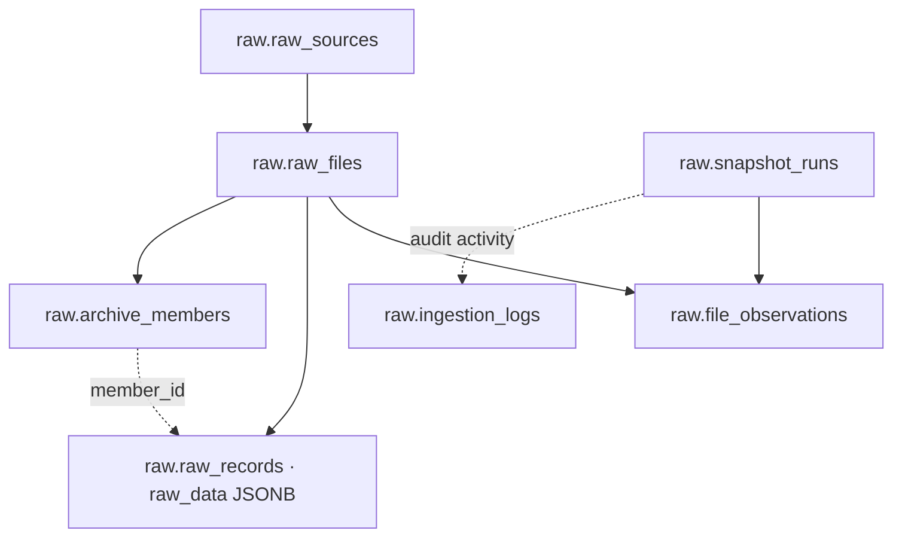
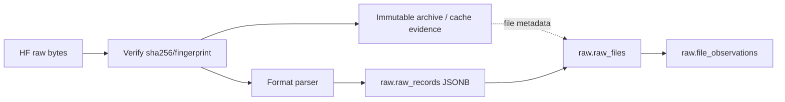

# M2 — Thiết kế Raw Storage & Data Model

**Vai trò:** chuyển yêu cầu M1 thành thiết kế lưu file version, raw JSONB, snapshot/lineage và audit. Đây là cách nhóm hóa tài liệu theo chức năng; trước khi dùng để chứng minh thứ tự milestone M2 chi tiết, cần đối chiếu với lịch sử commit.

## 1. Nguyên lý thiết kế

- **Raw giữ nguyên nội dung:** JSONB payload được đọc từ nguồn và lưu kèm metadata; Cleaning xử lý ở downstream.
- **Snapshot/lineage là lớp riêng:** một record vật lý thuộc phiên bản file (`file_id`); snapshot liên kết file version theo `relative_path`.
- **Reuse để tiết kiệm:** nếu nội dung file không thay đổi, snapshot mới tái sử dụng file version đã có thay vì tạo bản sao raw records.
- **Immutability + hash:** archive chứa nguồn nguyên bản, hash/metadata phục vụ kiểm toán và recovery.
- **Nullable evidence:** `league_code`, `season`, `event_time` có thể chưa xác định được từ dữ liệu nguồn.

## 2. Sơ đồ logical storage



**Cần xem `sql/schema/raw_schema_v2.sql` để xác nhận khóa/index/FK thực tế.** Mũi tên ở đây biểu thị cách hệ thống truy xuất dữ liệu, không phải tuyên bố tất cả có ràng buộc FOREIGN KEY.

## 3. Bảng dữ liệu chính

| Table | Grain logic | Mục đích |
|---|---|---|
| `raw.raw_sources` | một source identity | Ghi nhận nguồn upstream |
| `raw.snapshot_runs` | một lần snapshot / pinned revision | Trạng thái DDL: discovered/in_progress/completed/failed và dữ liệu đối chiếu |
| `raw.raw_files` | một bản file có identity/version | Format, content identity, record count, archive linkage |
| `raw.file_observations` | một file path quan sát trong một snapshot | `snapshot_id` + `relative_path` → `file_id` |
| `raw.archive_members` | một archive member (nếu có) | Truy vết JSON trong TAR.GZ |
| `raw.raw_records` | một raw record thuộc file version | Giữ JSONB và evidence/record locator |
| `raw.ingestion_logs` | sự kiện ingestion | Audit success/failure và hoạt động pipeline |

### `raw.raw_records` — cột đã xác minh live 24/10/2026

```text
record_id          bigint
file_id            bigint
member_id          bigint
record_locator     text
record_kind        varchar
raw_data           jsonb
league_code        text
season             varchar
event_time         timestamptz
metadata_evidence  jsonb
ingested_at        timestamptz
```

**Lưu ý:** `NULL` không tự động là lỗi. Smoke test trả về 1 row từ `2026_2027_new/football_data_raw_2627.csv` có `record_kind=csv_row`, còn `league_code` và `season` trống.

## 4. Phân biệt 4 loại định danh

- **HF revision:** định danh nguồn upstream bất biến cho một vòng đồng bộ.
- **Snapshot ID:** định danh một trạng thái hợp lệ của repo Raw Storage.
- **File ID / hash:** định danh một phiên bản file; nhiều snapshot có thể trỏ cùng file ID.
- **Record ID / locator:** định danh record và vị trí/loại record trong bản file tương ứng.

Đừng dùng `snapshot_id` làm khóa vật lý của `raw.raw_records`: dữ liệu được reuse vẫn phải đọc được ở snapshot mới thông qua `file_observations`.

## 5. File archive và PostgreSQL phối hợp thế nào?



Archive dùng để tái dựng/kiểm toán **byte gốc**; PostgreSQL JSONB dùng để phân tích và truy xuất theo bản ghi. Một record JSONB **không nhất thiết khôi phục lại chính xác byte format ban đầu** (CSV quoting, compression, container metadata...), vì vậy không được coi DB là thay thế cho raw archive.

## 6. Schema DDL và bảo mật

- `sql/schema/raw_schema_v2.sql`: `CREATE SCHEMA raw`, 7 bảng raw đã được kiểm kê.
- `sql/m4_4_handover_schema_v2.sql`: `CREATE SCHEMA handover`, 2 bảng `delivery_checkpoints` và `delivery_events`.
- Tên `RAW_STORAGE_DEPLOYMENT_V1.md` thuộc handover lịch sử, không có trong source release này. Dựng V2 từ `sql/schema/raw_schema_v2.sql`, `sql/m4_4_handover_schema_v2.sql` và [Operations](../OPERATIONS.md).
- `.env.example` / `.env.v2.example`: ví dụ cấu hình, không điền token/mật khẩu thật vào Git.

**Gate M2 → M3:** schema có thể ghi raw record JSONB kèm lineage; lưu file đa định dạng; thông tin snapshot và archive được biểu diễn rõ; có thể truy xuất một record theo `snapshot_id` + `relative_path`.

## 7. Kết quả đã xác minh

Snapshot #367: **296 file observations**, 296 relative paths/file IDs duy nhất, 8.502.614 logical record references; đã xác nhận kết nối PostgreSQL ở chế độ read-only. Đây là mốc kiểm chứng tích hợp ngày 24/10, không phải chứng cứ mọi migration có thể chạy không lỗi trên DB trắng (cần fresh-deploy validation).

Snapshot #368 nghiệm thu sau đó: **298 file observations**, 8.502.616 logical record references. Tự động hóa/recovery không đổi schema raw; các bằng chứng attempt/checkpoint bổ sung nằm ở local `reports/`. CI dùng fixtures, không provision PostgreSQL production.

**Bước kế tiếp:** [M3 — Basic Ingestion](../M3/README.md).
