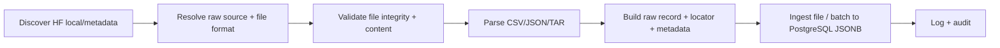

# M3 — Discovery, Validation, Parser & Basic Ingestion

**Vai trò:** hiện thực hóa tuyến thu thập metadata file → xác minh định dạng → chuyển record sang JSONB → ghi vào Raw Storage. M3 trong tài liệu này là **nhóm chức năng** đã triển khai; một số script có thể về sau được M4 gọi lại.

## 1. Mục tiêu chức năng

Mỗi raw file thuộc phạm vi EPL cần đi qua preflight có thể kiểm toán, trước khi dùng parser phù hợp và lưu record vào PostgreSQL. Yêu cầu vận hành: không silently skip dữ liệu không đúng định dạng, không mất metadata nguồn, và không phụ thuộc một schema CSV cố định.

## 2. Flow end-to-end ở mức file

Các bước công nghệ: kiểm `relative_path`, sha256/fingerprint, phân biệt format, chuẩn hóa record ở dạng JSON-compatible, giữ `record_kind`/`record_locator`, ghi `raw.raw_files` và `raw.raw_records`, đối chiếu record count. Các bước được M4 mở rộng thêm manifest pinned, immutable archive, reuse và snapshot lifecycle.

Đường incremental tự động hiện nhận candidate mới/thay đổi là **JSON và CSV không nén**. Parser/ingestion nền tảng còn đọc CSV.GZ/TAR.GZ, nhưng candidate nén thay đổi chưa được tự động hóa; file nén đã có vẫn được reuse. Kiểm thử CI bao gồm CSV+JSON hỗn hợp và malformed CSV trước registration. Xem [Automation](../AUTOMATED_INGEST.md).

## 3. Input / Output Contract

| Stage | Input | Output/điều kiện |
|---|---|---|
| Discovery | HF repo/revision, config, folder raw | danh sách file/path, định dạng, hash/metadata |
| Source resolver | relative path/format | source category, mapping hoặc trạng thái cần review |
| Validator | file bytes, expected metadata | PASS/FAIL với lý do, không tự chỉnh file nguồn |
| Parser | CSV, CSV.GZ, JSON, TAR.GZ | record JSON-compatible cùng vị trí gốc |
| Writer | normalized raw records + file metadata | file version, records JSONB, log |
| Audit | file/version, count, DB state | đối chiếu file, duplicate, record count và trạng thái |

**Không biến NULL metadata thành lỗi giả:** season/league của vài file có thể không có trong payload trực tiếp.

## 4. Module & config tiêu biểu đã có trong source inventory

> Đây là danh sách vị trí **đã thấy từ quá trình phát triển / release inventory**. Không khẳng định mọi module đều có một CLI độc lập; các entrypoint dưới M4/M5 là interface vận hành chính đã kiểm thử.

- `config/discovery_config.json` — tên đúng của file cấu hình Discovery.
- `config/source_mapping.json`, `config/csv_format_config.json` — source pattern và CSV variant.
- `scripts/raw_parser.py` — parser module nội bộ.
- `scripts/raw_access/raw_reader.py` — lớp đọc định dạng raw trong pipeline nội bộ.
- `scripts/tools/batch_ingestion.py`, `scripts/tools/chunked_batch.py`, `scripts/tools/ingestion_helper.py` — helpers ingestion.
- `scripts/tools/archive_manager.py`, `scripts/tools/verify_archive.py` — file/archive helpers.
- `scripts/tools/raw_sync_preflight.py`, `scripts/tools/raw_sync_write_plan.py` — preflight và write plan helpers.
- `scripts/discovery/hf_manifest_v2.py` — HF manifest/discovery logic.
- `scripts/incremental/check_raw_updates.py` — kiểm tra thay đổi raw.

Lịch sử phát triển cũng bao gồm các module `discover_files.py`, `source_resolver.py`, `raw_validator.py`, `raw_reader.py`, `check_file_duplicate.py`, `ingestion_logger.py`, `archive_raw_file.py`, `ingest_one_file.py`, `run_preflight.py`; **đường dẫn/trạng thái chính xác của chúng chưa được xác minh bởi release inventory hiện tại**, do đó không đưa thành lệnh chính thức trong README.

## 5. Quy tắc validation quan trọng

1. Không ingest file bất kỳ chỉ vì nó tồn tại: phải nhận diện đúng **RAW scope** và định dạng hợp lệ.
2. Mọi record cần giữ lineage đến file version/locator; TAR.GZ phải có khả năng truy vết archive member khi parser cấp evidence.
3. Kiểm số record dự kiến của CSV/CSV.GZ so với kết quả parse/ingest theo contract file.
4. Dữ liệu không đổi qua commit khác nhau phải có khả năng **reuse** về sau (xem M4), thay vì sao chép file/record.
5. File bất thường hoặc parse thất bại phải dừng/review, không báo giả `completed`.

## 6. Kết quả kiểm chứng và giới hạn

- Parser/reader CSV/JSON/TAR và preflight từng được kiểm thử trên dữ liệu mẫu, gồm `football_data_raw_2627.csv` và TAR.GZ.
- Mốc nghiệm thu #367 có **86 CSV, 9 CSV.GZ, 199 JSON, 2 TAR.GZ**. Snapshot #368 sau đó có **86 CSV, 9 CSV.GZ, 201 JSON, 2 TAR.GZ**; CSV được truy xuất dạng `csv_row` qua Data Access.
- Bằng chứng này xác nhận các định dạng đã có dữ liệu trong Raw Storage, **không phải** benchmark khả năng ingest mọi biến thể file trong tương lai.

## 7. Handover sang M4

M3 đưa ra file metadata, record reader/parser, validation và tầng ghi DB cơ bản. **M4** bổ sung vòng đời snapshot đầy đủ, manifest, planner, cache, archive bất biến, hash-based reuse, checkpointing, register/recovery. Không tự chạy lại tool M3 trực tiếp để cập nhật một snapshot đã `completed` khi M4 có runner an toàn hơn.

**Bước kế tiếp:** [M4 — Incremental Raw Storage](../M4/README.md).
