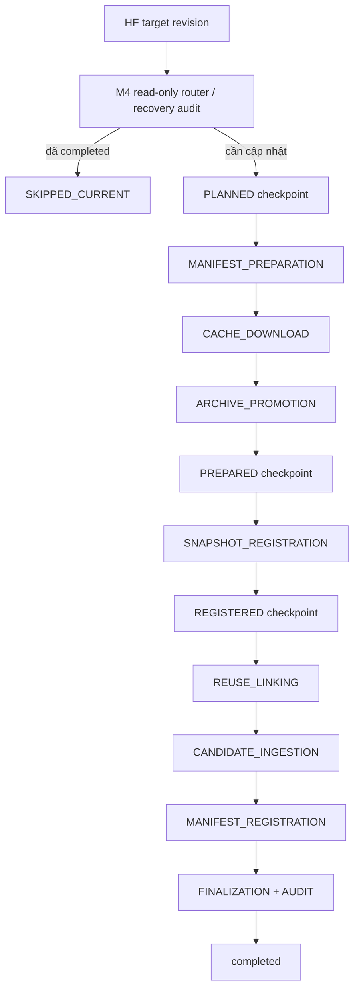

# M4 — Incremental Raw Storage, Immutable Archive & Recovery

**Mục tiêu:** khi Hugging Face có commit mới, chỉ nạp nội dung file thực sự mới/thay đổi, liên kết lại file không đổi, tạo snapshot có thể kiểm toán và chỉ đánh dấu `completed` khi các điều kiện nhất quán đạt yêu cầu.

## 1. Vì sao phải có M4?

M3 cho phép đọc/ingest raw, nhưng cập nhật theo ngày cần giải quyết: tệp thay đổi ở cùng path, có ngày không có dữ liệu mới, nhiều định dạng/phần tử TAR, lỗi mạng/ghi dở, retry nguy hiểm và nhu cầu tái lập đúng phiên bản nguồn. M4 đưa việc ingest lên mô hình **pinned revision + manifest + archive + DB snapshot + independent audit**.

## 2. Các định danh và bằng chứng

| Khái niệm | Nội dung |
|---|---|
| HF repo / target revision | Pin `Toibinguz/epl-premier-league-dataset` tại một commit SHA40 |
| Baseline snapshot | Snapshot `completed` được dùng làm điểm đối chiếu |
| Planned context | Kế hoạch immutable: target, baseline, file candidates/reuse, fingerprint và các digest đã kiểm chứng |
| Manifest | Danh sách file trong full snapshot, RAW scope riêng, bằng chứng phiên bản và bản archive của manifest |
| Candidate cache | Byte của file NEW/CHANGED tải/kiểm tra trước khi promotion |
| Immutable archive | Bản file content-addressed, **create-only**, không cho sửa âm thầm |
| PostgreSQL snapshot | Snapshot metadata và liên kết file version + records |
| Checkpoint | `PLANNED`, `PREPARED`, `REGISTERED` đã được chứng thực bằng digest/evidence |

**Quan trọng:** `UNCHANGED` không cần ingest lại record vật lý; `file_observations` của snapshot mới tái liên kết tới phiên bản file hiện hữu.

## 3. Vòng đời từng stage



Thứ tự là **contract vận hành**. M5 `auto_ingest --run` điều phối toàn luồng bằng context/evidence đã xác minh. Supervised Runner vẫn xử lý **một** stage mỗi lệnh với approve riêng; không dùng review state để tự suy đoán quyền ghi.

### Những stage ghi dữ liệu / xuất bản bằng chứng

| Stage | Tác dụng chính | Ghi vào đâu? |
|---|---|---|
| `PLANNED` | Xuất bản plan context immutable | checkpoint/report local |
| `MANIFEST_PREPARATION` | Publish manifest + immutable manifest archive | local artifacts |
| `CACHE_DOWNLOAD` | Download/verify candidate raw bodies | candidate cache |
| `ARCHIVE_PROMOTION` | Promote verified bytes thành immutable archive | raw archive local |
| `PREPARED` | Kiểm tra evidence cho candidates và xuất bản checkpoint | checkpoint local |
| `SNAPSHOT_REGISTRATION` | Tạo snapshot DB cho revision đích | PostgreSQL |
| `REGISTERED` | Đối chiếu DB và xuất bản checkpoint | checkpoint local |
| `REUSE_LINKING` | Gắn file versions đã có vào snapshot | PostgreSQL |
| `CANDIDATE_INGESTION` | Ingest candidate file/record mới vào JSONB | PostgreSQL |
| `MANIFEST_REGISTRATION` | Hoàn thiện metadata file manifest của snapshot | PostgreSQL |
| `FINALIZATION` | Kiểm count/identity và chốt completed | PostgreSQL |

## 4. Modules thực tế có trong pipeline

Các path dưới đây xuất hiện trong source audits hoặc interface M5 và là **điểm tham khảo**; trước khi gọi riêng các writer M4, phải dùng `--help`/plan và xem guard thực tế.

- `scripts/incremental/incremental_guarded_stage_planner.py`: phân tích recovery và stage review, read-only.
- `scripts/incremental/incremental_guarded_stage_executor.py`: guarded plan/review, **không** tự trở thành Writer.
- `scripts/incremental/incremental_recovery_audit.py`: đánh giá trạng thái dở dang.
- `scripts/incremental/prepare_incremental_manifest.py`: manifest plan/publish.
- `scripts/incremental/download_incremental_candidates.py`: candidate download.
- `scripts/incremental/promote_incremental_archive.py`: promote immutable archive.
- `scripts/incremental/incremental_execution_context.py`: checkpoint immutable, digest, read/write contract.
- `scripts/incremental/incremental_runner_contracts.py`: build Prepared/Registered từ evidence.
- `scripts/incremental/register_incremental_snapshot.py` và writer tương đương cho reuse/ingestion/manifest/finalization: chỉ vận hành qua guard được phê duyệt.
- `scripts/tools/` gồm các wrapper và verifier bổ trợ (kiểm tra cụ thể tại working tree).

**Không ghép các cờ `--publish`, `--download`, `--promote`, `--confirm-*` của M4 để vượt M5 journal.** Vận hành thường ngày dùng `scripts.orchestration.auto_ingest`; supervised entrypoint dành cho kiểm tra/chuyên biệt. Các tùy chọn gốc phải có pinned evidence.

## 5. Xử lý `PREPARATION_PARTIAL` / Router Alignment

M4 recovery audit có thể trả về `PREPARATION_PARTIAL` và router chỉ ra `MANIFEST_PREPARATION` **như audit entrypoint chung**. Điều này **không chứng minh** Manifest chưa tồn tại hoặc cần publish lại.

M5 bổ sung `preparation_evidence_resolver` và `safe_stage_transition` để xử lý trường hợp Manifest đã VERIFIED nhưng Cache/Archive vẫn thiếu. Chỉ khi evidence của từng stage trước và durable journal hợp lệ mới được xem xét scoped `CACHE_DOWNLOAD`/`ARCHIVE_PROMOTION`. Router M4 vẫn là nguồn điều kiện tổng quát; không làm giả Router hay tự động nhảy stage.

## 6. Recovery và các invariant không được phá

1. **Một pinned revision**: không tự chuyển sang HF `main` mới giữa stage.
2. **Immutable archive**: không ghi đè bytes/hash khác lên đường dẫn đã có.
3. **Không publish checkpoint ngược thời gian** cho completed snapshot lịch sử.
4. **Completed/no-change**: đọc mà không có mutation; kết quả `SKIPPED_CURRENT` là bình thường.
5. **Writer ambiguous:** nếu crash sau claim/bắt đầu ghi và chưa có chứng cứ hoàn tất, phải dừng/audit; **không tự retry**.
6. **Snapshot #367:** đã `completed` nên không chạy lại Writer trên revision `708a15b7...`.

Controlled Auto-Recovery bổ sung ledger append-only mà không đổi M5 claim gốc. Chỉ writer đã thoát với lỗi tạm thời nhận diện được mới có thể retry sau audit thiếu hợp lệ. Terminal success được xác minh/khôi phục checkpoint, không ghi lại. Budget không reset theo lượt. [Chính sách recovery](../CONTROLLED_AUTO_RECOVERY.md) giữ nguyên invariant writer ambiguous phải dừng.

## 7. Bằng chứng nghiệm thu đã xác minh

- Snapshot #365 baseline ghi nhận 286 raw files; sau đó sync incremental trên revision `d3648ed9...` với 10 NEW, 4 CHANGED, 282 UNCHANGED, 14 candidates; đã nghiệm thu kế hoạch và evidence ở những bước tương ứng.
- Snapshot #367 pinned `708a15b7589e8c43347827b13e6e9ac8def871b0`; 296 RAW files (293 reuse, 3 candidates), candidate 72 records, đã được xác nhận `completed` và audit độc lập.
- Ngày 24/10: A5.1 xác nhận **314 full manifest entries, 296 raw observations, 8.502.614 logical record references**.
- M5 read-only check trên HF `main` trả `SKIPPED_CURRENT`, exit=0, không Writer.
- Ngày 25/10: `auto_ingest --run` tạo snapshot #368 completed từ baseline #367; 292 REUSE + 6 candidate JSON, 385 record mới; audit 298 archive/8.502.616 tham chiếu record. JSON/CSV hỗn hợp có integration test; chưa có live revision mới với CSV thay đổi.

Số lượng nói trên là các checkpoint tại **thời điểm đã nghiệm thu**, không phải giá trị cứng phải xuất hiện ở mọi snapshot sau.

## 8. Giao diện vận hành ưu tiên

```powershell
# Chỉ kiểm tra, chạy tự động hoặc đọc kết quả gần nhất
& .\venv\Scripts\python.exe -B -m scripts.orchestration.auto_ingest --check
& .\venv\Scripts\python.exe -B -m scripts.orchestration.auto_ingest --run
& .\venv\Scripts\python.exe -B -m scripts.orchestration.auto_ingest --status

# Preview chuyên biệt một stage, sau khi xác minh baseline và SHA40 thật
& .\venv\Scripts\python.exe -B -m scripts.orchestration.supervised_pipeline_runner `
    --plan --stage PLANNED --target-revision "<FULL_SHA40_FROM_HF>" --baseline-snapshot 368
```

Lệnh `--plan` không ủy quyền Writer. Muốn thực thi một stage cần đầy đủ digest từ cùng phiên preview và phê duyệt rõ ràng. Xem [M5](../M5/README.md) và [Operations](../OPERATIONS.md). **Không dùng literal placeholder SHA40 trong chạy thật.**

**Bước kế tiếp:** [M5 — Automation, Guard & Data Access](../M5/README.md).

**Module compatibility:** Các wrapper trong [`scripts/tools/`](../../scripts/tools/) chuyển tiếp tới module chính trong [`scripts/incremental/`](../../scripts/incremental/), [`scripts/discovery/`](../../scripts/discovery/) và [`scripts/verification/`](../../scripts/verification/). Không xóa các wrapper có import cũ hoặc SHA256 pin.
