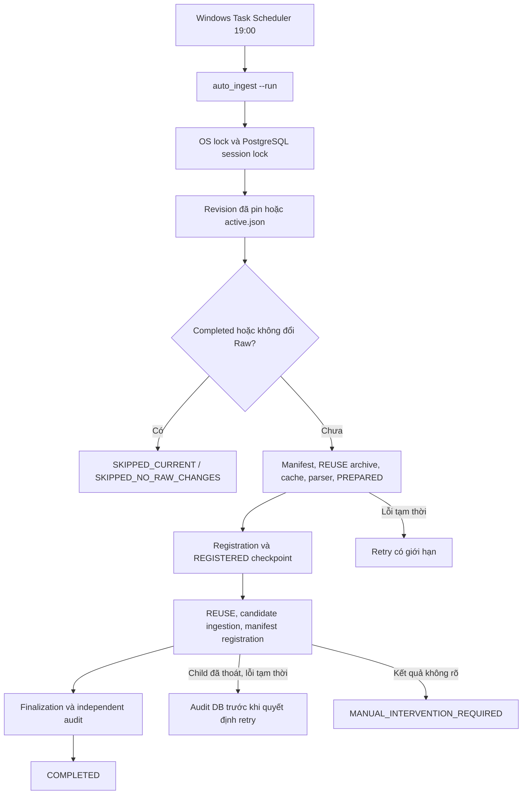

# M5 — Automation, Recovery, Scheduling & Raw Data Access

M5 hiện điều phối ingest tự động JSON/CSV, Controlled Auto-Recovery và bàn giao read-only cho Cleaning. `auto_ingest --run` đã nghiệm thu revision HF mới thành snapshot **#368 completed**. Task 19:00 gọi entrypoint này; monitor/supervised cũ tiếp tục phục vụ đánh giá chuyên biệt.

## 1. Phân hệ hiện tại

| Phân hệ | Module | Trách nhiệm |
|---|---|---|
| Automatic runner | `auto_ingest.py`, `auto_ingest_backend.py` | Pin revision, chuẩn bị, gọi M4 writer, audit completed |
| Retry policy | `auto_recovery.py` | Phân loại lỗi và retry thao tác an toàn có backoff/jitter |
| Controlled write recovery | `controlled_ingest_dispatch.py`, `auto_recovery_journal.py` | Đối soát process/DB và ledger create-only cho các attempt |
| Windows scheduling | `scripts/scheduling/install_windows_task.ps1`, `run_windows_task.ps1` | AutoIngest 19:00 và log/exit code |
| Monitor | `commit_watcher.py`, `controller.py`, `end_to_end_readonly.py`, `unified_incremental_runner.py` | Chỉ đọc revision/checkpoint và đưa ra review state |
| Supervised/checkpoint gates | `supervised_pipeline_runner.py`, `single_stage_write_executor.py`, `checkpoint_lifecycle.py`, `guarded_preparation_executor.py`, `safe_stage_transition.py` | Thao tác riêng một stage với pinned context/intent và xác nhận |
| Durable guard | `write_attempt_guard.py`, `durable_attempt_recovery_audit.py` | M5 claim/result gốc; không tự mở khóa claim mơ hồ |
| Cleaning access | `scripts/access/raw_data_access.py` | Đọc completed snapshot bằng phân trang |

## 2. Luồng đang vận hành



Luồng tự động sử dụng M4 primitives/writers và kiểm chứng riêng; không dùng `supervised_pipeline_runner --execute-one-stage` làm action lịch. [AUTOMATED_INGEST.md](../AUTOMATED_INGEST.md) mô tả từng stage.

## 3. Vận hành và lịch

```powershell
& .\venv\Scripts\python.exe -B -m scripts.orchestration.auto_ingest --check
& .\venv\Scripts\python.exe -B -m scripts.orchestration.auto_ingest --run
& .\venv\Scripts\python.exe -B -m scripts.orchestration.auto_ingest --status
```

Task `EPL Raw Storage - Safe Revision Check` giữ tên cũ, action hiện là `run_windows_task.ps1 -Mode AutoIngest`. Máy dùng UTC+7; task cần người dùng Windows đăng nhập, PostgreSQL và mạng hoạt động. `StartWhenAvailable`, `IgnoreNew`, giới hạn 12 giờ; scheduler không retry toàn job mù.

```powershell
powershell.exe -NoProfile -ExecutionPolicy Bypass -File .\scripts\scheduling\install_windows_task.ps1 `
    -Mode AutoIngest -At '19:00' -Replace -Install
```

Installer mặc định `Check` để giữ tương thích; phải chọn `AutoIngest` để cài lịch ghi tự động. Lịch ở cùng đường dẫn tự nạp source recovery đã cập nhật. [Operations](../OPERATIONS.md) có cách kích hoạt thử và phân tích receipt.

## 4. Controlled Auto-Recovery

Mặc định 3 lần thử, cơ sở chờ 2 giây, trần 30 giây và jitter. Context giữ một revision xuyên lượt. Writer chỉ được chạy tiếp sau lỗi tạm thời khi child đã kết thúc và audit mới xác nhận thiếu nhưng hợp lệ; file đã commit được kiểm chứng/bỏ qua. Terminal success có thể dùng để hoàn thiện readback/checkpoint mà không ghi lại.

M5 claim gốc bất biến. Ledger recovery gắn hash claim, context, argv và kết quả attempt trước. Budget writer giữ qua các lượt. Claim thiếu terminal evidence, writer timeout/crash, sai hash hoặc evidence mâu thuẫn cần can thiệp. Quy tắc và report field: [CONTROLLED_AUTO_RECOVERY.md](../CONTROLLED_AUTO_RECOVERY.md).

## 5. Monitor và supervised cũ

`unified_incremental_runner --check` chỉ phát hiện revision; `REVIEW_*` là thông báo cần xem xét. `supervised_pipeline_runner` giữ hợp đồng một stage với pinned SHA, context/intent digest và confirm flag. Không lấy preview làm quyền ghi hoặc ghép cờ M4 để vượt journal.

Đây là interface A2–A4 giữ tương thích, có giới hạn nghiệm thu riêng. Một số router cũ mặc định JSON-only hoặc từ chối explicit baseline trong recovery; runner tự động sử dụng context/evidence M4 đã xác minh. Khi điều tra, đối chiếu cả journal M5 và ledger recovery mới.

## 6. Raw Data Access cho Cleaning

```powershell
& .\venv\Scripts\python.exe -B -m scripts.access.raw_data_access --list-files --snapshot-id 368 --limit 5
& .\venv\Scripts\python.exe -B -m scripts.access.raw_data_access --records --snapshot-id 368 `
    --path '2026_2027_new/football_data_raw_2627.csv' --limit 2
```

DB `epl_raw_storage_v2`, transaction read-only, completed snapshot và observed path là bắt buộc. Keyset pagination dùng `next_after_path`/`next_after_record_id`; tối đa 50 record/page, 8 MiB/output. `league_code`, `season` có thể NULL. Raw không chạy Cleaning. Xem [handover contract](../raw_data_handover.md).

## 7. Bằng chứng và giới hạn

- Snapshot #368, revision `57d166f42099a561483f5d96aa0b4e93207fac6d`: 298 raw observations, 6 candidate JSON, 292 REUSE, 385 raw record được thêm; audit 298 archive và 8.502.616 tham chiếu record.
- Chạy lại và kích hoạt qua scheduler trả `SKIPPED_CURRENT`, không ghi trùng. Fault injection source connection trước khi đọc nguồn thật trả `RECOVERED`.
- Nghiệm thu recovery ngày 25/10: 1.968 test chạy, 17 skip, không lỗi. CI chạy cả test phát sinh về sau; số skip tùy OS/quyền symlink.
- CSV+JSON hỗn hợp được kiểm integration bằng fixture transport/SQL storage và parser/writer thật. Chưa nghiệm thu revision HF mới có CSV thay đổi trên deployment thật.
- Chưa quan sát lượt tự phát đúng 19:00 sau nâng cấp; chưa nghiệm thu fresh DB từ bước tạo baseline.
- CSV.GZ/TAR.GZ mới/thay đổi, path bị xóa hoặc vượt budget còn bị chặn; file nén không đổi vẫn reuse.

GitHub [CI](../../.github/workflows/ci.yml) và [dispatch trên storage host](../../.github/workflows/raw-ingest.yml). Source release giữ `.github/`, config mẫu, tests và docs; runtime/secrets thuộc hệ thống triển khai.
