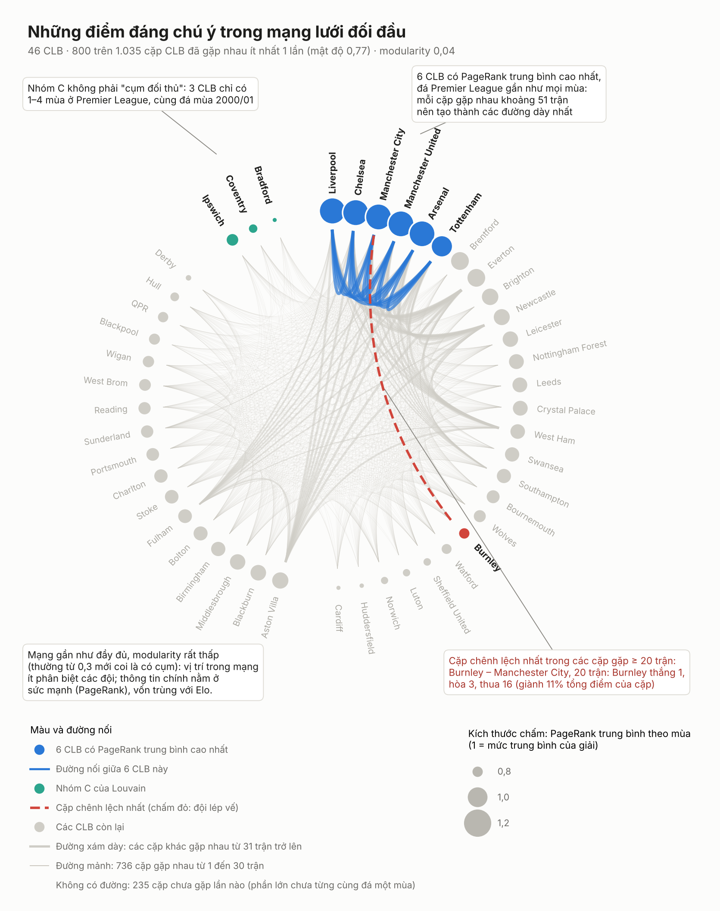
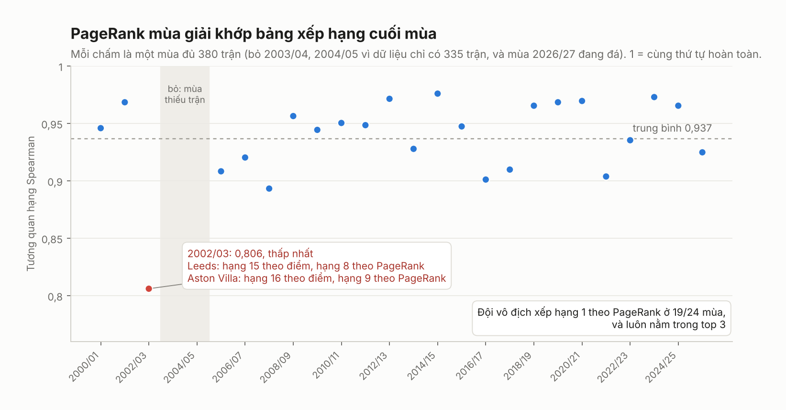

# Link Analysis – Mạng lưới đối đầu Premier League

Xem mỗi CLB là một **nút**, mỗi trận là một **cạnh**, rồi hỏi: vị trí của một đội trong mạng lưới đối đầu có giúp dự đoán trận tiếp theo không?

**Kết luận.** PageRank là thước đo sức mạnh hợp lý (khớp bảng xếp hạng cuối mùa: tương quan hạng Spearman trung bình 0,937 trên 24 mùa đủ trận), nhưng **đặc trưng đồ thị không cải thiện dự đoán** so với 85 đặc trưng số sẵn có trong `features.csv`, vì trùng thông tin với Elo (tương quan Pearson với `elo_diff` từ 0,65 đến 0,94).

Dữ liệu: `matches.csv`, `features.csv` của khâu Tích hợp dữ liệu, 9.850 trận đã đá từ 2000/01 đến 12/10/2026 (mùa 2026/27 mới có 60 trận).

**Xem nhanh:** mở [`link_analysis_tung_buoc.ipynb`](link_analysis_tung_buoc.ipynb). Notebook đi lại toàn bộ luồng dưới đây, mỗi bước có giải thích, bảng và hình; kết quả đã lưu sẵn nên xem trên GitHub không cần chạy.

## Luồng xử lý

```
clean/matches.csv ─► [1] build_graph_features.py ─► results/graph_features_matches.csv   9 cột gr_*, khóa match_id
        │
        └──────────► [2] network_analysis.py ─────► results/node_*.csv, edges_alltime.csv, notable_pairs.csv
                                                      figures/1, 1b, 2, 3
clean/features.csv ─► [3] evaluate.py ────────────► results/evaluation.txt, evaluation_summary.csv,
   (+ kết quả [1])                                    feature_candidates_link_analysis.csv, figures/4
```

| Bước | Làm gì | Kết quả chính |
|---|---|---|
| **1. Dựng đồ thị, tính đặc trưng** | Mỗi trận cho đội nhà một phần điểm `s = 0,5 + 0,5 × clip(hiệu số, −3, 3) / 3`; bên thua "bầu" cho bên thắng theo `s`. PageRank cao khi thắng được đội mạnh. Với mỗi ngày D, đồ thị **chỉ dùng các trận trước D** trong 3 năm, trận cũ nhẹ dần (nửa đời 365 ngày). | 9 cột `gr_*` cho 9.850 trận; kiểm chứng không rò rỉ bằng `--selftest` và `tests/` |
| **2. Phân tích mạng lưới** | Mật độ, cộng đồng Louvain, PageRank từng mùa so với bảng xếp hạng. Phần này chỉ mô tả, dùng toàn bộ dữ liệu, không đưa vào mô hình | 46 CLB; 800 trên 1.035 cặp đã gặp ít nhất 1 lần (mật độ 0,77, gần đầy đủ); modularity 0,04 (không có cụm rõ); Spearman 0,937 |
| **3. Đánh giá** | Thêm 5 đặc trưng đồ thị vào 85 đặc trưng số của `features.csv` (mọi cột số trừ cột định danh và kết quả). Kiểm thử từng mùa 2010/11 – 2026/27, mỗi mùa chỉ học từ các mùa trước (6.140 trận). So log loss; khoảng tin cậy (KTC) 95% của chênh lệch tính bằng bootstrap theo cặp | Không cải thiện (bảng dưới) |

| Gradient Boosting | Log loss | Ghi chú |
|---|---|---|
| 85 đặc trưng | 0,9835 | tham chiếu |
| 85 đặc trưng + đồ thị | 0,9845 | +0,0011, KTC 95% [−0,0009; +0,0029]: không cải thiện |
| Chỉ Elo / chỉ 5 đặc trưng đồ thị / chỉ kèo | 0,9887 / 0,9914 / 0,9755 | đồ thị một mình gần bằng Elo (kém hơn 0,003) |

Log loss càng thấp càng tốt. Logistic Regression cho cùng kết luận (0,9885 → 0,9894, KTC [+0,0002; +0,0016]: hơi kém đi). Giả thuyết **H4** của EDA (đối đầu bổ sung thông tin sau Elo và phong độ) cũng được kiểm định: **không được ủng hộ**. Chi tiết: `results/evaluation.txt`.

## Hình

| | |
|---|---|
|  |  |
| **Mạng lưới đối đầu.** Mỗi đường là một cặp đã gặp nhau (đường mảnh: 1–30 trận, đường dày: từ 31 trận); không có đường là chưa gặp lần nào. 6 CLB mạnh nhất tạo các đường dày nhất; mạng gần đầy đủ và không có cụm rõ. Bản thường: `figures/1_mang_luoi.png`. | **Kết quả đánh giá.** Vạch khoảng tin cậy của cấu hình có đồ thị cắt qua 0 hoặc nằm bên phải: không tốt hơn. |
|  |  |
| **PageRank so với bảng xếp hạng.** Khớp cao ở mọi mùa đủ trận; đội vô địch xếp hạng 1 theo PageRank ở 19/24 mùa và luôn trong top 3. | **Ví dụ 2015/16.** Leicester vô địch, nhưng Tottenham đứng đầu PageRank: PageRank tính cả cách biệt tỷ số, và Tottenham thắng cách biệt từ 3 bàn 9 trận (Leicester 4). |

## Kết quả bàn giao

| Khâu | File | Cách dùng |
|---|---|---|
| Xây dựng mô hình | `results/graph_features_matches.csv` | Ghép vào `features.csv` theo `match_id` (đoạn mã dưới). Không bắt buộc dùng, xem kết luận. |
| Xây dựng mô hình, EDA | `results/feature_candidates_link_analysis.csv`, `results/hypotheses_link_analysis.csv` | Cùng khuôn với `feature_candidates.csv`, `hypotheses.csv` của EDA; nối thẳng vào danh mục chung. |
| Trực quan hóa | `results/edges_alltime.csv`, `results/node_metrics_*.csv`, `figures/` | Có cột `club_id` chuẩn của nhóm để ghép dữ liệu. |
| Xây dựng mô hình (mô hình tuyến tính) | ghi chú | Cắt mỗi cột về phân vị 1–99% trước khi chuẩn hóa: Logistic Regression trên 85 đặc trưng từ log loss 1,156 xuống 0,9885. Ngay cả khi đó, chỉ dùng `elo_diff` vẫn tốt hơn (0,9815), nên chọn lọc đặc trưng thay vì dùng hết. |

```python
graph = pd.read_csv("link_analysis/results/graph_features_matches.csv")
df = features.merge(graph.filter(regex="^(match_id|gr_)"), on="match_id", how="left")
```

| Cột | Ý nghĩa (dương = lợi cho đội nhà) |
|---|---|
| `gr_pagerank_home`, `gr_pagerank_away`, `gr_pagerank_log_ratio` | PageRank hai đội và log tỉ số |
| `gr_common_opp_diff`, `gr_common_opp_n` | Kết quả gián tiếp qua đối thủ chung, số đối thủ chung |
| `gr_trans2_diff` | Ưu thế bắc cầu 2 bước (A thắng C, C thắng B) |
| `gr_h2h_share`, `gr_h2h_gd`, `gr_h2h_weight` | Đối đầu trực tiếp có trọng số thời gian, co về trung tính khi ít trận |

## Cấu trúc thư mục

```
link_analysis/
├── README.md
├── link_analysis_tung_buoc.ipynb   đi lại toàn bộ luồng, khoảng 2 phút
├── run_all.sh                      chạy lại mọi bước bằng script
├── requirements.txt
├── src/
│   ├── build_graph_features.py     bước 1
│   ├── network_analysis.py         bước 2
│   ├── evaluate.py                 bước 3
│   └── figures.py                  mọi hình (dùng chung cho script và notebook)
├── tests/test_graph_features.py    6 kiểm thử: công thức, đối chiếu networkx, rò rỉ, toàn vẹn đầu ra
├── results/                        11 file kết quả
└── figures/                        5 hình
```

## Chạy lại

Đặt `matches.csv`, `features.csv` (thư mục `clean/` của dataset Hugging Face) cạnh thư mục này.

**Từng bước trong Jupyter** (khoảng 2 phút):

    pip install -r requirements.txt jupyter
    jupyter notebook link_analysis_tung_buoc.ipynb

**Toàn bộ bằng script** (sinh lại mọi file trong `results/` và `figures/`, khoảng 25 phút, phần lớn là bước 3):

    pip install -r requirements.txt
    bash run_all.sh matches.csv features.csv

Dữ liệu cho kết quả hiện tại: 9.850 trận, 2000/01 – 12/10/2026, cùng bản với báo cáo EDA (trùng SHA-256).
