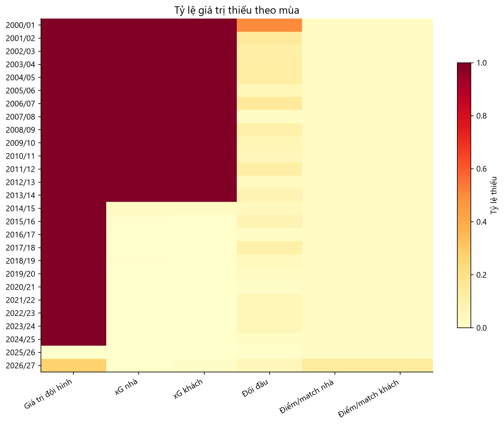

# 01 — Phạm vi và chất lượng dữ liệu

[Mục lục](00_muc_luc.md) · [Báo cáo gộp](report.md)

## Biểu đồ 01: Giá trị thiếu theo mùa

**Cách đọc:** Mỗi ô là tỷ lệ thiếu của một đặc trưng trong một mùa. Màu đậm hơn nghĩa là tỷ lệ thiếu cao hơn. Đây là tỷ lệ theo mùa, không phải tỷ lệ gộp toàn bộ dữ liệu.

**Nhận xét:** `squad_value_log_ratio` thiếu 9.431/9.867 dòng (95,6%), chủ yếu chỉ hiện diện từ 2025/26; không đủ để làm biến chính cho mô hình nhiều mùa. Hai cột xG 5 trận đều thiếu 5.248 dòng (53,2%), tập trung ở các mùa cũ vì dữ liệu xG chỉ có từ giai đoạn sau. `h2h_home_ppg` thiếu 801 dòng (8,1%). Các đặc trưng phong độ khác cũng có thể thiếu ở đầu lịch sử của từng đội.

**Hệ quả phân tích:** So sánh mô hình có xG cần giới hạn vào cùng những mùa có xG và đánh giá trên **cùng số trận** với mô hình không xG. Nếu không, chênh lệch điểm đánh giá có thể do khác tập trận hoặc khác thời kỳ. Chỉ học giá trị điền thiếu trên tập huấn luyện của từng lần chia theo thời gian; không thay dữ liệu thiếu bằng 0 khi 0 mang ý nghĩa thật.

**Kiểm tra cơ bản:** Không có khóa trận trùng theo `season`, `date`, `home_team`, `away_team`; không có kết quả H/D/A trái với tỉ số; không có ngày không đọc được. Hai mùa 2003/04 và 2004/05 mỗi mùa có 335 trận thay vì 380. Mùa 2026/27 hiện có 70 trận trong nguồn chính, còn cache Understat đánh dấu 79; cần đồng bộ nguồn trước khi báo cáo xu hướng mùa đang diễn ra.
