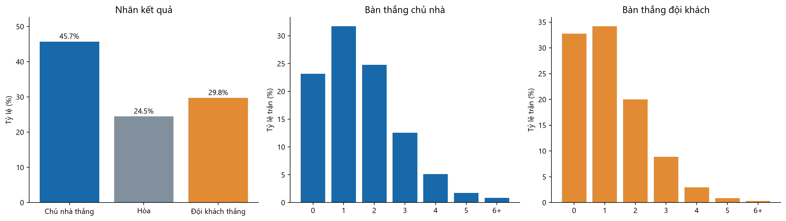
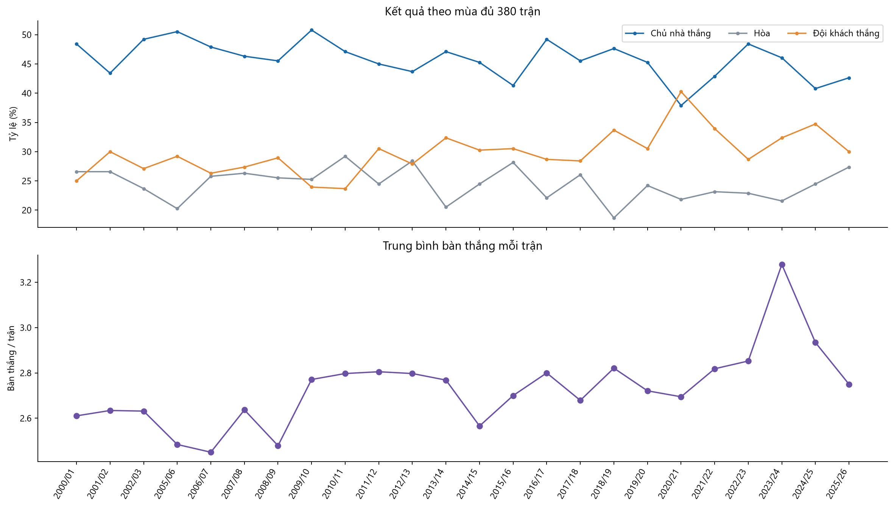
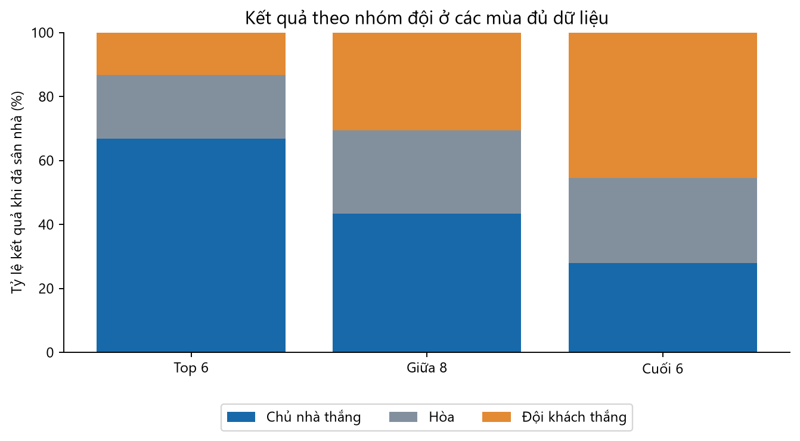

# 02 — Bàn thắng, kết quả, mùa giải và nhóm đội

[Mục lục](00_muc_luc.md) · Mẫu: 9.120 trận của 24 mùa đủ 380 trận.

## Biểu đồ 02: Kết quả và phân phối bàn thắng

**Nhận xét:** Chủ nhà thắng 45,7%, hòa 24,5%, đội khách thắng 29,8%. Trung bình chủ nhà ghi 1,54 bàn/trận, đội khách 1,19 bàn/trận; chênh lệch trung bình là +0,35 bàn cho chủ nhà (khoảng 95% theo sai số chuẩn: +0,31 đến +0,39). Phân phối bàn thắng tập trung ở các tỉ số thấp, có đuôi phải gồm ít trận rất nhiều bàn. Đây là bằng chứng mô tả của lợi thế sân nhà; chưa loại trừ khác biệt sức mạnh giữa các cặp đấu.

**Hướng kiểm định:** So sánh mô hình dự đoán H/D/A có hệ số sân nhà với mô hình chỉ dùng chênh lệch sức mạnh. Nếu mô hình hóa bàn thắng, ước lượng kỳ vọng bàn thắng chủ/khách riêng và so sánh xác suất H/D/A suy ra với mô hình phân lớp trực tiếp.

## Biểu đồ 03: Xu hướng theo mùa

**Nhận xét:** Tỷ lệ chủ nhà thắng và đội khách thắng biến động theo mùa, không cố định ở tỷ lệ gộp toàn bộ 24 mùa. Mùa 2020/21 có tỷ lệ đội khách thắng khoảng 40%, cao hơn chủ nhà khoảng 38%; đây là một mùa cần kiểm tra riêng thay vì suy rằng lợi thế sân nhà luôn có cùng cường độ. Số bàn trung bình mỗi trận cũng đổi theo mùa; điểm cao nhất trong hình là khoảng 3,28 bàn/trận ở 2023/24. Đường nối giữa 2002/03 và 2005/06 đi qua khoảng trống của hai mùa 2003/04–2004/05; không được hiểu là có số liệu cho hai mùa đó.

**Hướng kiểm định:** Kiểm tra độ ổn định xác suất theo mùa trên các tập kiểm tra theo thời gian; cân nhắc cập nhật hiệu chỉnh xác suất khi phân phối kết quả thay đổi. Không đưa mùa đang diễn ra vào so sánh tổng số trận/bàn với mùa đủ dữ liệu.

## Biểu đồ 04: Nhóm đội bóng

| Nhóm theo thứ hạng cuối mùa | Chủ nhà thắng | Hòa | Đội khách thắng |
|---|---:|---:|---:|
| Top 6 | 66,8% | 20,0% | 13,2% |
| Giữa 8 | 43,3% | 26,2% | 30,5% |
| Cuối 6 | 27,9% | 26,7% | 45,4% |

**Nhận xét:** Kết quả tại sân nhà khác rõ giữa các nhóm sức mạnh: Top 6 thắng sân nhà nhiều hơn nhóm cuối 6 khoảng 38,9 điểm phần trăm. Biểu đồ cũng cho thấy lợi thế sân nhà không bù hết sự yếu thế của nhóm cuối 6.

**Lưu ý khi lập mô hình:** Nhóm này được xác định bằng **thứ hạng cuối mùa**, tức chứa thông tin từ những trận xảy ra sau trận cần dự đoán. Chỉ dùng để mô tả; với mô hình trước trận hãy dùng Elo hoặc điểm/trận tích lũy đến trước trận. Dataset chỉ có một giải, nên chưa thể so sánh giữa các giải đấu.
