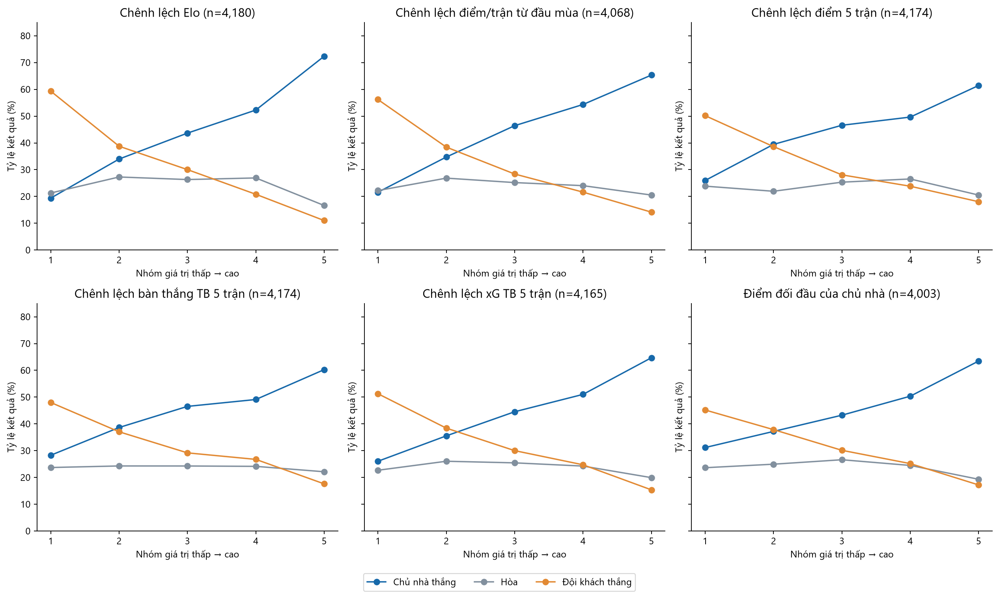
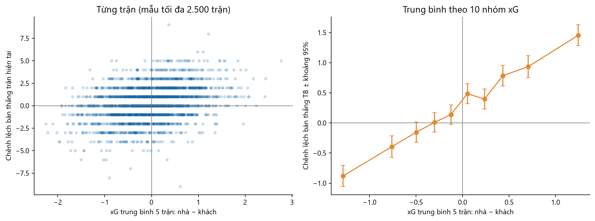

# 03 — Phong độ, đối đầu, xG và kết quả

[Mục lục](00_muc_luc.md) · Mẫu: 4.180 trận của các mùa đủ dữ liệu 2015/16–2025/26. Số trận hợp lệ của từng biến được ghi trong hình.

## Biểu đồ 05: Tỷ lệ kết quả theo mức đặc trưng

**Cách đọc:** Mỗi đặc trưng được chia thành tối đa 5 nhóm giá trị từ thấp đến cao. Đường xanh là tỷ lệ chủ nhà thắng, cam là đội khách thắng, xám là hòa. Các đường thể hiện liên hệ *đơn biến*; không kiểm soát Elo hoặc các biến còn lại.

| Đặc trưng trước trận | Chủ nhà thắng nhóm thấp → cao | Chênh lệch |
|---|---:|---:|
| `elo_diff` | 19,4% → 72,4% | +53,0 điểm % |
| Điểm/trận từ đầu mùa: chủ − khách | 21,6% → 65,3% | +43,7 điểm % |
| Điểm trung bình 5 trận: chủ − khách | 26,0% → 61,4% | +35,5 điểm % |
| Bàn thắng trung bình 5 trận: chủ − khách | 28,3% → 60,3% | +32,0 điểm % |
| xG trung bình 5 trận: chủ − khách | 26,1% → 64,7% | +38,7 điểm % |
| `h2h_home_ppg` | 31,2% → 63,5% | +32,3 điểm % |

**Nhận xét:** Chênh lệch Elo cho phân tách kết quả mạnh nhất trong sáu đường được vẽ. Các thước đo phong độ, xG và đối đầu cũng cho xu hướng tăng tỷ lệ thắng nhà khi giá trị cao hơn; tỷ lệ hòa thay đổi ít hơn và không nhất thiết đơn điệu. Độ lớn chênh lệch ở đây **không phải** mức cải thiện dự đoán khi thêm biến, vì nhiều biến cùng phản ánh sức mạnh đội.

**Hướng kiểm định:** Lấy `elo_diff` làm mốc rồi thêm từng nhóm phong độ, xG, đối đầu trên cùng tập trận và cùng cửa sổ kiểm tra. Xem log loss, hiệu chỉnh xác suất và độ cải thiện qua nhiều mùa; nếu cải thiện không ổn định, không giữ biến chỉ vì đường EDA đẹp.

## Biểu đồ 06: xG gần đây và chênh lệch bàn thắng thực tế

**Cách đọc:** Bên trái là tối đa 2.500 trận để tránh che điểm; bên phải là chênh lệch bàn thắng trung bình trong 10 nhóm xG, có thanh sai số xấp xỉ 95%.

**Nhận xét:** Khi xG 5 trận của chủ nhà cao hơn đội khách, chênh lệch bàn thắng thực tế có xu hướng tăng. Tuy vậy, tại cùng một mức xG vẫn có nhiều tỉ số khác nhau, gồm cả trận đi ngược xu hướng. xG gần đây mang tín hiệu xác suất, không cho kết quả chắc chắn của từng trận. Một số khoảng sai số gần mức 0 giao với 0, nên không diễn giải chúng như khác biệt rõ ràng.

**Hướng kiểm định:** Thử xG ở mô hình H/D/A và mô hình bàn thắng Poisson; so sánh với biến bàn thắng trung bình 5 trận để xem xG có thêm giá trị ngoài bàn thắng quá khứ không. Chỉ sử dụng xG của các trận **trước** trận cần dự đoán.
