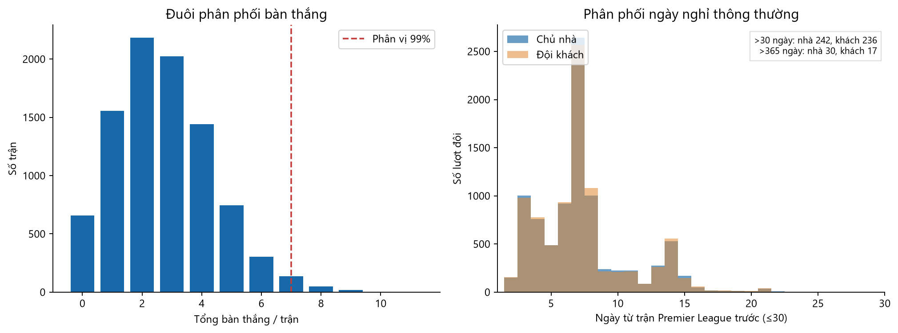

# 04 — Ngoại lệ và mất cân bằng nhãn

[Mục lục](00_muc_luc.md) · Mẫu: 9.120 trận thuộc các mùa đủ dữ liệu.

## Biểu đồ 07: Đuôi bàn thắng và khoảng cách giữa các trận Premier League

**Nhận xét về bàn thắng:** Phân vị 99 của tổng bàn thắng/trận là 7; có 211 trận từ 7 bàn trở lên và trận nhiều nhất có 11 bàn. Đây có thể là các trận thật, không phải lỗi chỉ vì nằm ở đuôi phân phối. Trước khi loại khỏi mô hình bàn thắng, cần đối chiếu nguồn trận và kiểm tra ảnh hưởng của chúng đến độ ổn định mô hình.

**Nhận xét về `rest_days`:** Phần lớn lượt đội có khoảng 3–14 ngày từ trận Premier League trước; hình chỉ vẽ giá trị đến 30 ngày để thấy phần chính của phân phối. `home_rest_days` có 242 giá trị trên 30 ngày, 30 giá trị trên 365 ngày, lớn nhất 8.134 ngày. `away_rest_days` có 236, 17 và 5.971 tương ứng. Mã tạo biến dùng khoảng cách giữa hai trận Premier League của cùng đội, kể cả sau khi đội vắng giải nhiều năm. Vì vậy đây **không phải số ngày nghỉ thực tế**; tạm hoãn dùng `rest_diff` cho dự đoán. Muốn dùng lịch nghỉ, cần lịch của các giải khác hoặc định nghĩa rõ “số ngày từ trận Premier League trước”, xử lý riêng lần đầu mùa/tái lên hạng.

## Mất cân bằng kết quả

Nhãn chủ nhà thắng H chiếm 45,7%, hòa D 24,5%, đội khách thắng A 29,8%. Mức lệch là đáng kể nhưng cả ba lớp đều có nhiều quan sát. Mô hình luôn đoán H có accuracy 45,7% trên tập EDA này; đây chỉ là mốc minh họa, không phải accuracy của tập kiểm tra tương lai. Khi đánh giá, báo cáo confusion matrix, macro-F1, log loss và tỷ lệ đúng từng lớp. Với dự đoán xác suất, log loss và đồ thị hiệu chỉnh quan trọng hơn việc chỉ tối đa hóa accuracy.
