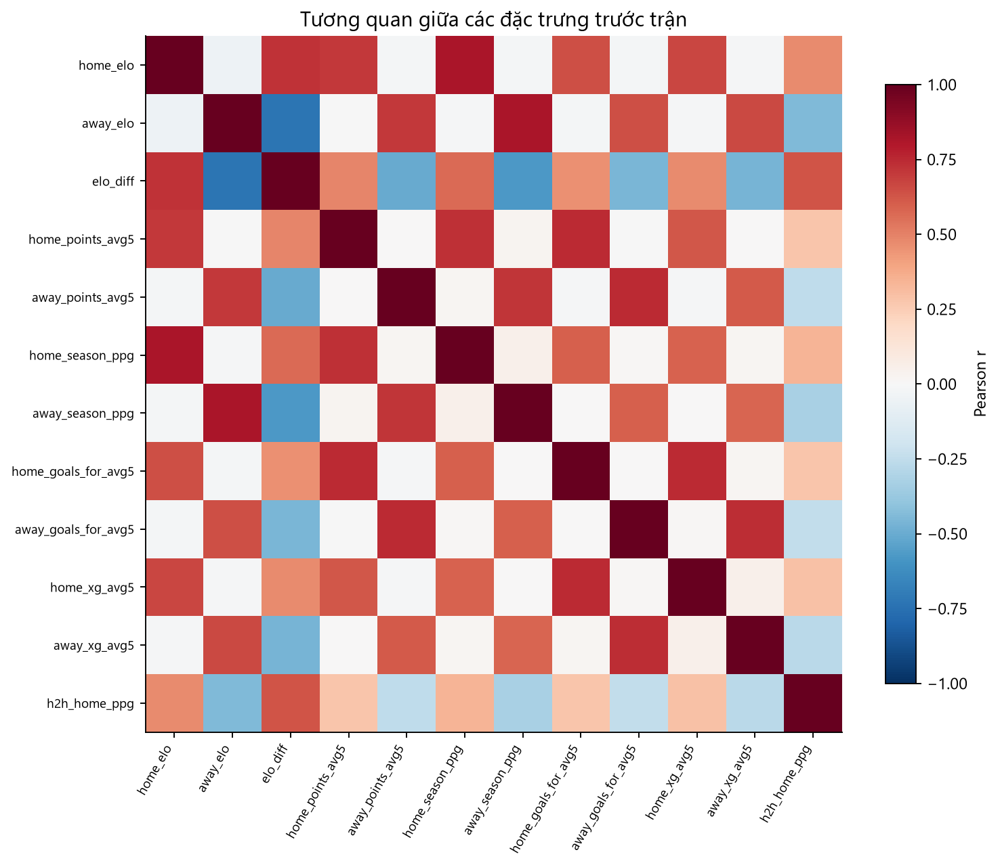
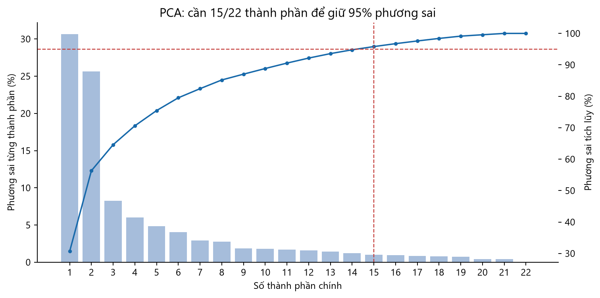

# 05 — Tương quan đặc trưng và kiểm tra giảm chiều

[Mục lục](00_muc_luc.md)

## Biểu đồ 08: Ma trận tương quan

**Cách đọc:** Màu đỏ là tương quan Pearson dương, xanh là âm, trắng gần 0. Ma trận chỉ chọn 12 biến trước trận để hình dễ đọc; không phải toàn bộ 23 cột đặc trưng.

**Nhận xét:** Các chỉ số cùng đội như Elo, điểm 5 trận, điểm/trận từ đầu mùa, bàn thắng 5 trận và xG 5 trận thường cùng chiều. Chỉ số đội khách thường tương quan âm với `elo_diff`. `elo_diff` là phép tính trực tiếp `home_elo - away_elo`, nên đưa cả ba vào mô hình tuyến tính không điều chuẩn gây phụ thuộc tuyến tính chính xác. Tương quan giữa hai biến dự đoán chưa chứng minh một biến là thừa: phải đo hiệu quả khi thêm/bỏ biến trên tập kiểm tra theo thời gian.

**Quyết định:** Với hồi quy logistic đa lớp, bắt đầu bằng `elo_diff`, rồi thêm các biến chênh lệch có ý nghĩa, chuẩn hóa trên tập train và dùng điều chuẩn. Với mô hình cây, tương quan ít gây lỗi ước lượng hơn nhưng có thể chia tầm quan trọng giữa các biến tương tự; đánh giá theo nhóm biến và dùng phép loại biến trên cùng tập kiểm tra.

## Biểu đồ 09: PCA

**Cách đọc:** Cột là phương sai từng thành phần; đường là phương sai tích lũy. PCA được tính trên 3.899 trận gần đây đủ dữ liệu, 22 biến số trước trận sau chuẩn hóa, bỏ `squad_value_log_ratio`; không đưa kết quả trận vào PCA.

**Nhận xét:** Hai thành phần đầu giữ 56,3% phương sai, ba thành phần giữ 64,6%; cần 11 thành phần cho 90% và 15/22 thành phần cho 95%. Do đó giảm xuống 2–3 chiều sẽ làm mất phần lớn biến thiên của dữ liệu. Dataset cũng chỉ có 23 cột đặc trưng ban đầu, chưa có áp lực chiều quá lớn.

**Quyết định:** **Chưa cần giảm chiều cho EDA hoặc mô hình đầu tiên.** Có thể vẽ PCA 2D để quan sát cấu trúc, nhưng không dùng nó thay các biến gốc trong phần giải thích. Nếu thử PCA trong mô hình, fit bộ điền thiếu, bộ chuẩn hóa và PCA **chỉ trên tập train của mỗi lần chia theo thời gian**, rồi so sánh với mô hình không PCA trên cùng tập kiểm tra. PCA tối đa hóa phương sai của X, không được bảo đảm giữ thông tin liên quan đến nhãn H/D/A.
