# EDA Premier League: matches.csv và features.csv

Báo cáo khám phá dữ liệu sạch phục vụ phân tích bóng đá và chuẩn bị dự đoán trước trận. Mọi con số mô tả snapshot đang có trên máy, không xác nhận kết quả ngoài đời hoặc dữ liệu mới hơn ngày cuối của snapshot.

Thời điểm lập: 2026-10-26T22:39:46 (UTC+07). Hai bảng có 9.850 trận khớp theo match_id; matches có 106 cột, features có 102 cột, trong đó 87 đặc trưng ứng viên.

## 1. Các phát hiện chính

- Tập dữ liệu chỉ gồm Premier League, 46 đội, từ 19/08/2000 đến 12/10/2026. Phân tích so sánh qua mùa dùng 24 mùa đủ, 9.120 trận.
- Trên toàn snapshot: chủ nhà thắng 45,6%, hòa 24,8%, đội khách thắng 29,6%. Lợi thế sân nhà hiện diện trong thống kê quan sát, có biến động qua mùa.
- Ở các mùa đủ, trung bình có 1,54 bàn nhà và 1,19 bàn khách/trận. Chênh bàn trung bình nhà−khách là 0,35; khoảng bootstrap theo mùa 95% [0,30; 0,39].
- Elo, odds, phong độ và đối đầu có liên hệ đơn biến với kết quả. Khi giới hạn các đội gần sức mạnh Elo, chênh lệch liên quan đến điểm phong độ và H2H thu hẹp; xG gần đây là giả thuyết bổ sung đáng kiểm tra, chưa được chứng minh bằng mô hình.
- Có 167 trận cần kiểm tra tính nhất quán giữa thống kê sút khác nguồn. rest_days là khoảng cách tới trận EPL quan sát trước, không phải nghỉ mọi đấu trường.
- 43 cột lịch sử được tính lại độc lập trên toàn bộ trận và có 0 sai khác. Điều này không xác nhận timestamp công bố dữ liệu hay mọi tình huống của toàn bộ 87 biến.

## 2. Phạm vi, đơn vị quan sát và cách lấy mẫu

| Bảng / mẫu | Số dòng | Số cột / mùa | Mục đích |
|---|---|---|---|
| matches.csv | 9.850 | 106 | Một trận; tỷ số, thống kê cùng trận, nguồn và cờ chất lượng |
| features.csv | 9.850 | 102 | Một trận; đặc trưng trước trận theo thiết kế, định danh và nhãn |
| Mẫu so sánh mùa đủ | 9.120 | 24 mùa | 380 trận, 20 đội và 38 trận mỗi đội trong từng mùa |

| Mùa | Số trận | Số đội | Ghi chú |
|---|---|---|---|
| 2003/04 | 335 | 20 | Mùa lịch sử thiếu trận |
| 2004/05 | 335 | 20 | Mùa lịch sử thiếu trận |
| 2026/27 | 60 | 20 | Mùa đang diễn ra trong snapshot |

Không thực hiện so sánh liên giải vì không có giải thứ hai. Tất cả dòng hiện tại đều là played; không có provisional, postponed hoặc upcoming. Các thống kê toàn snapshot vẫn giữ mùa thiếu; các biểu đồ xu hướng, nhóm đội và phân phối bàn thắng chính dùng riêng mẫu mùa đủ, được ghi tại từng hình.

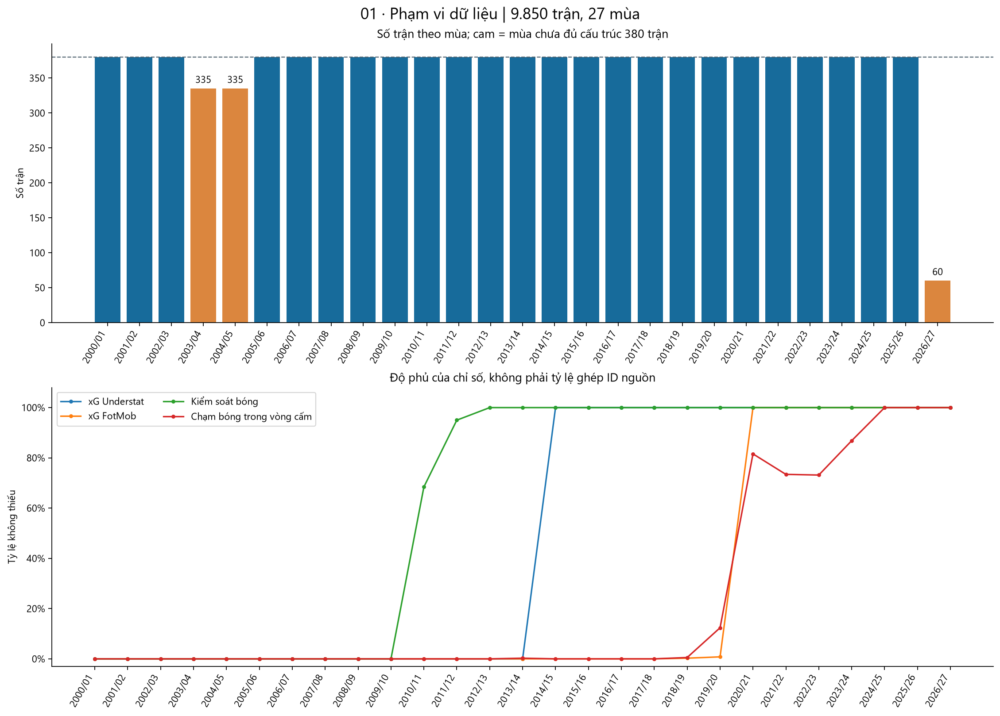

Hình 01. Mùa thiếu và độ phủ chỉ số theo thời gian; màu cam không đồng nghĩa dữ liệu sai.

## 3. Kiểm toán dữ liệu và dữ liệu thiếu

| Trạng thái | Số kiểm tra |
|---|---|
| Đạt | 243 |
| Cảnh báo cần diễn giải | 7 |
| Thông tin | 3 |
| Không đạt | 0 |

Hai bảng không trùng match_id, ghép một–một và khớp các trường ngày, đội, tỷ số, kết quả. Kiểm toán kiểm tra miền giá trị, quan hệ tỷ số–nhãn, thống kê và lịch sử trước trận. Các cảnh báo về khác nguồn, khán giả được điền và lịch sử cũ được giữ riêng; không tự xóa hoặc sửa dòng nguồn.

[Chi tiết kiểm tra dữ liệu](data_quality_checks.csv)

[Các dòng được gắn cờ và lý do](data_issues.csv)

| Cột | Số thiếu | Tỷ lệ thiếu |
|---|---|---|
| home_points5 | 20 | 0,2% |
| home_ppg | 270 | 2,7% |
| h2h_home_points | 800 | 8,1% |
| diff_xg5 | 5.256 | 53,4% |
| diff_possession5 | 3.822 | 38,8% |
| diff_big_chances5 | 5.970 | 60,6% |
| diff_box_touches5 | 7.680 | 78,0% |
| diff_xgot5 | 7.531 | 76,5% |
| odds_home_prob | 760 | 7,7% |
| gameweek | 9.790 | 99,4% |

Xóa mọi dòng có bất kỳ ô trống trên cả 102 cột chỉ còn 47 trận. Chỉ xét các biến số dự báo, bỏ gameweek và nhãn, cũng chỉ còn 2.035 trận đủ. Vì vậy không dùng dropna toàn bảng hoặc điền 0 đồng loạt. xG bắt đầu từ 2014/15; các biến FotMob có mốc phủ khác nhau. Thiếu theo thời kỳ không tương đương một giá trị 0 thật.

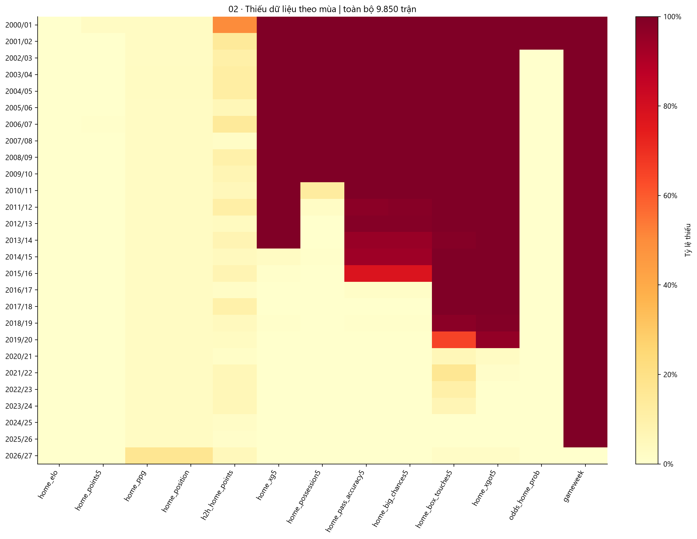

Hình 02. Cột đại diện ở phía chủ nhà và các biến chênh lệch; CSV danh mục có mức thiếu của toàn bộ đặc trưng.

| Tổ hợp nguồn | Số trận | Tỷ lệ |
|---|---|---|
| FD+US+TM+FM | 4.560 | 46,3% |
| FD | 3.821 | 38,8% |
| FD+TM+FM | 760 | 7,7% |
| FD+FM | 649 | 6,6% |
| FD+US+FM | 60 | 0,6% |

FD = Football-Data; US = Understat; TM = Transfermarkt; FM = FotMob. Cờ đã ghép nguồn không bảo đảm mọi chỉ số của nguồn đó đều được ghi nhận. gameweek chỉ có ở mùa hiện tại nên không phù hợp làm điều kiện giữ dòng lịch sử.

## 4. Bàn thắng, bàn thua, nhãn và tỷ số

| Mẫu | Kết quả | Số trận | Tỷ lệ | Wilson 95% xấp xỉ |
|---|---|---|---|---|
| Toàn snapshot | Chủ nhà thắng | 4.495 | 45,6% | [44,7%; 46,6%] |
| Toàn snapshot | Hòa | 2.441 | 24,8% | [23,9%; 25,6%] |
| Toàn snapshot | Đội khách thắng | 2.914 | 29,6% | [28,7%; 30,5%] |
| Mùa đủ | Chủ nhà thắng | 4.172 | 45,7% | [44,7%; 46,8%] |
| Mùa đủ | Hòa | 2.233 | 24,5% | [23,6%; 25,4%] |
| Mùa đủ | Đội khách thắng | 2.715 | 29,8% | [28,8%; 30,7%] |

Lớp lớn nhất/nhỏ nhất có tỷ số 1,84. Cần theo dõi riêng lớp hòa; mức lệch nhãn quan sát không tự động dẫn đến oversampling. Các khoảng Wilson chỉ mô tả dưới xấp xỉ quan sát độc lập; đội bóng lặp lại khiến suy luận chính thức cần tính đến phụ thuộc.

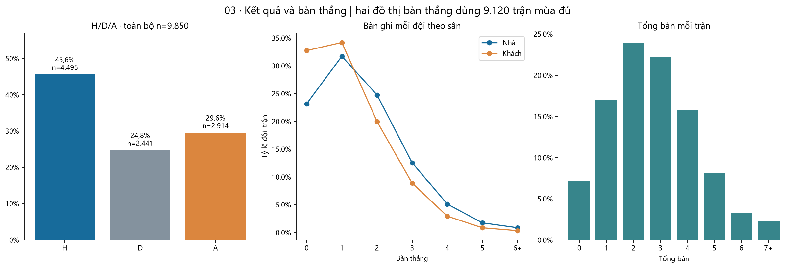

Hình 03. Phân phối kết quả trên toàn snapshot; phân phối bàn thắng dùng 24 mùa đủ.

| Đại lượng | Trung bình | Phương sai | Phương sai/TB | Tỷ lệ 0 |
|---|---|---|---|---|
| Bàn nhà | 1,538 | 1,699 | 1,104 | 23,2% |
| Bàn khách | 1,190 | 1,343 | 1,128 | 32,8% |
| Tổng bàn | 2,728 | 2,764 | 1,013 | 7,2% |

Tỷ lệ hai đội cùng ghi bàn là 51,2%; chủ nhà giữ sạch lưới 32,8%, đội khách giữ sạch lưới 23,2%. Tương quan Pearson bàn nhà–khách là -0,092. Các kiểm tra này giúp đặt giả thuyết cho mô hình đếm; không đủ kết luận phân phối Poisson hoặc độc lập là đúng.

Khi gộp toàn bộ đội–trận của giải, tổng bàn ghi và tổng bàn thua bằng nhau, kể cả phân phối đối ứng của chúng. Khác biệt tấn công/phòng ngự cần xét theo đội, mùa và sân, không diễn giải hai tổng toàn giải như hai nguồn thông tin độc lập.

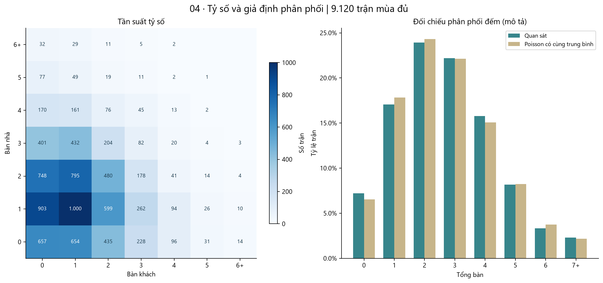

Hình 04. Tỷ số và đối chiếu tổng bàn với Poisson có cùng trung bình; đây là mô tả phân phối, không phải mô hình dự báo.

## 5. Mùa giải và lợi thế sân nhà

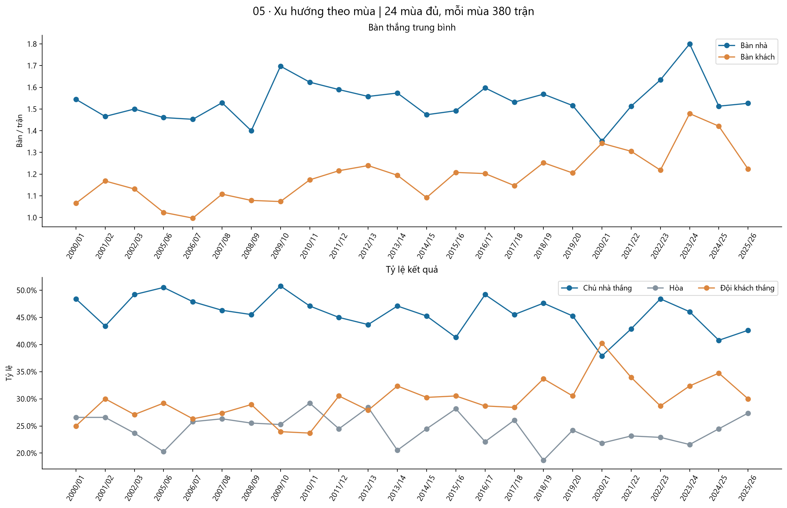

Hình 05. Chỉ dùng mùa đủ; mỗi điểm có 380 trận nên các tỷ lệ và trung bình có cùng mẫu số.

Trong các mùa đủ, tổng bàn/trận thấp nhất ở 2006/07 (2,45) và cao nhất ở 2023/24 (3,28). Chênh tỷ lệ H−A thấp nhất ở 2020/21 (-2,4%), cao nhất ở 2009/10 (26,8%). Đây là cực trị trong mẫu, không chứng minh xu hướng tuyến tính hoặc khác biệt có ý nghĩa xác nhận.

| Thước đo sân nhà ở mùa đủ | Ước lượng | Bootstrap theo mùa 95% |
|---|---|---|
| Tỷ lệ H trừ tỷ lệ A | 16,0% | [13,5%; 18,3%] |
| Bàn nhà trừ bàn khách | 0,348 | [0,299; 0,394] |

Khoảng trên được tính bằng 4.000 lần lấy mẫu lại 24 mùa (seed 42), giữ các trận trong cùng mùa đi cùng nhau. Nó mô tả biến động giữa các mùa đã quan sát; 24 cụm là hữu hạn và các mùa vẫn có đội lặp lại. Không diễn giải đây là hiệu ứng nhân quả của sân nhà.

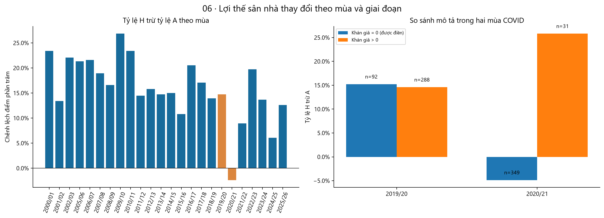

Hình 06. Thanh cam đánh dấu 2019/20 và 2020/21; so sánh khán giả chỉ mang tính mô tả trong từng mùa.

Có 441 giá trị khán giả được điền; các giá trị 0 giai đoạn COVID có cờ attendance_imputed. Khác biệt giữa nhóm có/không khán giả còn chịu ảnh hưởng của lịch, sức mạnh đội và thời điểm; không quy toàn bộ khác biệt cho khán giả.

## 6. Nhóm đội và khả năng ghi bàn/phòng ngự

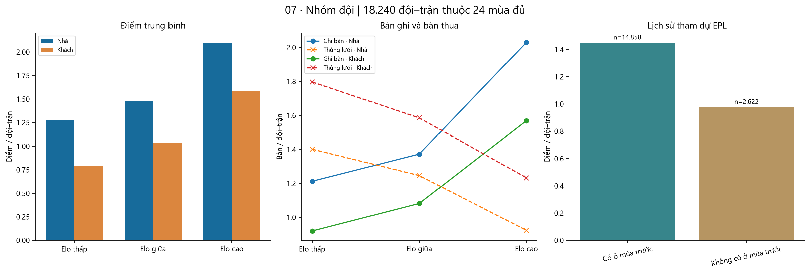

Hình 07. Nhóm Elo lấy từ giá trị trước trận; ngưỡng phân vị toàn mẫu chỉ phục vụ EDA. Không dùng thứ hạng cuối mùa để tạo nhóm dự báo.

| Nhóm Elo trước trận | Sân | Đội–trận | Điểm/trận | Bàn ghi/trận | Bàn thua/trận |
|---|---|---|---|---|---|
| Elo thấp | Khách | 3.038 | 0,79 | 0,92 | 1,80 |
| Elo thấp | Nhà | 3.042 | 1,27 | 1,21 | 1,40 |
| Elo giữa | Khách | 3.038 | 1,03 | 1,08 | 1,59 |
| Elo giữa | Nhà | 3.042 | 1,48 | 1,37 | 1,25 |
| Elo cao | Khách | 3.044 | 1,59 | 1,57 | 1,23 |
| Elo cao | Nhà | 3.036 | 2,10 | 2,03 | 0,92 |

Đội không có mặt mùa EPL trước được nhận diện bằng lịch sử tham dự quan sát, gồm đội lần đầu xuất hiện hoặc trở lại. Đây là nhóm mô tả, chưa xác nhận toàn bộ lịch thi đấu hạng dưới. Nhóm đầu tiên của lịch sử dữ liệu được loại khỏi so sánh này.

| Đội (ít nhất 3 mùa đủ tương đương) | Đội–trận | Điểm/trận | Bàn ghi/trận | Bàn thua/trận |
|---|---|---|---|---|
| Manchester United | 912 | 1,97 | 1,83 | 1,02 |
| Liverpool | 912 | 1,94 | 1,88 | 1,00 |
| Arsenal | 912 | 1,93 | 1,89 | 1,04 |
| Manchester City | 874 | 1,92 | 1,96 | 1,03 |
| Chelsea | 912 | 1,88 | 1,79 | 1,01 |
| Tottenham | 912 | 1,62 | 1,63 | 1,27 |
| Everton | 912 | 1,39 | 1,29 | 1,27 |
| Newcastle | 836 | 1,34 | 1,34 | 1,44 |

Bảng trên tổng hợp các lần xuất hiện trong mẫu mùa đủ, không phải bảng xếp hạng của một mùa. Các đội có số mùa góp mặt khác nhau; không suy rằng khác biệt do một đặc trưng duy nhất.

## 7. Thống kê cùng trận và đối chiếu nguồn xG

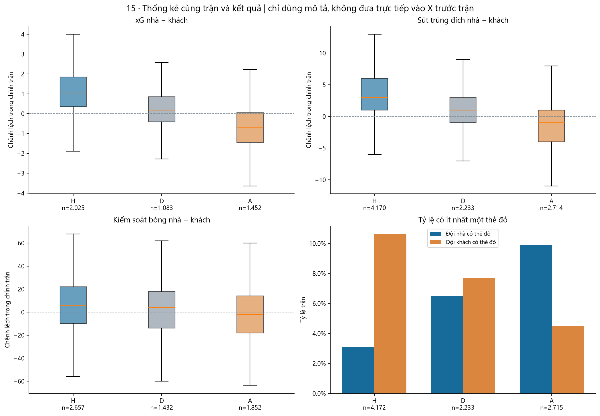

Hình 15. Ba đồ thị hộp thể hiện trung vị và khoảng tứ phân vị; điểm ngoài râu vẫn được giữ trong dữ liệu. Thẻ đỏ dùng tỷ lệ có ít nhất một thẻ vì trung vị và tứ phân vị đều bằng 0.

Số sút, xG, kiểm soát bóng và thẻ của chính trận liên hệ với kết quả theo mô tả. Chúng không có trước trận nên không được đưa trực tiếp vào mô hình dự đoán trước trận. Thẻ và kiểm soát bóng cũng có thể là hệ quả của diễn biến/tỷ số, không chỉ là nguyên nhân.

| Thước đo trên cùng mẫu | Giá trị |
|---|---|
| Đội–trận có cả hai xG | 4.688 |
| Spearman Understat–FotMob | 0,940 |
| Chênh trung bình FotMob−Understat | -0,091 |
| Dải TB ±1,96 SD của chênh | [-0,711; 0,529] |

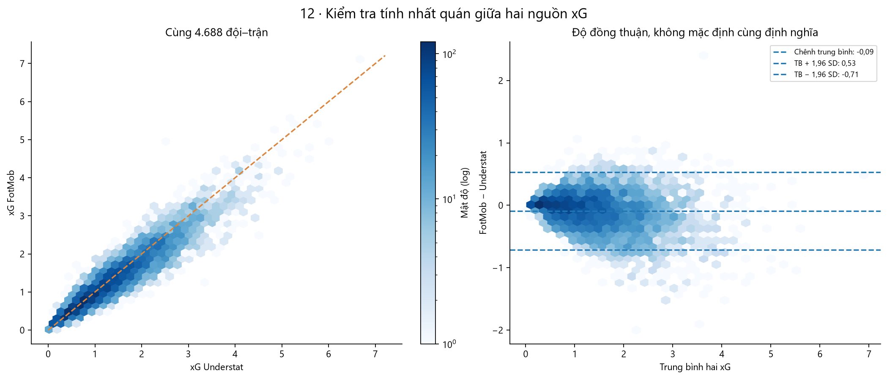

Hình 12. Tương quan cao không đồng nghĩa hai mô hình xG có thể thay thế hoàn toàn; dải SD không phải khoảng tin cậy của trung bình.

Khi dựng đặc trưng, cần giữ nhất quán nguồn xG hoặc kiểm tra nhạy cảm khi đổi nguồn. Báo cáo không tự ghép hai nguồn thành một chỉ số mới.

## 8. Ý nghĩa và thời điểm có đặc trưng

| Nhóm biến | Định nghĩa đúng | Lưu ý sử dụng |
|---|---|---|
| points5, goals_for5, goals_against5 | Trung bình tối đa 5 trận EPL trước, không phải tổng 5 trận | Cửa sổ có thể ngắn hơn 5 và không reset qua mùa |
| xg5, xga5 và các trung bình FotMob | Trung bình các giá trị không thiếu trong cửa sổ tối đa 5 trận | Có thể chỉ dựa trên 1–4 quan sát; cần thêm số quan sát hợp lệ |
| ppg, played, goals_for_pg, position | Thống kê từ phần mùa đã quan sát trước trận | Mùa lịch sử thiếu không tái dựng đúng toàn bộ bảng xếp hạng |
| h2h_home_points / goal_diff | TB tối đa 5 lần gặp trước, quy về đội đang làm chủ nhà | Có thể rất cũ; kiểm tra n đối đầu |
| elo_home_win_prob | Điểm kết quả kỳ vọng Elo với H=1, D=0,5, A=0 | Không phải P(H) ba lớp đã hiệu chuẩn; biến đổi đơn điệu của Elo |
| rest_days | Ngày từ trận EPL quan sát gần nhất | Không phải thời gian nghỉ mọi đấu trường |
| odds_*_prob | Nghịch đảo odds Avg, B365 dự phòng, chuẩn hóa tổng bằng 1 | Chưa có timestamp thu thập; đóng khung thời điểm dự đoán trước khi dùng |

Có 143 trận có ít nhất một đội với cửa sổ kết quả đã biết nhưng chưa đủ 5 trận; 800 trận chưa có đối đầu quan sát trước. H2H với ít nhất 3 lần gặp có 7.632 trận. Cửa sổ phong độ vẫn có thể chứa kết quả nhiều năm trước khi một đội trở lại EPL.

Kiểm toán mới tính lại độc lập 43 cột trên toàn bộ 9.850 trận, gồm Elo, phong độ kết quả/bàn/xG, phong độ sân, thống kê mùa, ngày EPL và H2H; có 0 ô sai khác. Kiểm tra này đọc trạng thái trước khi cập nhật kết quả hiện tại. Không thay thế kiểm chứng timestamp dữ liệu, thời gian kickoff thiếu, toàn bộ biến FotMob hoặc dữ liệu nguồn thực tế.

## 9. Phong độ, bàn thắng trung bình, đối đầu và kết quả

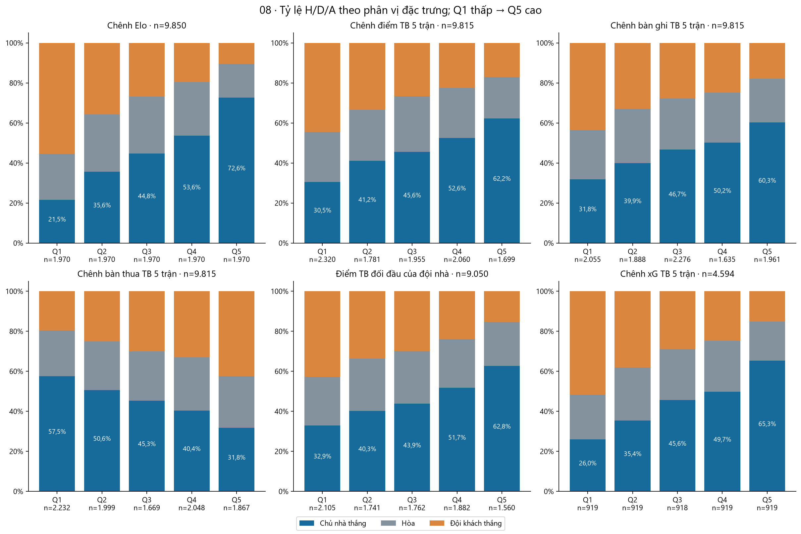

Hình 08. Các phân vị là nhóm mô tả toàn mẫu, không phải ngưỡng quyết định của mô hình. Một số giá trị bằng nhau làm kích thước nhóm không đều.

| Biến | Số trận hợp lệ | Spearman với H | Spearman với hiệu số bàn |
|---|---|---|---|
| odds_home_prob | 9.090 | 0,383 | 0,460 |
| elo_diff | 9.850 | 0,354 | 0,426 |
| diff_ppg | 9.577 | 0,292 | 0,355 |
| diff_xg5 | 4.594 | 0,276 | 0,333 |
| diff_shots_on_target5 | 9.815 | 0,246 | 0,305 |
| diff_points5 | 9.815 | 0,225 | 0,274 |
| diff_goals_for5 | 9.815 | 0,207 | 0,256 |
| diff_goals_against5 | 9.815 | -0,186 | -0,217 |
| h2h_home_points | 9.050 | 0,202 | 0,247 |
| h2h_home_goal_diff | 9.050 | 0,235 | 0,287 |

Nhãn H/D/A không được mã hóa thành một thang số tùy ý để tính tương quan. Báo cáo dùng H=1, còn lại=0 hoặc hiệu số bàn (đại lượng có thứ tự tự nhiên). Các hệ số trên dùng tập trận hợp lệ riêng, vì vậy không xếp hạng khả năng dự đoán trực tiếp giữa chúng.

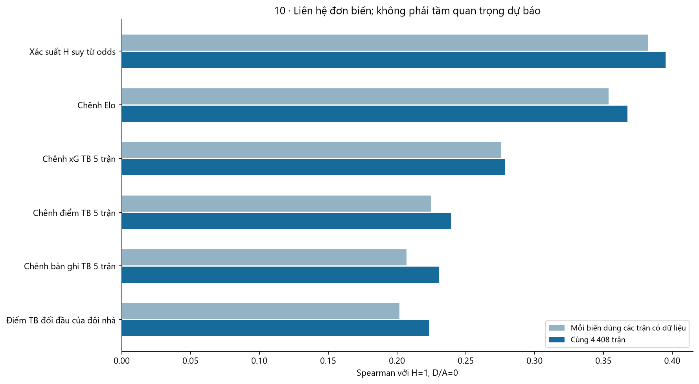

Hình 10. So sánh bổ sung trên cùng 4.408 trận đủ sáu biến; mẫu này thiên về giai đoạn có xG và không đại diện đồng đều toàn lịch sử.

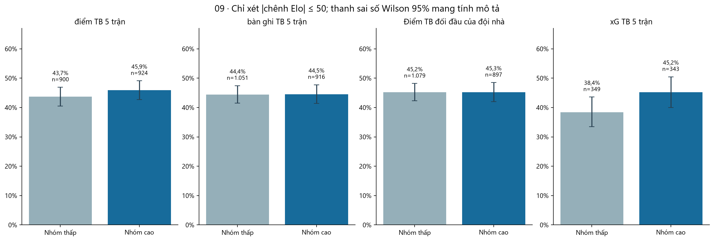

Hình 09. So nhóm thấp/cao theo tercile toàn mẫu trong các trận gần Elo; đây chỉ là điều kiện thô, chưa loại hết khác biệt về sức mạnh và thời kỳ.

| Biến | Ngưỡng thấp / cao | Tỷ lệ H thấp | Tỷ lệ H cao | Chênh cao−thấp | Elo TB thấp / cao |
|---|---|---|---|---|---|
| Chênh điểm TB 5 trận | ≤-0,400 / ≥0,400 | 43,7% (n=900) | 45,9% (n=924) | 2,22 điểm % | -8,5 / 7,9 |
| Chênh bàn ghi TB 5 trận | ≤-0,400 / ≥0,400 | 44,4% (n=1.051) | 44,5% (n=916) | 0,11 điểm % | -6,5 / 5,0 |
| Điểm TB đối đầu của đội nhà | ≤1,000 / ≥1,600 | 45,2% (n=1.079) | 45,3% (n=897) | 0,03 điểm % | -4,4 / 4,0 |
| Chênh xG TB 5 trận | ≤-0,324 / ≥0,257 | 38,4% (n=349) | 45,2% (n=343) | 6,79 điểm % | -7,8 / 6,1 |

Trong nhóm gần Elo, khác biệt của phong độ điểm, bàn ghi và đối đầu giảm mạnh so với liên hệ thô. xG giữ chênh lệch lớn hơn nhưng hai nhóm vẫn khác Elo trung bình và phạm vi thời kỳ. Đây là lý do đề xuất kiểm định giá trị tăng thêm của xG bằng mô hình theo thời gian; chưa phải bằng chứng nhân quả hoặc cải thiện dự báo.

## 10. Bất thường và quyết định xử lý

| Nhóm cờ | Số cờ | Trận duy nhất trong nhóm | Diễn giải |
|---|---|---|---|
| attendance_imputed | 441 | 441 | Khán giả được điền: giữ cờ khi phân tích |
| cross_source_shots | 176 | 167 | Trong + ngoài vòng cấm (FotMob) vượt tổng sút (Football-Data): xác minh định nghĩa/nguồn |
| cross_source_zero_shots | 6 | 3 | Sút trong và ngoài vòng cấm bằng 0 nhưng Football-Data có sút: xác minh giá trị 0 và độ phủ nguồn |
| observed_epl_gap | 534 | 284 | Khoảng cách EPL >30 ngày: gồm nghỉ mùa, vắng giải; không tự coi là lỗi |
| suspect_possession | 1 | 1 | Xem reason_vi trong bảng chi tiết |

Trong/ngoài vòng cấm vượt tổng sút ở 167 trận, nhưng các chỉ số đến từ hai nguồn nên đây là cảnh báo tính nhất quán, chưa đủ để kết luận tổng nào sai. Ngoài ra có trận Newcastle–Tottenham ngày 15/05/2016 ghi kiểm soát bóng 3%–97% và tỷ số 5–1; cần xác minh nguồn.

Có thêm 3 trận mà hai thành phần sút FotMob đều bằng 0 trong khi tổng sút Football-Data dương. Các số 0 này cần được kiểm tra về độ phủ/ghi nhận nguồn, không tự diễn giải là đội không có cú sút nào.

Khoảng cách EPL lớn nhất là 9.225 ngày; 52 đội–trận có khoảng cách trên một năm. Không cắt các giá trị này rồi gọi chúng là nghỉ thực tế. Có thể thiết kế cờ lịch sử cũ, khoảng cách trong mùa, hoặc bổ sung lịch mọi đấu trường trước khi kiểm định mệt mỏi.

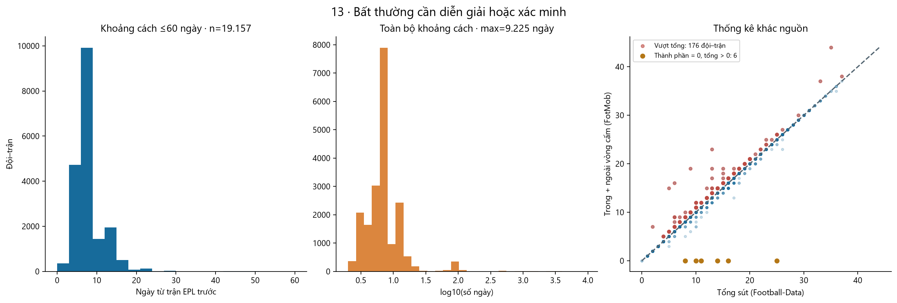

Hình 13. Không có dòng nào bị tự động loại khỏi dữ liệu nguồn. Phân phối log cho thấy vì sao mean/std đơn thuần không diễn giải được rest_days.

## 11. Đặc trưng tiềm năng, trùng thông tin và độ ổn định

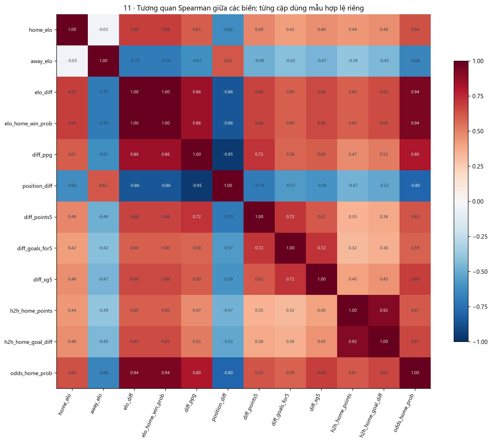

Hình 11. Tương quan từng cặp không cùng mẫu; quan hệ xác định đại số được kiểm tra thêm bằng công thức.

14 cột diff_* có sẵn đều bằng home−away của chỉ số tương ứng. Không đưa đồng thời cả ba biến vào hồi quy tuyến tính không điều chuẩn. elo_home_win_prob là biến đổi đơn điệu của elo_diff; position_diff và diff_ppg, cùng hai biến H2H, có mức trùng thông tin lớn. Không cần PCA bắt buộc cho EDA; ưu tiên tính giải thích và chọn theo nhóm.

| Biến | Thiếu | Quyết định đề xuất |
|---|---|---|
| elo_diff | 0,0% | Ưu tiên elo_diff làm biến sức mạnh đại diện. |
| diff_ppg | 2,8% | Ưu tiên thử làm đại diện chênh lệch; xác nhận giá trị thêm vào Elo bằng chia tập theo thời gian. |
| diff_points5 | 0,4% | Ưu tiên thử làm đại diện chênh lệch; xác nhận giá trị thêm vào Elo bằng chia tập theo thời gian. |
| diff_goals_for5 | 0,4% | Ưu tiên thử làm đại diện chênh lệch; xác nhận giá trị thêm vào Elo bằng chia tập theo thời gian. |
| diff_goals_against5 | 0,4% | Ưu tiên thử làm đại diện chênh lệch; xác nhận giá trị thêm vào Elo bằng chia tập theo thời gian. |
| diff_shots_on_target5 | 0,4% | Ưu tiên thử làm đại diện chênh lệch; xác nhận giá trị thêm vào Elo bằng chia tập theo thời gian. |
| diff_xg5 | 53,4% | Ưu tiên thử trên tập con có xG; so sánh cùng trận và cùng giai đoạn với mô hình không xG. |
| diff_xga5 | 53,4% | Ưu tiên thử trên tập con có xG; so sánh cùng trận và cùng giai đoạn với mô hình không xG. |
| h2h_home_points | 8,1% | Thử bổ sung sau Elo; ưu tiên một đại diện H2H và kiểm tra giá trị tăng thêm. |
| h2h_home_goal_diff | 8,1% | Thử bổ sung sau Elo; ưu tiên một đại diện H2H và kiểm tra giá trị tăng thêm. |
| diff_possession5 | 38,8% | Thử trên tập con FotMob đủ độ phủ; hoãn cho mô hình toàn lịch sử. |
| diff_big_chances5 | 60,6% | Thử trên tập con FotMob đủ độ phủ; hoãn cho mô hình toàn lịch sử. |
| diff_box_touches5 | 78,0% | Thử trên tập con FotMob đủ độ phủ; hoãn cho mô hình toàn lịch sử. |
| diff_xgot5 | 76,5% | Thử trên tập con FotMob đủ độ phủ; hoãn cho mô hình toàn lịch sử. |
| odds_home_prob | 7,7% | Tách kịch bản có odds; hoãn dùng nếu chưa xác minh thời điểm ghi nhận và quyền tiếp cận lúc dự đoán. |
| home_rest_days | 0,2% | Hoãn dùng như biến mệt mỏi; cần bổ sung lịch đầy đủ hoặc đổi rõ ý nghĩa thành khoảng cách EPL. |

[Danh mục đầy đủ 87 đặc trưng: định nghĩa, nguồn, thời điểm có, thiếu, tương quan và quyết định](feature_candidates.csv)

Tương quan chỉ hỗ trợ khám phá. Các quyết định là thứ tự kiểm định, không phải danh sách đã được chứng minh có ích. Giữ hai kịch bản: chỉ dùng dữ liệu bóng đá và có thêm odds đúng thời điểm. Không dùng thiếu dữ liệu của một thời kỳ như đường tắt nhận diện nhãn.

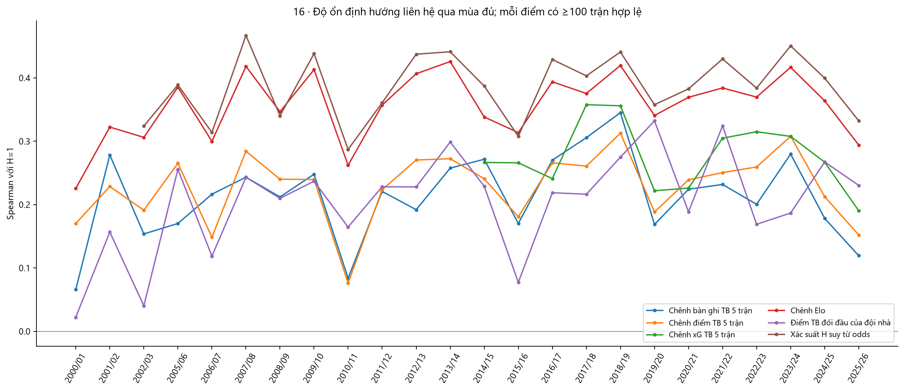

Hình 16. Hướng liên hệ ổn định qua mùa chưa chứng minh dự báo ngoài mẫu. Mốc ≥100 quan sát tránh diễn giải hệ số từ rất ít trận.

| Biến | Mùa đủ điều kiện | Số mùa tương quan dương | Khoảng Spearman |
|---|---|---|---|
| diff_goals_for5 | 24 | 24 | [0,066; 0,345] |
| diff_points5 | 24 | 24 | [0,076; 0,313] |
| diff_xg5 | 12 | 12 | [0,190; 0,358] |
| elo_diff | 24 | 24 | [0,226; 0,426] |
| h2h_home_points | 24 | 24 | [0,022; 0,332] |
| odds_home_prob | 22 | 22 | [0,287; 0,467] |

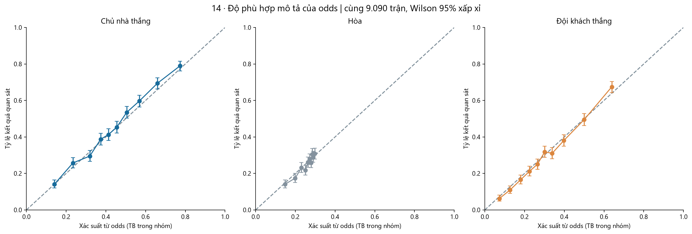

Hình 14. Kiểm tra mô tả xác suất từ odds trên snapshot, không phải kết quả backtest hoặc hiệu quả tài chính. Không vẽ Elo expectation như P(H).

Các odds được dùng để tạo features là Avg với B365 dự phòng, chuẩn hóa nghịch đảo; không phải tự động là closing odds. Timestamp thu thập chưa được cung cấp, nên độ sẵn có ở mốc dự đoán trước trận một ngày chưa được xác nhận.

## 12. Giả thuyết cần kiểm tra bằng mô hình

| Mã | Giả thuyết | So sánh đề xuất |
|---|---|---|
| H1 | Elo bổ sung khả năng dự đoán H/D/A so với tần suất nhãn lịch sử. | Mốc tần suất chỉ học từ train → logistic đa lớp có Elo. |
| H2 | Phong độ điểm và bàn ghi/bàn thua gần đây bổ sung thông tin ngoài Elo. | Elo → Elo + nhóm phong độ. |
| H3 | Phong độ xG/xGA bổ sung thông tin ngoài Elo và phong độ bàn thắng. | Elo + phong độ bàn → thêm xG/xGA. |
| H4 | Đối đầu bổ sung thông tin sau khi đã xét Elo và phong độ. | Elo + phong độ → thêm nhóm H2H. |
| H5 | Lợi thế sân nhà biến đổi theo thời kỳ. | Hệ số sân nhà cố định → hệ số học trên quá khứ theo thời kỳ. |
| H6 | Phong độ đúng sân bổ sung cho phong độ tổng. | Phong độ tổng → thêm nhóm phong độ sân. |
| H7 | Độ mới của lịch sử hoặc khoảng nghỉ được định nghĩa đúng có ích. | Elo + phong độ → thêm cờ gián đoạn; kiểm tra lịch nghỉ thực riêng. |
| H8 | Chỉ số lối chơi FotMob bổ sung thông tin ngoài nhóm cơ bản. | Elo + phong độ + xG → thêm từng nhóm FotMob. |
| H9 | Odds đúng thời điểm cung cấp mốc tham chiếu hoặc thông tin bổ sung. | Tách kịch bản chỉ bóng đá / có odds; so trên cùng mẫu. |

[Chi tiết giả thuyết, tập dữ liệu, tiêu chí và lưu ý](hypotheses.csv)

Không giả thuyết nào được chấp nhận chỉ từ EDA. Mô hình nền nên gồm tần suất nhãn học từ train, sau đó một mô hình H/D/A đơn giản với Elo. Khi dự đoán tỷ số, kiểm định riêng Poisson/biến thể đếm dựa trên quá khứ, độ phân tán và phụ thuộc bàn nhà–khách; hình đối chiếu Poisson chưa phải mô hình dự báo.

## 13. Kế hoạch đánh giá và giới hạn diễn giải

- Chốt mục tiêu: dự đoán H/D/A hay tỷ số; chốt mốc trước giờ bóng lăn hoặc trước một ngày. Chỉ dùng các trường đã sẵn có ở mốc đó.
- Đánh giá mở rộng theo thời gian: train bằng các mùa trước, validation bằng mùa tiếp theo; các trận cùng ngày không tách hai phía ranh giới.
- Để so nhóm biến cơ bản/xG/FotMob/H2H/odds, dùng cùng trận và cùng fold. Báo cáo riêng mẫu dài hạn và mẫu giàu thống kê gần đây.
- Điền thiếu, chuẩn hóa, chọn biến, PCA nếu có và hiệu chỉnh xác suất chỉ được học trong train của từng fold. Không dùng kết quả test để chọn biến.
- Thước đo chính cho H/D/A là log loss đa lớp; bổ sung Brier, macro-F1, recall lớp hòa, confusion matrix và hiệu chỉnh xác suất. Báo cáo biến động qua mùa.
- Giữ một tập kiểm tra khóa sau khi chốt đặc trưng và quy trình. Vì EDA này đã xem toàn snapshot, một mùa đã được xem không còn hoàn toàn chưa đụng tới; ưu tiên kiểm chứng xác nhận bằng snapshot tương lai chưa xem.
- Kiểm tra nhạy cảm với hai mùa thiếu, đội trở lại EPL, cửa sổ ít hơn 5, H2H ít trận, định nghĩa nguồn xG và khoảng trống lịch sử.
- Mọi liên hệ trong báo cáo là mô tả, chưa suy ra nhân quả. Các đội lặp lại và nhiều phép so sánh làm các khoảng đơn giản không đủ cho suy luận xác nhận.

Mức 'đã xử lý' và 108 kiểm tra QA của pipeline nguồn không đồng nghĩa dữ liệu không còn vấn đề cho mọi bài toán. Kiểm toán mới tập trung thêm vào mục tiêu EDA và thời điểm dự đoán. Không huấn luyện mô hình dự đoán trong lần bàn giao này.

[Tham khảo phương pháp: tránh rò rỉ dữ liệu (scikit-learn)](https://scikit-learn.org/stable/common_pitfalls.html#data-leakage)

[Tham khảo phương pháp: đánh giá theo thời gian (scikit-learn)](https://scikit-learn.org/stable/modules/cross_validation.html#cross-validation-of-time-series-data)

## 14. Bàn giao và tái lập

- report.html: báo cáo tự chứa toàn bộ 16 biểu đồ, mở ngoại tuyến bằng trình duyệt.
- report.md và figures/: báo cáo Markdown cùng ảnh PNG có thể đưa vào tài liệu hoặc slide.
- feature_candidates.csv: danh mục 87 biến và quyết định kiểm định đề xuất.
- hypotheses.csv: 9 giả thuyết cùng phép so sánh và tiêu chí.
- data_quality_checks.csv và data_issues.csv: kết quả kiểm tra và dòng được gắn cờ; đây là sản phẩm kiểm toán, không phải dữ liệu nguồn đã sửa.
- analysis_metadata.json: thời điểm tạo, phiên bản thư viện, SHA256 của hai nguồn và chi tiết kiểm toán.

Nguồn: clean/matches.csv và clean/features.csv, đã tải từ thư mục clean của kho Toibinguz/epl-premier-league-dataset trên Hugging Face. Định nghĩa lịch sử được đối chiếu mã origin/Data_itegration tại commit eaef4cd, thư mục Data integration and preprocessing. Mã EDA chỉ đọc nguồn và ghi trong reports/eda_matches_features; dấu vân tay được so trước và sau chạy.

| Nguồn | Đường dẫn | SHA256 |
|---|---|---|
| matches | clean\matches.csv | 3c122c5f6d5f7ff5aed498ae28499ca26e6a6e8d26639d52172876b2a668b81a |
| features | clean\features.csv | 671192ed692d4a609ebf530dc9f161101f8c803271c4ad15dac27087bdb1ecdf |

Lệnh tái tạo từ thư mục dự án (cần pandas, numpy, matplotlib và scipy):

    python reports/eda_matches_features/run_eda.py
